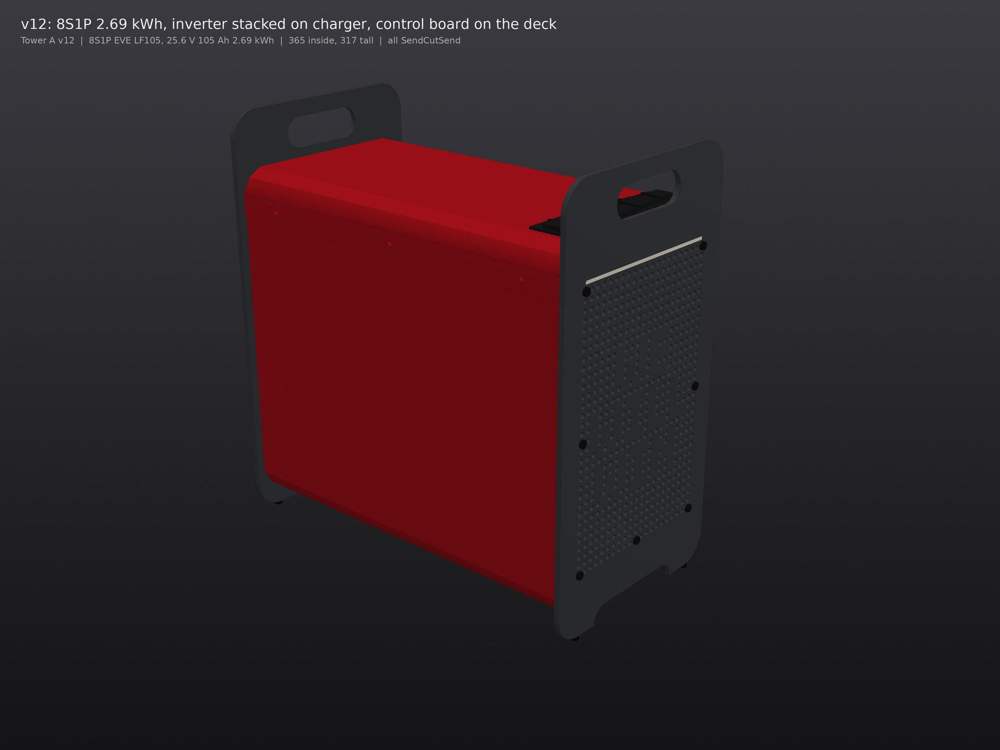

# claude-battery-pack
Claude make me a 1 kWh battery pack. It must be beautiful.

Tower A: a portable LiFePO4 pack. All fabricated parts come from SendCutSend; the enclosure is powder-coated Roadster red.



## Current design: v12

| | |
|---|---|
| Cells | 8 × EVE LF105, 8S1P |
| Pack | 25.6 V nominal, 105 Ah, 2.69 kWh |
| Current | 1C (105 A) continuous; 3C (315 A) for 30 s, per the cell spec |
| Charger | MEAN WELL NPB-450-24, 120 VAC in through an IEC C14 inlet |
| Inverter | MEAN WELL NTS-400P-124, 400 W pure sine, NEMA 5-15 outlet |
| DC out | Anderson connector |
| Control | One PCB: BQ76952 AFE, contactor, shunt, fuse, precharge, ESP32 (Wi-Fi debug) |
| Size | about 379 × 206 × 317 mm (365 mm inside length) |
| Mass | about 26 kg, of which the cells are 15.8 kg |

### Layout
- The 8 cells stand upright with their busbars on top.
- An NF-A14 fan in the rear plate pulls air along the stack.
- **Deck 1** (5052 tray on standoffs over the cells) carries:
  - the charger at the rear;
  - the control board, flat, at the front.
- **Deck 2** sits on posts above the charger and carries the inverter.
- The pack+ and pack− copper straps are Z-bent. They rise through slots in deck 1 and bolt to the underside of the board with M6 bolts.
- The 4 lid connectors (outlet, Anderson, C14 inlet, M12 data) are in one column at the front, directly above the board.

## Budget (USD, ±10%, 2026-11-23)
| Item | 4S (v9) | 8S (v12) |
|---|---|---|
| SendCutSend parts (v5 quote $1,458, scaled) | 1,450 | 1,700 |
| EVE LF105 cells @ $65 | 260 | 520 |
| Duty + GST on cells | 40 | 70 |
| MEAN WELL NPB-450 charger | 135 | 135 |
| MEAN WELL NTS-400P inverter | 105 | 105 |
| Control PCB, assembled (est.) | 150 | 150 |
| Contactor, fuse, shunt, precharge (est.) | 180 | 180 |
| Sense flex PCB (est.) | 40 | 40 |
| Fan, panel connectors (est.) | 85 | 85 |
| Hardware, 6 AWG wire, lugs (est.) | 110 | 120 |
| **Total** | **≈2,600** | **≈3,100** |

Not included: SendCutSend shipping to Canada. The v9 cell module (4S1P) weighs 10.4 kg; see `versions/v09-inverter-front-bay/module_renders/`.

## Repo layout
- `cad/`: parametric build123d models and scripts. Each version has three files:
  - `towerN.py`: the model;
  - `run_towerN.py`: builds it, checks every pair of parts for interference, and exports STEP/STL;
  - `render_towerN.py`: makes the 4K pyvista renders.

  Older non-tower concepts are `packmodel.py` with `run.py` and `render*.py`. `flats5.py` unfolds the v5 sheet-metal parts into SendCutSend DXFs and runs DFM checks.
- `versions/`: renders for every version, plus:
  - v2–v3 and v12: assembly STEP files;
  - v5: the SendCutSend DXFs and the 2026-11-22 quote CSV.

  See `versions/README.md`.

## Rebuild
```
pip install -r cad/requirements.txt
cd cad
python run_tower12.py            # build, interference check, STEP + STL into cad/out_tower12/
xvfb-run python render_tower12.py
```

## Open items
- SendCutSend flat patterns and a quote for v12. The last quote was for v5: $1,458.18.
- Contactor selection.
- 0.063" G10 sheet is out of stock at SendCutSend; it's needed for the cell top plate.
- Confirm SendCutSend can bend 0.125" C110 copper for the Z-straps.
- Cooling vents for the charger/inverter stack.
- The NPB-450 and NTS-400P hole patterns and terminal positions in the model are placeholders.
