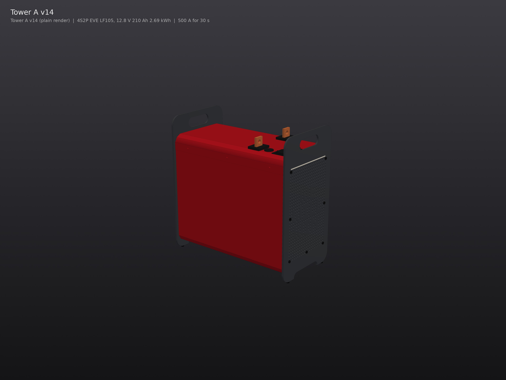

# claude-battery-pack
Claude make me a 1 kWh battery pack. It must be beautiful.

A portable LiFePO4 pack designed end to end by Claude. All fabricated parts come from SendCutSend; the enclosure is powder-coated Roadster red.



## Current design: v14
Start with [`docs/v14-baseline.md`](docs/v14-baseline.md) (one-page spec). Cells: [`docs/cells.md`](docs/cells.md). The reasoning is in [`docs/v14-design-review.md`](docs/v14-design-review.md) and [`docs/v14-design-notes.md`](docs/v14-design-notes.md).

| | |
|---|---|
| Cells | 8 × EVE LF105, **4S2P** |
| Pack | 12.8 V nominal, 210 Ah, 2.69 kWh |
| Current | 500 A for 30 s, 210 A continuous |
| Power train | Bolted copper: Class T JJN-500 → TE EV200 contactor, Tesla shunt on the low side, MRBF branch fuses, M10 terminals through the lid |
| Control | Controls-only PCB (BQ76952 + ESP32); flex sense board with 5 M3 taps and an NTC on each |
| Charger / inverter | MEAN WELL NPB-450-12 / NTS-400P-112 |
| Size | 389 × 206 × 390 mm (375 mm inside length) |

## Budget (USD, ±10%, 2026-11-23) ⚠️ predates v14 (4S2P, 500 A power train); not yet re-estimated
| Item | 4S (v9) | 8S (v12) |
|---|---|---|
| SendCutSend parts (v5 quote $1,458, scaled) | 1,450 | 1,700 |
| EVE LF105 cells @ $65 | 260 | 520 |
| Duty + GST on cells | 40 | 70 |
| MEAN WELL NPB-450 charger | 135 | 135 |
| MEAN WELL NTS-400P inverter | 105 | 105 |
| Control PCB, assembled (est.) | 150 | 150 |
| Contactor, fuse, shunt, precharge (est.) | 180 | 180 |
| Sense flex PCB (est.) | 40 | 40 |
| Fan, panel connectors (est.) | 85 | 85 |
| Hardware, 6 AWG wire, lugs (est.) | 110 | 120 |
| **Total** | **≈2,600** | **≈3,100** |

Not included: SendCutSend shipping to Canada. The v9 cell module (4S1P) weighs 10.4 kg; see `versions/v09-inverter-front-bay/module_renders/`.

## v13 mechanical changes
Body lead-in lip, tie rods at the optimal height, Z-shaped copper straps. See [`docs/mechanical-v13.md`](docs/mechanical-v13.md).

## Control board
Electrical architecture: series and parallel modes, current paths, contactor, Tesla shunt grounding. See [`docs/control-board-electrical.md`](docs/control-board-electrical.md).

## Repo layout
- `cad/`: parametric build123d models and scripts. Each version has three files:
  - `towerN.py`: the model;
  - `run_towerN.py`: builds it, checks every pair of parts for interference, and exports STEP/STL;
  - `render_towerN.py` / `render_towerN_plain.py`: the **fast render** (plain, v1–v11 style);
  - `render_vN_nice.py`: the **beautiful render** (studio PBR, v12 onward).

  Older non-tower concepts are `packmodel.py` with `run.py` and `render*.py`. `flats5.py` unfolds the v5 sheet-metal parts into SendCutSend DXFs and runs DFM checks.
- `versions/`: renders for every version, plus:
  - v2–v3 and v12: assembly STEP files;
  - v5: the SendCutSend DXFs and the 2026-11-22 quote CSV.

  See `versions/README.md`.

## Rebuild
```
pip install -r cad/requirements.txt
cd cad
python run_tower14.py            # build, interference check, STEP + STL into cad/out_tower14/ (~2 min; --fast = check only)
xvfb-run python render_tower14_plain.py all   # FAST render (plain, v1–v11 style), ~10 s/view
DRAFT=1 xvfb-run python render_v14_nice.py    # BEAUTIFUL render (studio, v12+), ~50 s/view draft; drop DRAFT for final quality (slow)
```
See `CLAUDE.md` § Rendering for the full comparison.

## Open items
See `CLAUDE.md` (handoff) and `docs/v14-design-review.md`.
