# Contactor mounting and the power bay: every option

**Status 2026-11-24 (evening):** exploration in progress. Supersedes the bay layout of v15 (`versions/v15-concept-d/`) only if a concept here wins. ⚠️ marks every unconfirmed value.

## 1. The problem

v15 works on paper but its current path is ugly:
- **+ path winds in three planes.** Cell + collector (z 210) → riser → MRBF (z 228–254) → link up to the GX12 studs (z 283) → load stud → drop 58 mm → SB175 contacts (z 230). 5 bent bars, 7 bolted joints.
- **The SB175 is located by the tray, not the lid.** It pokes through a lid hole with 1 mm per side, so the tolerance stack (tray → standoffs → body → lid) can exceed the gap. Plug and unplug loads go into bolted copper.
- **Root cause:** a contactor with studs on top (z 283) and an output connector with contacts pointing down (z 230) at different heights. Every bar between them has to climb and drop.

The question: **how should the contactor be mounted, and which contactor, so that the path from cells to the output connector is short, flat and obvious?**

## 2. Requirements, with source and how much each can move

Flex: **Hard** = safety or physics, do not move. **Firm** = owner rule, move only with the owner's OK. **Soft** = preference or target, trade it if something better comes back.

### 2.1 Electrical
| # | Requirement | Source | Flex |
|---|---|---|---|
| E1 | 175 A continuous DC out; total bay current ≈ 175 A + charger/inverter branches | Owner baseline 2026-11-24 (power-train.md §7) | Firm |
| E2 | Contactor continuous rating ≥ 175 A at bay temperature, with margin | E1 | Hard |
| E3 | Contactor survives the prospective fault (6.5–6.9 kA) for the main fuse's clearing time without welding or exploding | power-train.md C2 | Hard ⚠️ needs the fuse I²t vs contactor short-circuit carry |
| E4 | One disconnect for all loads and the charger: contactor on the load side of the main fuse; converter branches from its load side | power-train.md E2 | Hard |
| E5 | Single pole is enough (floating SELV pack, ≤ 14.6 V); either leg | power-train.md §7 | Firm |
| E6 | Coil hold power while ON: ≤ 2 W preferred, ≤ 5 W acceptable. The pack is OFF (contactor open, BQ in SHUTDOWN) when not in use, so hold power is spent only while the pack is working | Wake/latch design (v14-design-notes §9a) | Soft |
| E7 | Fail-open on loss of control power or BQ fault | power-train.md P3 | Hard (a latching contactor needs a stored-energy open circuit to meet it) |
| E8 | Few series joints (each ≈ 10–30 µΩ ⚠️) | power-train.md E4 | Soft |

### 2.2 Clearance and shorts (rules from v14 and v15)
| # | Requirement | Source | Flex |
|---|---|---|---|
| C1 | + to − copper ≥ 10 mm, by distance, not by insulation | Owner 2026-11-24, CLAUDE.md | Hard |
| C2 | Pack copper to chassis metal ≥ 7 mm | CLAUDE.md | Hard |
| C3 | No pack copper through a closed hole in chassis metal | CLAUDE.md | Hard |
| C4 | Pack copper to series bars (mid-potential) ≥ 7 mm | v15 practice | Firm |

### 2.3 Assembly and service
| # | Requirement | Source | Flex |
|---|---|---|---|
| A1 | Every part installs top-down, in the README order; every bolt tightened from above | Owner | Firm. A bench sub-assembly that then drops in top-down counts, if the owner accepts it |
| A2 | Main fuse installed last = service disconnect (or another single part that kills the output) | power-train.md P5 | Firm |
| A3 | Lid removable without unbolting rigid copper | power-train.md A3/A4 | Hard |
| A4 | Only SendCutSend parts and catalog parts with a real manufacturer datasheet; buy links | Owner | Firm |
| A5 | No load reacted by the cell poles (M4, 2 N·m ⚠️) | power-train.md A6 | Hard |

### 2.4 Layout and output
| # | Requirement | Source | Flex |
|---|---|---|---|
| L1 | **Output connector faces up**, through the lid | Owner 2026-11-24 evening | Firm |
| L2 | **Busbars where possible; cables allowed between the bay and the output connector** (vendor-crimped 1/0) | Owner 2026-11-24 evening: "with cables on the end if not bus bars, here's a case in which it's ok" | Firm |
| L3 | Straight, short, readable current path: few bends, little climbing | Owner ("no clear amazing current path, it winds around") | Soft, but the point of this study |
| L4 | Fits the bay without moving the converters, the front PCB or the lid AC panel | v15 layout | Soft |
| L5 | Busbars on top | CLAUDE.md | Firm |

### 2.5 The bay, in numbers (from the v15 build)
| Item | Value |
|---|---|
| Bay | x 50 (charger end) → 155 (front PCB parts) / 170 (PCB), y ±93.4 inside the body |
| Cell terminals, series bars | z 206.9–210 |
| Pack + collector (cells 7–8) | x 77–152, y −46…−21 |
| Pack − origin (cells 1–2) | rear, x −147…−77, y −46…−21; v15 brings it forward in a band at y −86…−66 |
| Tray 1 (G10) | z 218.5–221.6 |
| Lid seam / lid top | z 277.7 / 319.7 (inner top 318.1) |
| Lid AC panel (outlet, inlet) hanging down | x 116–168, y −83…−5, down to z 288 |
| Pushbutton | x 63–87, y −82…−58, down to z 288 |
| Inverter (deck 2) | x −155…31, z 282–316 |
| Charger | x −155…50, z 222–277 |
| Front PCB control parts | x 155–170, z 228–285 |

## 3. The finding that decides it

**An upward-facing output connector terminates downward.** The SB175 is 79.6 mm long and its busbar contacts land 89.8 mm ⚠️ below its mating face. With the mating face just above the lid (z ≈ 328), its copper terminal is at **z ≈ 238**. Any contactor that sits on tray 1 (z 221.6) with its studs on top puts them at z ≥ 256 (EVC 175, the lowest found) or 279–297 (GX12, GV14, EV200). So the copper must climb to the contactor and come back down to the connector, whichever upright contactor is chosen. That is v15's winding, and it is geometry, not a bad layout.

**Fix: point the contactor's terminals down too.** Then the contactor terminals, the SB175 busbar contacts and the fuse all land on **one flat copper plane** at z ≈ 238. That is exactly what a PCB-mount contactor is built for, with a G10 plate as the "PCB" and flat-cut copper bars as its "traces".

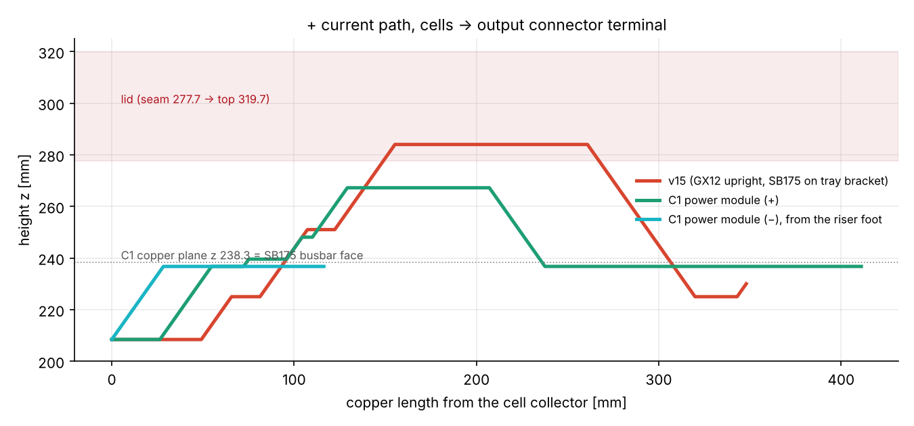

## 4. Contactor survey (2026-11-24)

Prices USD unless noted, distributor stock on the date checked. ✓ = manufacturer document, ⚠️ = reseller or unlabelled drawing value.

| Part | Rating | Body (mm) | Terminals | Mounts | 12 V hold | Stock / price | Verdict |
|---|---|---|---|---|---|---|---|
| Gigavac **GX12BA** (v15) | 225 A ✓ | 84.6 × 55.9 × 57.3, flange 114.8 long ⚠️ | M10 studs ✓ | upright, any position ✓ | dual-coil option ⚠️ | Waytek $125.11 ✓ | Flange too long for C1's footprint |
| Gigavac **GV141BAX** (GV14 upright) | 400 A, 100 V ✓ | 59.9 × 55.7, flange 72.5 ⚠️ | M8 studs ✓ | upright / side / PCB, any position ✓ | 2.8 W dual coil (230 mA) ✓ | ECCO / Master Electronics, 24 in stock, $111.07 ✓ | **C1 pick (mounted upside-down)** |
| Gigavac **GV144BPB / CPX** (GV14 PCB) | 400 A ✓ | 59.9 × 56.1 ⚠️ | M8-6H female, flush on base ✓ | PCB: held only by its two M8 bolts ✓ | 2.8 W | Authorized: 0 stock, MOQ 11, 8 wk ✗ (a Shenzhen broker lists 1507, not authorized) | Ideal shape, not buyable in ones today |
| Gigavac **GVL14** | 400 A latching ✓ | as GV14 PCB | M8 threaded, PCB ✓ | PCB | **0 W** (pulse set/reset) ✓ | not checked ⚠️ | Same geometry as C1; needs a stored-energy open circuit (E7) |
| Gigavac GV12 | 200 A ✓ | as GV14 | M8 | upright / side / PCB ✓ | **8 W, no economizer** ✓ | — | ✗ hold power |
| Gigavac GXL14 / MXL14 | 350 / 400 A latching ✓ | 114.8 / 82 long ⚠️ | M10 | upright | 0 W | GXL14C1B (24 V coil) Mouser $407 | ✗ size, price |
| Gigavac MX14BA | 400 A ✓ | — | M10 | upright | — | Waytek $154.16, 140-day lead if not stocked | No advantage over GV14 |
| TE **EV200** | 500 A ✓ | ≈ 0.43 kg ⚠️ | M8 male | bottom ✓ | 1.7 W (0.13 A) ✓ | ≈ $147 onlinecomponents ⚠️ | Tall, studs up: same problem as GX12 |
| TE LEV200 | 500 A ✓ | 77.7 long ✓ | M8 male | bottom **or side** ✓ | 1.1 A = **13 W**, no economizer ✓ | — | ✗ hold power |
| TE **EVC 175** | 175 A @ 85 °C, 500 A 30 s, 5 kA 20 ms ✓ | **77.3 × 50.9 × 34.2**, 295 g ✓ | M6 bolts, "one-time mounting only" ✓ | side or bottom ✓ | internal (3/33 Ω ≈ 4.4 W ⚠️) or external economizer | 0 stock, MOQ 9, **28 weeks** ✗ | Lowest profile found; not buyable |
| TE EVC 250 | 250 A, 6 kA ✓ | 93.1 × 55.3 × 49.8, 560 g ✓ | M6 bolts | side / bottom ✓ | dual coil, internal switch | not checked ⚠️ | Taller than EVC 175, no win |
| Panasonic AEV19012 | 300 A ✓ | 111 × 63 × 74.7, 750 g ⚠️ | screw | flange, either direction ✓ | 3.6–3.8 W ✓ | — | ✗ size |
| Omron **G9EK-1-E** | 200 A @ 500 V ✓ | 64.2 × 86 × 47.7, 310 g ✓ | screw | flange | 3 W ✓ | DigiKey €144.75 ✓ | Viable alternative to GV14; terminals up only |
| Omron G9EC-1 / G9EH-1 | 200 / 300 A ✓ | 98 × 44 × 86.7 / 111 × 60 × 76.7 ✓ | M8 nuts | "no restriction on mounting direction" ✓ | 11 W (24 V) / ≈ 7 W | — | ✗ hold power, size |
| Hongfa HFE82V-200B | 200 A ✓ | 81 × 39 × 70, 350 g ⚠️ | screw (family also offers female + busbar terminals) | vertical / horizontal variants | not found ⚠️ | Future sells HFE82V-300C in boxes of 30 ✗ | ✗ quantity |
| Littelfuse DCNLR200NB12 | 200 A, 60 V ✓ | — | M8 copper bolts ✓ | bottom ✓ | **9.5 W** ✓ | — | ✗ hold power; DCNLM (side) 10 W ✗; DCNLH (latching) obsolete at DigiKey |
| Albright SW200 | 250 / 400 A ✓ | 70 × 63 × 153, 1.23 kg ✓ | studs | bracket | continuous coil, W not given | — | ✗ size |
| Blue Sea **ML-RBS 7713** | 500 A, 300 A live switching @ 12 V ✓ | 138.9 × 76.2 × 95.3, 0.94 kg ⚠️ | 3/8"-16 studs ✓ | base | **13 mA (0.16 W)**, auto-release, LOCKED-OFF knob ✓ | $238–260 ⚠️ | ✗ fits nowhere in the bay (scan below) |
| Back-to-back FETs (custom board) | design-dependent | ≈ 60 × 56 × 8 | bolt to bars | flat | 0 (gate drive mW) | PCB sponsored (PCBWay) | Viable; short-circuit design risk (power-train.md candidate E) |

**Hold power in context (E6).** The pack is OFF when not in use (contactor open, BQ76952 in SHUTDOWN), so hold power is only spent while it is working: 2.8 W is 0.13 % of a 175 A × 12.8 V = 2.24 kW load. Acceptable. The 8–13 W parts are rejected for heat in the bay, not energy.

## 5. Every mounting method considered

| # | Method | Result | Modelled |
|---|---|---|---|
| M1 | Upright on tray 1, studs up (v15) | + copper climbs to z 284 and drops to 225: 348 mm, 5 + 3 joints, 5 bent bars | v15 build |
| M2 | Upright, lowest-profile contactor (EVC 175, 34.2 mm) on tray 1 | Terminals at z 255.8, 17.5 mm above the SB175 busbar face: a step in every bar, or the SB175 sits 26 mm proud of the lid. And it is not stocked (28 wk) | Numbers only |
| M3 | Upright on the cell-top G10 (below tray 1) | Terminals, series bars and the sense flex cover the cell tops; a bridge over the flex puts the base at z ≥ 211, terminals ≥ 245 (EVC 175) or ≥ 268 (GV14). Still a step | Numbers only |
| M4 | On its side, studs horizontal (all surveyed Gigavac/TE parts allow any position) | Risers could bolt straight onto the studs, but every nut is tightened sideways: 30 mm of room on the −y side, ~50 mm on +y. Fails A1 | No |
| M5 | Upside-down, hung from a top plate by its flange | Gives the right plane, but the plate must sit at z ≈ 297, under the lid's AC panel (hangs to z 288 at y < −5), and the GX12 flange (114.8 mm) does not fit the bay. Superseded by M6: the contactor can hang from its own studs | Merged into C1 |
| **M6** | **Terminals down onto a flat copper plane on a G10 plate (C1)** | **One plane, z 238.3, shared with the SB175 busbar contacts. + copper 203 mm, rises 28 mm once, 0 drops, 0 bends in the module** | **Yes: GV14 PCB, GV141BAX upside-down, FET board** |
| M7 | PCB-mount hung UNDER a plate, terminals up (my earlier proposal) | Copper plane at z ≈ 276, 38 mm above the SB175 terminals: the drop comes back | Numbers only |
| M8 | Contactor on the lid with the SB175 (lid power module) | Lid carries pack copper, the coil harness and the contactor weight; 2 cables from the bay through a service loop. No gain over C1 | No |
| M9 | SB175 bolted to the lid, 1/0 pigtails to the bay | The SB175's cable exits downward at z ≈ 240. Turning a 1/0 cable onto a horizontal ring lug needs ≈ 40–55 mm ⚠️ bend radius plus ≈ 30 mm of lug: lug at z ≤ ≈ 165, inside the cells. Only works with the SB175 ≥ 50 mm proud of the lid | Numbers only |
| M10 | Contactor carried by the pack + collector | Loads on the M4 cell poles (A5) | No |
| M11 | Contactor beside the cells (the −y corridor) | Corridor 28 mm wide with the tie rods at y ±74.5; EVC 175 is 34.2 thick | No |
| M12 | Between the module end plate and the front PCB | 8.0 mm gap | No |
| M13 | Low-side: contactor in pack − next to the shunt | Allowed (E5). Tried in C1's footprint: the 35 mm-wide shunt and the 26.8 mm SB175 pitch leave no room for a contactor on the − side without crossing the + bar. High-side kept | Layout sketch only |
| M14 | Blue Sea ML-RBS, knob up through the lid (manual LOCKED-OFF) | **0 of ≈ 900 positions fit**, either orientation (5 mm grid, against walls, lid panel, front PCB parts, charger, inverter, standoffs) | Yes: `g_mlrbs_fit.py` |
| M15 | FET switch board in C1's plane | Fits; the switch is 8 mm tall instead of 60 | Yes |
| M16 | Latching GVL14 in C1 | Same footprint as the GV14 PCB; 0 W hold; needs a stored-energy open circuit | Same geometry as C1 |

## 6. Concept C1: the PCB-style power module (recommended)

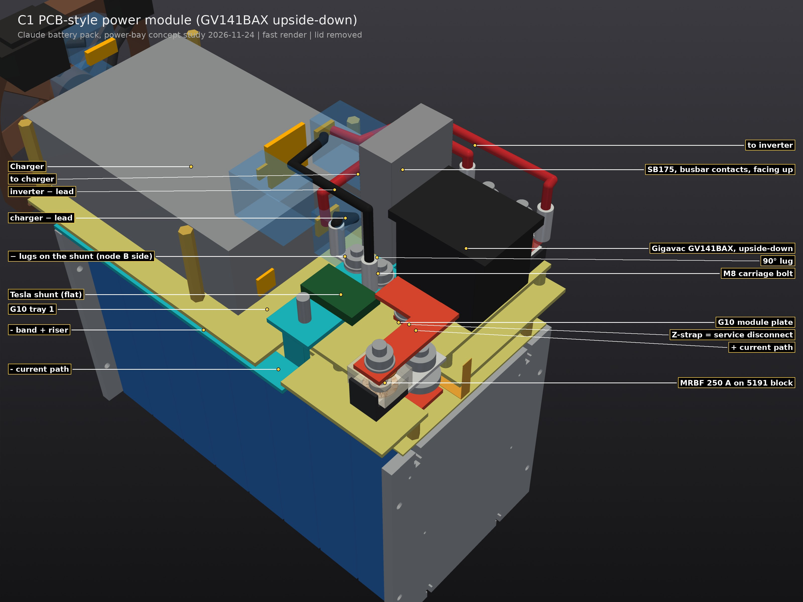
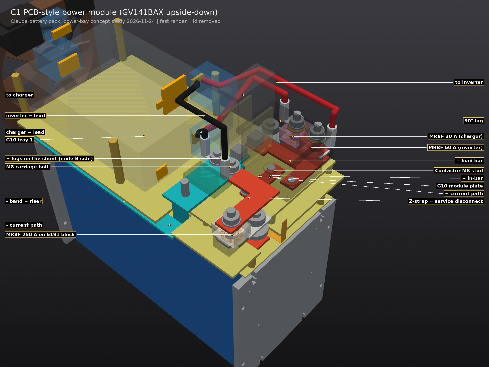
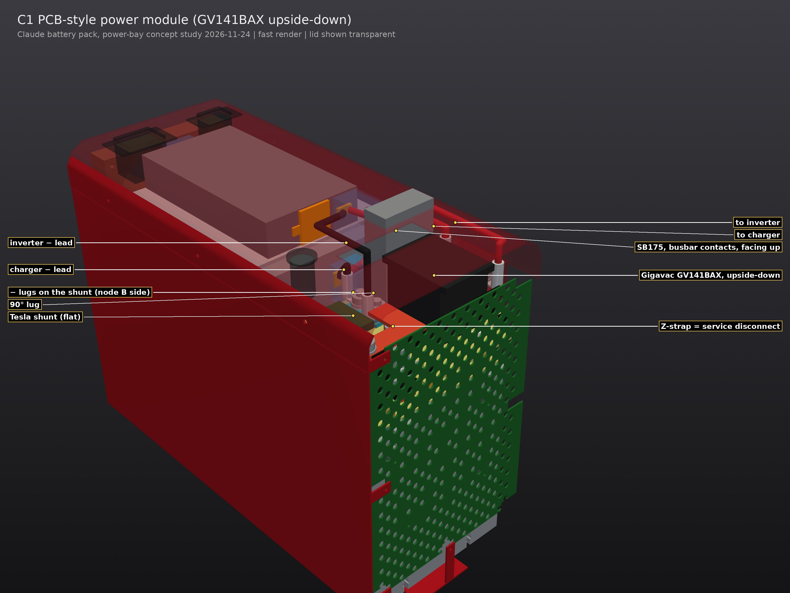

**What it is.** One G10 plate (x 54–150, y −64…88, z 232.0–235.1) on five standoffs from tray 1. All module copper is 1/8 in (3.2 mm) bar, flat-cut, lying on the plate: z 235.1–238.3, 25 × 3.2 mm = 79 mm² (2.2 A/mm² at 175 A). Standing on that copper, terminals down:
- **Contactor:** Gigavac GV141BAX (upright version, mounted upside-down: its two M8 studs go down through the bar, nuts under the plate). The GV144 PCB-mount version drops into the same footprint if it comes back in stock.
- **Output:** Anderson SB175 (6325G1 housing) with two 180BBS busbar contacts; their ¼-20 studs go down through the bar and plate, lock nuts underneath. Mating face 8.4 mm above the lid (v15: 10.0). The housing's two mounting holes bolt to two G10 cheeks, so plug loads go housing → cheeks → plate → standoffs → tray 1 → module, never through copper.
- **Shunt:** the Tesla shunt lies flat, node A on the − riser flange, node B over a narrow − tab that runs to the SB175 − contact.
- **Fuses:** the MRBF 250 A main fuse bridges the + riser flange and the module's + in-bar, on top of both. A dual MRBF block on a tab of the + load bar feeds the charger and inverter.

**Levels (bottom to top).**

| Level | What | z (mm) |
|---|---|---|
| L0 | Pack copper: + collector on cells 7–8, − band from cells 1–2, series bars. The two risers belong to L0 and reach up to L3 | 206.9–210.0, risers to 238.3 |
| L1 | G10 tray 1 (open notches let the risers pass) | 218.5–221.6 |
| L2 | G10 module plate on 5 standoffs; contactor stud nuts hang under it | 232.0–235.1 |
| L3 | Module copper, one flat plane: + in-bar, + load bar, − tab, shunt bar; riser flanges flush with it | 235.1–238.3 |
| L4 | Parts standing on L3, terminals down: contactor, SB175, MRBFs, shunt board, SB175 cheeks | 238.3–298 (SB175 to 328.1) |

**"PCB-style" is a metaphor:** there is no circuit board in the module (only the shunt's own sensing board). The G10 plate (L2) plays the bare FR4 board, the flat copper bars (L3) lying directly on it play the traces, and the contactor and SB175 bolt down through bar and plate like through-hole parts. The copper is not bonded to the plate; the bolts clamp it.

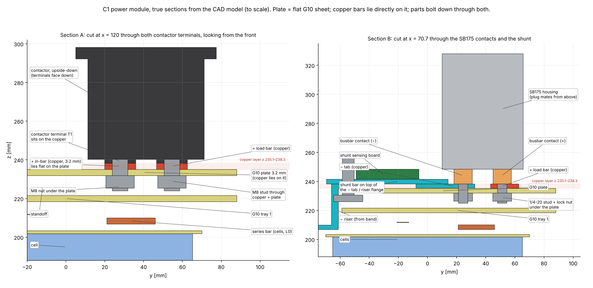
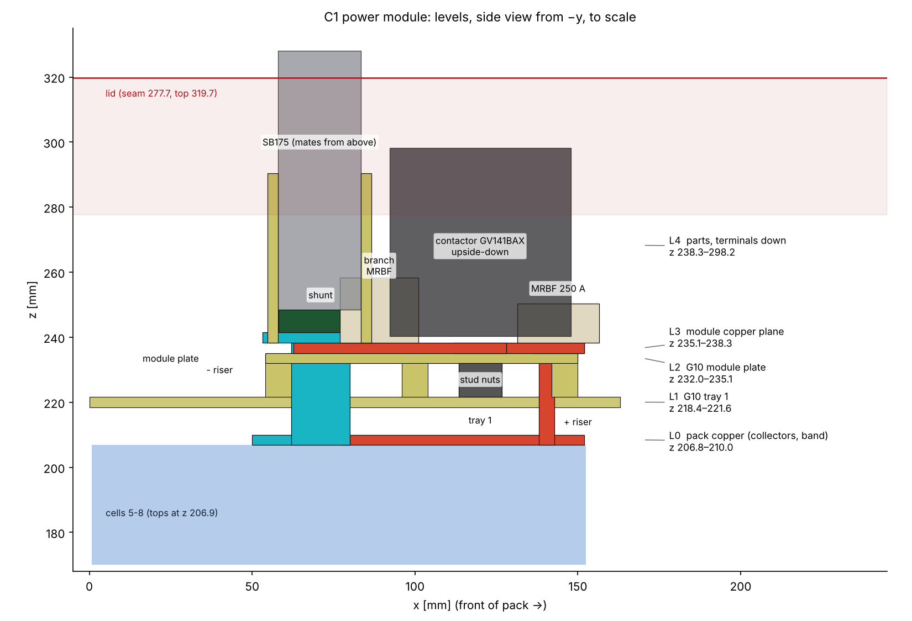
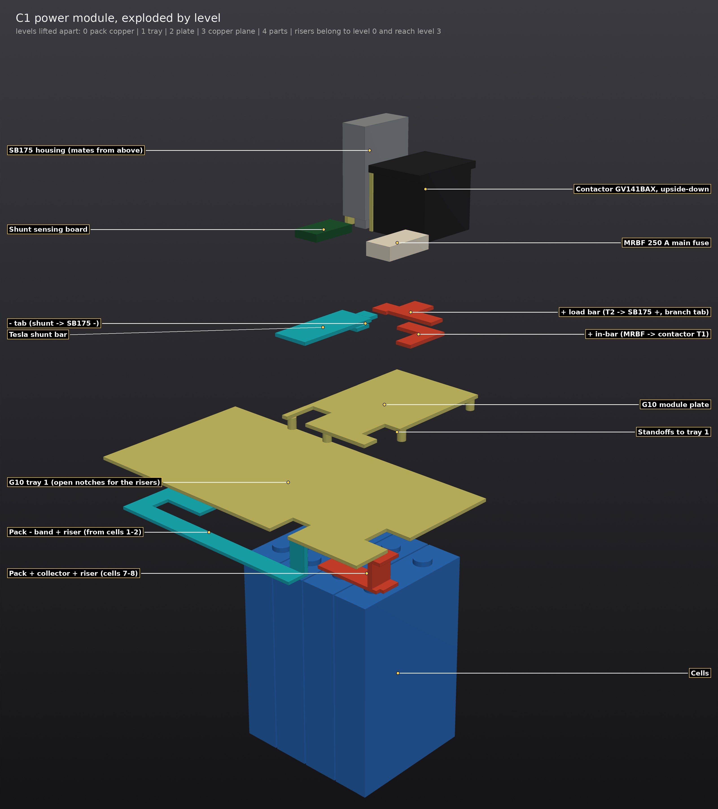

Plan views: [L0](img/contactor/c1_module_gv14up_lvl0_pack_copper.jpg), [L1](img/contactor/c1_module_gv14up_lvl1_tray.jpg), [L2](img/contactor/c1_module_gv14up_lvl2_plate.jpg), [L3](img/contactor/c1_module_gv14up_lvl3_copper.jpg), [L4](img/contactor/c1_module_gv14up_lvl4_parts.jpg).

**Current path.** + : cells 7–8 collector → one vertical riser (28 mm) → flange → MRBF → in-bar → contactor T1 → T2 → load bar → SB175 +. − : band → one vertical riser → flange → shunt → − tab → SB175 −. Every module joint is in the plane; no bar is bent.

**Assembly.**
1. Bench, module upside-down: SB175 and contactor face-down on the bench, copper on them, plate on top. Bolts and lock nuts tightened from above (the future underside). Carriage bolts (DIN 603 M8, A2) go up through square holes in the copper for the MRBF, branch and converter studs, so their nuts can later be tightened from above with nothing to hold underneath. SendCutSend cuts square holes like any other profile.
2. Pack: risers are part of the collector straps (as v15), each with an upward M8 carriage bolt in a square hole in its flange. Tray 1 drops in around them through open notches.
3. Module drops in top-down; plate notches clear the two riser flanges; shunt node A lands on the − riser bolt. Nut from above.
4. Converter leads, coil and shunt harness to the front PCB.
5. **MRBF last**, over the + riser bolt and the in-bar bolt: service disconnect.
6. Lid: the hole moves to the SB175 (x 58–83, y 10–66), with ≥ 3 mm per side ⚠️ against the tray → standoffs → body → lid stack.

**Checks (`cad/concepts/contactor/`, all three variants).** Interference: none. + to − copper: **10.8 mm** (≥ 10, at the SB175's two contacts). Pack copper to chassis: **7.3 mm** (≥ 7). Pack copper to series bars: **7.4 mm** (≥ 7).

| | v15 | C1 |
|---|---|---|
| + copper, cells → output terminal | 348 mm | **203 mm** |
| + climb / drop | 76 / 59 mm | **28 / 0 mm** |
| Bolted joints after the cells (+ / −) | 5 / 3 | 5 / 3 (no gain: same parts in series) |
| Bent bars | 5 | **2 risers, nothing else** |
| Copper planes | 3 (z 225, 251, 284) | **1 (z 238.3)** |
| Plug load path | through bolted copper | **through G10 cheeks to the module** |
| Contactor | GX12, $125.11 | GV141BAX, $111.07 |

**FET variant (C1-FET).** Same module with a back-to-back FET board where the contactor was; it stands 8 mm above the plane instead of 60. Removes the coil and the precharge relay; adds the short-circuit turn-off design risk. Kept as the upgrade path.

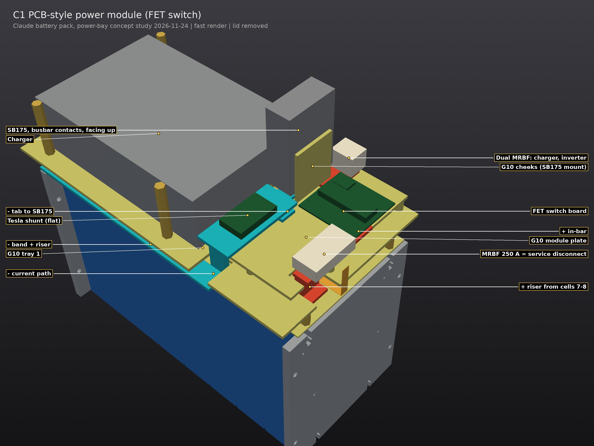

## 7. Findings in v15 itself (fix whichever concept wins)
| # | Finding | Fix |
|---|---|---|
| F1 | P4 (+) collector corner is **6.8 mm** from an upper standoff (x 154–162, y −58.5…−51.5) | 5 mm corner chamfer → ≥ 8 mm (done in the concept sandbox) |
| F2 | P1 (−) collector ends at x −76.6, **6.6 mm** from series bar B | End it at x −80 → 10 mm; the cell-2 terminal pad stays covered (done in the sandbox) |
| F3 | A tray screw (x −140, y −52) is 6.3 mm above the − band's corner near cells 1–2. v15's clearance script never checked screws | Move the screw or notch the band corner |
| F4 | GX12 modelled as 57 × 45 × 60; the datasheet says 84.6 long (114.8 with flange) ⚠️ | Moot if C1 wins |
| F5 | SB175 modelled with a 25.4 × 79.6 face; the housing is 55.6 × 25.4 face, 79.6 long ✓ | Moot if C1 wins |

## 8. Traps found
| # | Trap | Rule |
|---|---|---|
| T1 | An up-facing connector's terminals face down; an upright contactor's face up. Any layout combining them climbs and drops | Choose terminal directions before choosing parts |
| T2 | "PCB-mount" parts are often MOQ-only; the upright sibling may be stocked and usable upside-down | Check stock of every variant, not just the ideal one |
| T3 | The Tesla shunt is 35 mm wide; the SB175 contact pitch is 26.8 mm ⚠️. Landing the shunt directly on the connector gives 1–4 mm + to − | Narrow (16 mm) tabs within 30 mm of a 2-pole connector |
| T4 | v15's clearance check excluded screws and standoffs; F1–F3 were invisible | The sandbox checks every metal part |
| T5 | EVC 175/250 load terminals are "one-time mounting only" | Avoid for anything unbolted in service |

## 9. Sources
- Gigavac GV12/GV14/GVL14 datasheets (Sensata 2022, via RS, nijkerk-ne mirror): mounting codes 1/2/4/5, PCB terminal "M8X1.25-6H", "PC Board not included", coil table, GVL14 bi-stable ✓. Dimension labels ⚠️ (text extraction unlabelled).
- DigiKey GV142BAX attributes: 230 mA, 2.8 W, 400 A ✓. ECCO / Master Electronics GV141BAX $111.07, 24 in stock ✓. Master Electronics GV144BPB 0 stock MOQ 11 ✓.
- Gigavac GX12 datasheet (dimensions 84.6 / 114.8 / 55.9 / 57.3, M5 mounting) ⚠️ labels; Waytek GX12BA $125.11, 225 A, M10 ✓.
- TE EVC 175 product page and Dalroad catalog (70.3 × 50.9 × 34.3 / 77.3 × 50.9 × 34.2, 295 g, M6, 5 kA) ✓; onlinecomponents stock 0, MOQ 9, 28 weeks ✓.
- TE EV200 datasheet (0.13 A hold) ✓; LEV200 (11 Ω, 1.1 A) ✓; EVC 250 datasheet ✓.
- Omron G9EK-1-E datasheet (3 W, 310 g) ✓, DigiKey €144.75 ✓; G9EC-1 / G9EH-1 datasheets ✓.
- Panasonic EV (AEV) catalog ✓; Hongfa HFE82V datasheets ✓; Littelfuse DCNLR / DCNLM / DCNLH pages ✓; Albright SW200 ✓.
- Blue Sea 7713 product page (13 mA ON, 3/8"-16 studs, 0.94 kg) ✓; spec sheet 6834 rev 007 dimensions ⚠️ labels.
- Anderson SB175 datasheet: housing 55.6 × 25.4 × 79.6, 180BBS ¼-20, bus bar mounting 89.8 ⚠️ reading; Waytek 6325G1 $17.25 ✓; DigiKey 180BBS CAD 56.43 ✓.

## 10. Open items
- ⚠️ Labelled drawings for GV14 (stud pitch 26.7?, body height 59.9?), SB175 busbar mounting (89.8 mm, pitch 26.8), MRBF and its ring-tab spacing. Sensata and Anderson sites (needs a fetch the session could not get approved).
- ⚠️ GV14 PCB-mount stock watch (GV144BPB); GVL14 stock and price.
- ⚠️ Lid hole clearance from the real tolerance stack (≥ 3 mm/side assumed).
- ⚠️ 1/8 in copper from SendCutSend: confirm thickness offered and the minimum square-hole size for M8 carriage bolts.
- Owner decisions: accept a bench-built module (A1 as written means every bolt in the pack); keep high-side switching; GV14 vs FET board.

## 11. Blue Sea MRBF blocks: real geometry (added 2026-11-24)

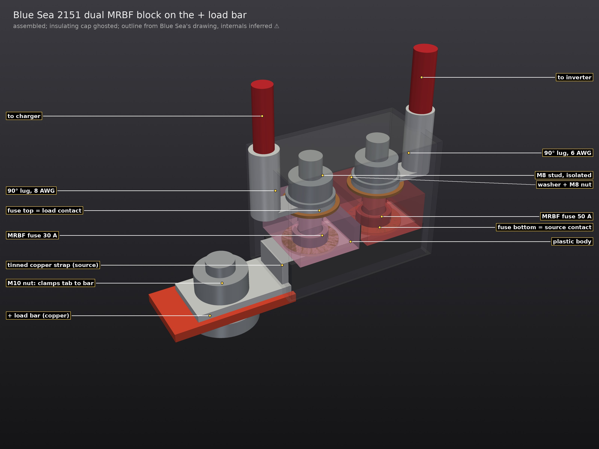
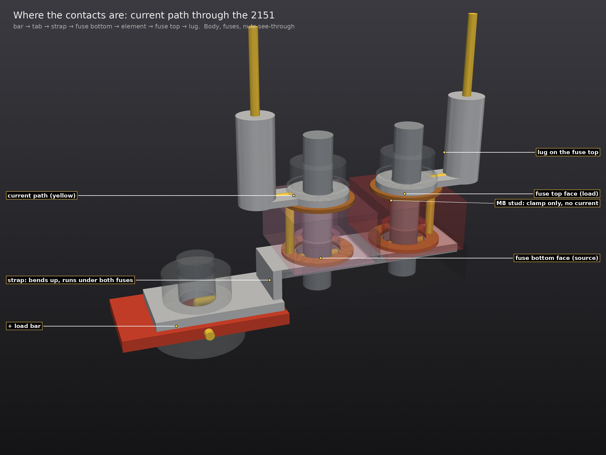
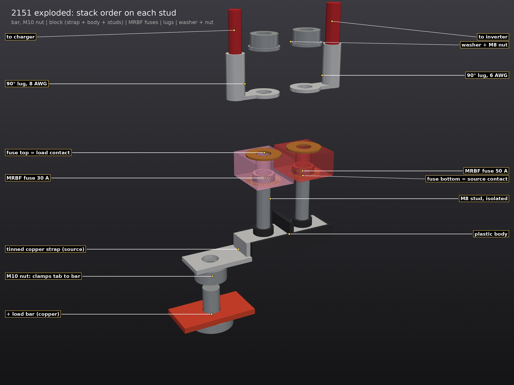

Model: `cad/concepts/contactor/lib.py` (`bs_block`, `bs_cap`, `lug90`, `stud_stack`), close-up `mrbf_block.py` + `shoot_mrbf.py`.

**Geometry.** Source: Blue Sea dimensioned drawing (bluesea.com/products/2151 → "Dimensioned Drawing", file 5191.jpg, covers 5191 and 2151), read 2026-11-24.
- **2151:** 88.5 long × 20.0 wide ✓. Body 56.5 long × 11.0 high ✓. Tab 2.5 thick ✓. M10 hole Ø9.525 ✓. Stud tops 44.5 above the base ✓.
- **2151 positions along the length** (scaled off the drawing ⚠️ ±0.5 mm): hole 13.0, studs 47.2 / 73.4 (pitch 26.2), latch rib 58.9–61.7 (18.4 high). The drawing's "0.47 in / 2.0 mm" label is a dropped digit (0.47 in = 11.9 mm, matches the scale).
- **5191:** 60.9 long ✓, body 29.0 ✓, hole 12.0 ⚠️ (scaled), stud 46.4 (14.5 from the end ✓).
- **MRBF fuse:** 27.8 × 23.0 × 16.3 mm ⚠️ (reseller: 12voltplanet, Solar4RVs). The 23 mm side runs along the block: 2 × 11.5 + rib fits the 26.2 mm pitch exactly, a consistency check on the scaled positions.

**How it works.** The MRBF is a stack fuse: bottom face = source contact, top face = load contact. The cable lug sits on the fuse top; the M8 stud is isolated and only clamps. Current path: bar → M10-clamped tab → tinned strap bends up at the body and runs under both fuses (inferred from the side view ⚠️) → fuse bottom → element → fuse top → lug.

**Traps found**
- **T6. An MRBF cannot bridge two bars.** C1 §6 drew the main MRBF as a flat link between two studs; that is wrong. The output comes out on top of the fuse, ~27 mm above the copper (11 block + 16.3 fuse). The main fuse needs a 5191 on an M10 stud plus a strap or cable from the fuse top back down to the in-bar: +1 part, +2 joints vs §6. Rule: model stack fuses as stacks.
- **T7. No bare MRBF on a stud.** Blue Sea (resources/640): "Terminal Fuses must be used only with a Terminal Fuse Block."
- **T8. Two studs in a row, cables leaving along that row: the far lug hits the near stud.** In C1 ±y is blocked by the wall (7 mm rule) and the contactor. Use 90° lugs (barrel up), one pointing −x, one +x. Buy: Del City 929605 (6 AWG, 5/16", ~$2.55 ea, min 5) and Zoro MAX 5950-050EL (8 AWG, 90°, $14.29 per 50), checked 2026-11-24.
- **T9. ALLOW-list wildcard `("hw_","")` hid a real clash.** The M10 bolt head under the + flange at (144, −33.5) overlaps the + riser at x 138–142.76. Fix: move the riser to x 124 and enlarge the flange to x 124–152.

**Fit in C1 (applied to `c1_power_module.py` 2026-11-24; all 3 variants: 0 interferences, + to − 10.4 mm (5191 strap to shunt bar), pack to chassis 7.3 mm, + path 306 mm with 59 mm climb / 30 mm drop, 7 joints)**
- **Contactor:** −11 mm in y (CY 41.2 → 30.2).
- **2151:** along x at y 76, M10 hole at (70.7, 76) on a load-bar branch x 62.7–88.7, y 43.2–86. Fuses land at x 105/131 beside the contactor. Metal to the +y wall 7.4 mm.
- **Load bar near the SB175:** must stay y ≥ 42.4 to keep 10 mm to the − tab.
- **Standoff:** (58, 82) → (58, 60), clear of the M10 head.
- **Main fuse:** 5191 at (144, −33.5) pointing −x, stud at x 109.6. A Z-strap from the fuse top down to a new in-bar at x 101.6–117.6, y −15..8.85.

**Open**
- ⚠️ 2151 internals and cap outline.
- ⚠️ MRBF contact-face sizes.
- ⚠️ 90° lug dims.
- ⚠️ SendCutSend copper bend for the Z-strap.
- Shown below: `c1_module_gv14up_iso.jpg`, `c1_module_gv14up_top.jpg`. The ALLOW wildcard `("hw_","")` is replaced by explicit pairs; that exposed and fixed a carriage head vs standoff clash (standoff (58,−56) → (58,−20)).
- §6 figures (sections, levels, profile) predate this change; regenerate them.
- The − leads for the charger and inverter are not placed yet.

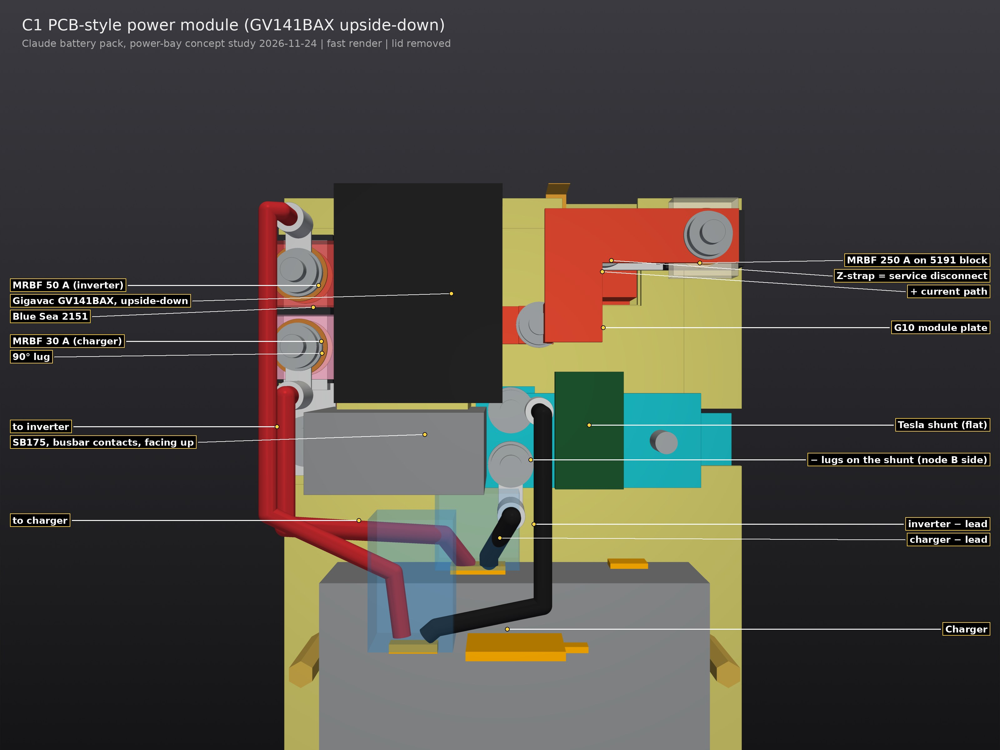

**Rev 2026-11-24 b: contactor turned 90° (fuse service).** The GV141BAX mounting flange (at z 292–298, out to y 66.45) blocked both 2151 fuses from sliding off their studs. The fuses have to rise 33.5 mm, and their housings start at y 62.1. A fuse that can't come out without pulling the module fails A-rules.
- **Options:**
  - A. GV14 PCB-mount, which has no flange: 0 in stock.
  - B. Turn the GV141BAX 90°: chosen.
  - C. Move it another 4.3 mm toward −y: strap foot clash, and + to − drops to 10.07 mm.
  - D. Pull the module to change a fuse.
- **Now:** contactor at (122, 32), terminals along x. T1 (line) at x 108.65 sits on a straight in-bar column from the strap foot. T2 (load) at x 135.35 feeds a wide load bar at y 50–86 that runs under the 2151 to the SB+ pad. The flange stops at y 59.9.
- **Main fuse:** the strap-foot nut now has 5 mm to the contactor (was 1.25).
- **New check `lift_check`:** with the lid, cables, lugs, nuts and strap off, each fuse is swept up its stud. All 3 fuses are clear in all 3 variants.
- **Other checks:** 0 interferences; + to − 10.4 mm; pack to chassis 7.3 mm.
- **Cost:** the + path is now 352 mm, up from 306, because the load bar detours around the in-bar.
- **Trap T10:** static interference checks miss removal paths. Rule: every serviceable part gets a sweep check.

**Rev 2026-11-24 c: shunt board crosswise, 5191 points −y.**
- **Shunt board:** the owner's photo shows the sensing board crosswise on the bar, between the bolts. It is flush with one edge and the connector end overhangs ~8 mm ⚠️. Modelled at x 53.2–96.2, connectors toward +x, role "neg", so the 10 mm + to − rule now applies to it.
- **5191:** turned to point −y (stud at (144, −67.9)), which clears the board. The Z-strap is now an L in plan, still with 2 bends: fuse top → +y → −x above the flange → leg down to the in-bar foot at (113.6, −9.5).
- **In-bar column:** x 106.6–120.6, 10.4 mm to the board. Line-to-load gap at T2 is now 6.75 mm, both + across the open contactor.
- **Checks (all 3 variants):** 0 interferences; + to − 10.5 mm (strap to board); pack to chassis 7.3 mm; all fuses lift out. + path 411 mm.
- **Open, blocking: converter plug-in access.**
  - In front of the charger's +x face (x 50) there is 3.2 mm before tray 1, the shunt and the plate.
  - In front of the inverter's +x face (x 31) there is 23.8 mm before the SB175 cheek.
  - If the DC terminals face the power bay, neither can be plugged in: need ≥ 30 mm ⚠️.
  - First find which end the terminals are on (NPB-450 datasheet: AC input and DC output are on opposite ends). Then either flip the converters so DC faces the bay and move the module +x, or route the leads to the far ends.
