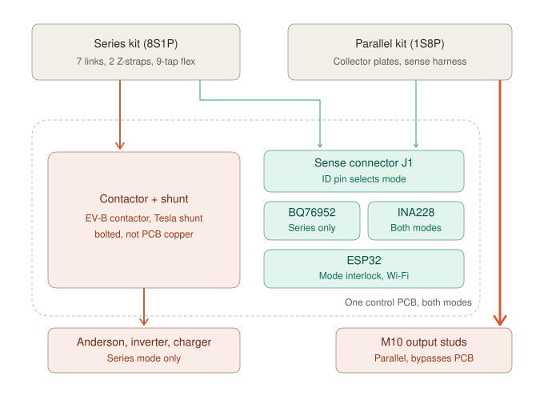
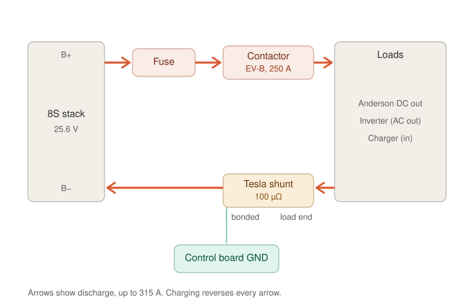
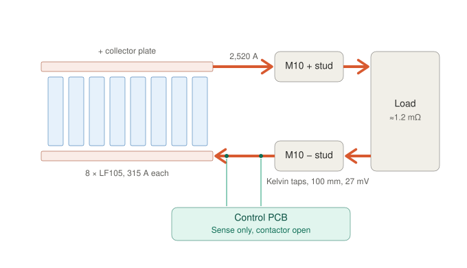
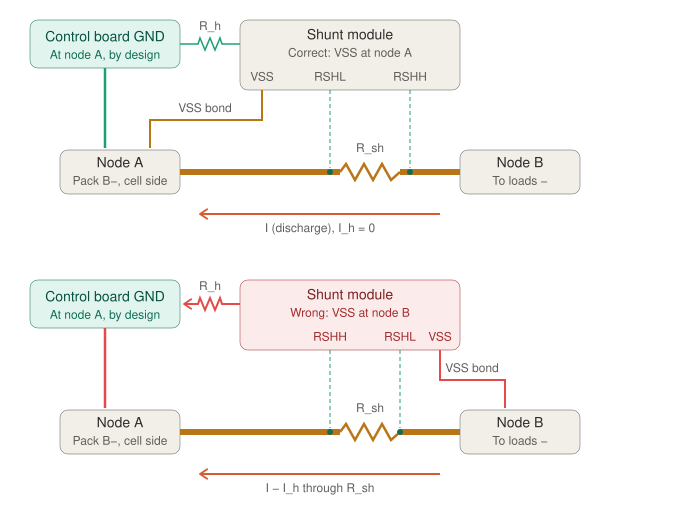

# Control board: electrical architecture (draft, 2026-11-23)

The control board is a single PCB that serves two swappable busbar configurations of the 8 × EVE LF105 pack:

| Mode | Configuration | Nominal voltage | Burst current (3C, 30 s) | Outputs |
|---|---|---|---|---|
| Series | 8S1P | 25.6 V | 315 A | Anderson DC, 120 VAC inverter, 120 VAC charger |
| Parallel | 1S8P | 3.2 V | 2,520 A | M10 DC studs only. Charging is done in series mode. |

**Design rule: power current never flows through PCB copper.**
- The contactor, shunt and pack straps are bolted copper.
- The PCB carries only sense lines, coil drive and logic.

## 1. Busbar kits and the mode interface

| Item | Series kit | Parallel kit |
|---|---|---|
| Copper | 7 links, plus 2 Z-straps to the contactor and shunt | + and − collector plates with a G10 insulator between them (scaled-up v5 1S4P kit) |
| Sense | 9-tap flex (VC0–VC8) plus thermistors | Harness carrying fused pack V+/V−, collector-plate Kelvin taps, thermistors |
| J1 ID pin | Series | Parallel |
| Contactor | Allowed to close | Held open |

**Mode interlock:** the ESP32 reads the ID pin on J1. It closes the contactor only when the ID reads series **and** the BQ76952 reports healthy.

**Kit-swap procedure:**
1. Charge in series. The BQ76952 balances the cells during charge.
2. Confirm all 8 cell voltages are within about 20 mV. The ESP32 shows this on the Wi-Fi page.
3. Swap kits.

Paralleling cells at different voltages drives large equalizing currents through the terminals.

**Terminal threads:**
- One EVE spec revision lists the poles as internal **M4** threads with 6 mm effective depth. The CAD currently assumes M6.
- Confirm on the test cell.
- Either way, fit permanent studs in the terminals and swap only the nuts, so repeated kit swaps don't strip the aluminum threads.

## 2. Current paths

### Series mode

**Path:** B+ → fuse → contactor → load → Tesla shunt → B−.

**Loads:** the Anderson DC output, the NTS-400P-124 inverter, and the NPB-450-24 charger, whose current flows in the opposite direction.

### Parallel mode

**Path:** the 2,520 A goes from the + collector plate to the M10 + stud, through the load, to the M10 − stud and back to the − plate. It never touches the PCB.

**What's off:** the contactor is open, and the Tesla shunt, Anderson, inverter and charger are all disconnected.

**Why the inverter and charger can't run:**
- The inverter needs 20–33 V input.
- The charger outputs 21–42 V.

**Current sensing** uses the collector plate's output tab as the shunt:

| Parameter | Value |
|---|---|
| Section | 50 × 3.175 mm C110 copper |
| Kelvin tap spacing | 100 mm |
| R_tab = ρL/A | 1.72e-8 Ω·m × 0.1 m / 159e-6 m² ≈ 10.8 µΩ |
| V at 2,520 A | ≈ 27 mV, within the INA228's ±40.96 mV range |
| INA228 resolution | 78.125 nV/LSB ≈ 7 mA |
| Temperature compensation | Copper resistance +0.39 %/K, corrected in firmware from a thermistor on the tab; expect ±3 % |

**Why not a dedicated shunt in parallel mode:**
- A 25 µΩ busbar shunt at 2,520 A dissipates 159 W, 4.4× its 36 W rating.
- It adds 63 mV of drop, which is 2 % of 3.2 V.

## 3. Pack current capability, 1S8P

The limit is the cell rating and the load, not the cells' internal resistance.

| Parameter | Value | Source |
|---|---|---|
| Cell AC impedance (1 kHz) | ≤ 0.5 mΩ spec; 0.32 mΩ measured on new cells | [EVE LF105 spec F](https://files.batteryjunction.com/frontend/files/EVE/EVE-LF105-Datasheet.pdf), [NKON reviews](https://www.nkon.nl/en/review/product/list/id/4746/) |
| Cell DCIR | ≈ 0.5 mΩ | NKON reviews |
| Rated burst | 3C (315 A) for 30 s | [18650batterystore listing](https://www.18650batterystore.com/en-ca/products/eve-lf105) |

**Model:** each cell path is 0.5 mΩ DCIR plus 0.1 mΩ of joint resistance, giving 0.6 mΩ. Eight paths in parallel give 75 µΩ. Adding 50 µΩ for the plates and tab gives R_total ≈ 0.13 mΩ, with OCV ≈ 3.3 V.

| Case | Current | Terminal voltage | Internal loss |
|---|---|---|---|
| Rated, 3C per cell | 2,520 A | ≈ 2.97 V | ≈ 0.8 kW |
| Pulled to the 2.5 V cutoff (outside spec) | ≈ 6,000 A | 2.5 V | ≈ 4.8 kW |
| Short circuit | ≈ 25 kA | 0 V | — |

- **Bulk heating at the rated point:** about 50 W per cell, or 1.5 kJ into 1.98 kg over 30 s. That's about 1 °C.
- **The load is the real limit:** drawing 2,520 A at 2.97 V needs a load of about 1.2 mΩ. A 1 m out-and-back run of 4/0 AWG alone is about 0.32 mΩ.

## 4. Power-path components (series mode)

### Contactor: Panasonic EV-B (AEVB series)

| Parameter | Value |
|---|---|
| Continuous rating | 250 A |
| Overload rating | 900 A for 20 s at 85 °C |
| Switching life | 70,000 operations at 140 A, 20 VDC |
| Coil | 12 V, usable 10–16 V; runs from the board's 12 V rail |
| Mounting | Body mounts to the PCB; power terminals are screws |
| Price | ≈ $112 (DigiKey) |
| Source | [Panasonic EV-B series](https://na.industrial.panasonic.com/products/relays-contactors/contactors/lineup/dc-contactors/series/151891) |

Load requirement: 105 A continuous and a 315 A burst.

**Alternatives:**

| Part | Rating | Price | Notes |
|---|---|---|---|
| TE EV200 | 500 A, 9–36 V coil | £174 | Larger and heavier |
| Gigavac GX14 | 350 A, 24 V coil | — | |
| Altran APV500 | 500 A, fully PCB-mount | $798 | Too expensive |

No reasonably priced contactor switches 2,520 A, so parallel mode is bolted and switchless.

### Shunt: Tesla Model S HV shunt module (1016792-00-C)

Source: [CKalitin/tesla-model-s-2012-shunt-resistor](https://github.com/CKalitin/tesla-model-s-2012-shunt-resistor)

| Item | Value |
|---|---|
| Resistance | 100 µΩ |
| Measurement front end | Isabellenhütte IHM-A-1500, 16-bit |
| Interface | STM8AF6266 microcontroller as SPI slave. ⚠️ Harness: first noted as 8-pin; measured 2026-11-24 as a **10-pin Molex Mini-Fit** with a key slot between pins 1 and 2. **NOT YET CONFIRMED**; see v14-design-review §M9 |
| Physical (⚠️ unconfirmed) | Bar 35 × 83.5 mm; bolts on the centre line, 15 mm from each end (53.5 mm apart), size unknown; PCB 25 mm wide, centred, overhanging 8 mm |
| Hardware overcurrent detection | LM2903 comparator |
| Rating per the IHM-A-1500 datasheet | 1,500 A *starter* (cranking pulse); ±300 A continuous |
| Series mode, 315 A | 31.5 mV, 9.9 W: OK |
| 1S8P through the shunt, 2,520 A | 252 mV, which the chip can measure (gain 1 range −300 to +800 mV), but 635 W in the element. Too much: use Kelvin taps instead. |

**Interface:**
- Supply: the IHM needs VDDA of 4.7–5.3 V, so the module runs at 5 V and its STM8 does too.
- Logic levels:
  - The STM8's VIH is 0.7·VDD = 3.5 V.
  - The ESP32's GPIO absolute maximum is VDD + 0.3 V = 3.6 V.
  - So the board needs a 4-channel level shifter on NSS/SCK/MOSI/MISO (e.g. TXU0104).
  - The STM32F103 bench test worked without one because the F103's SPI pins tolerate 5 V, but its 3.3 V drive was 0.2 V below the STM8's VIH.
- Isolation: not needed. The shunt sits low-side in B−, and the control board's ground is pack B−.

## 5. Shunt module grounding and orientation

| Symbol | Meaning | Value |
|---|---|---|
| Node A | Shunt-bar end facing the cells (pack B−). Control board GND connects here, by design. | — |
| Node B | Shunt-bar end facing the loads (charger, inverter, Anderson −). | — |
| R_sh | Manganin resistive element between A and B. | 100 µΩ |
| VSS bond | The module's supply ground, bonded to the bar inside the module. Which end is not yet known. | — |
| Kelvin RSHL / RSHH (dashed) | Sense lines from the element ends to IHM pins 1 and 2. Carry ≤ 1 nA, so only the drop across R_sh is read. | — |
| R_h | Harness ground wire (J1 pin 2) between module VSS and control board GND. 22 AWG, 52.96 mΩ/m × 0.5 m. | ≈ 26 mΩ |
| I | Pack current. | ≤ 315 A in series mode |
| I_h | Current in the harness ground wire. | — |

**Correct orientation (VSS bond at node A).** Both ends of R_h sit at node A:

    I_h ≈ 0          V_sh = I · R_sh

- V_sh = shunt voltage [V]
- I = pack current [A]
- R_sh = shunt resistance [Ω]

**Wrong orientation (module rotated, VSS bond at node B).** R_h joins node B to node A, in parallel with R_sh:

    I_h = I · R_sh / (R_sh + R_h) ≈ 0.38 % · I       V_sh = (I − I_h) · R_sh

- I_h = harness ground current [A]
- R_h = harness ground wire resistance [Ω]

| Case | I | I_h | Reading error | Module-to-board ground offset |
|---|---|---|---|---|
| Series burst | 315 A | 1.2 A | −0.38 % | 31.5 mV |
| Hypothetical 1S8P through the shunt | 2,520 A | 9.7 A | −0.38 % | 252 mV |

RSHL and RSHH also swap ends, so the reading's sign flips. The 0.38 % error is small enough to go unnoticed; what you'd actually notice is a hot or melted signal-gauge ground wire. The Kelvin lines don't help: they measure the voltage across R_sh correctly, but less current is flowing through R_sh.

**Rules:**
1. The control board's single ground point is at node A, pack B−.
2. Mount the shunt with its VSS-bonded end at node A. Fix a wrong orientation mechanically: a firmware sign flip doesn't remove the ground loop.
3. All load and charger negatives land on node B, so every amp crosses R_sh.

**Pre-install test:**
1. Pass 1–5 A through the bar from a bench supply.
2. Measure from J1 pin 2 to each bolt.
3. The bonded end reads ≈ 0 mV. The other end reads I × 100 µΩ, or 0.1–0.5 mV.

## 6. Monitoring per mode

| Function | Series (8S) | Parallel (1S8P) |
|---|---|---|
| Cell voltages | BQ76952 (needs ≥ 3 series cells; BAT ≥ 4.7 V) | INA228 VBUS (0–85 V, 195 µV/LSB). Pack voltage equals every cell's voltage. |
| Current | Tesla shunt over SPI (and/or the BQ76952 coulomb counter) | INA228 on the collector-tab Kelvin taps |
| Temperatures | Thermistors on ESP32 ADC (both modes) | Same |
| Balancing | BQ76952 | Not needed |
| Board supply | Buck-boost, ≈ 2.5–30 V input (part TBD) | Same |
| Charging | NPB-450-24 | None: swap to series to charge |

## Open items

- [ ] Confirm the LF105 terminal thread (M4 vs M6) on the test cell; add terminal studs to the CAD.
- [ ] 4-wire test to find the Tesla shunt's bonded end; measure bar dimensions and bolt spacing for the layout.
- [ ] Push the STM32F103 ↔ STM8 SPI driver to the shunt repo, to be ported to the ESP32.
- [ ] Select the buck-boost (≈ 2.5–30 V in) and the 5 V rail for the shunt module.
- [ ] Freeze the J1 pinout.
- [ ] Rework the v12 CAD so the Z-straps bolt to the contactor and shunt, not to PCB pads.
- [ ] Verify the Panasonic EV-B coil drive and mounting footprint.
