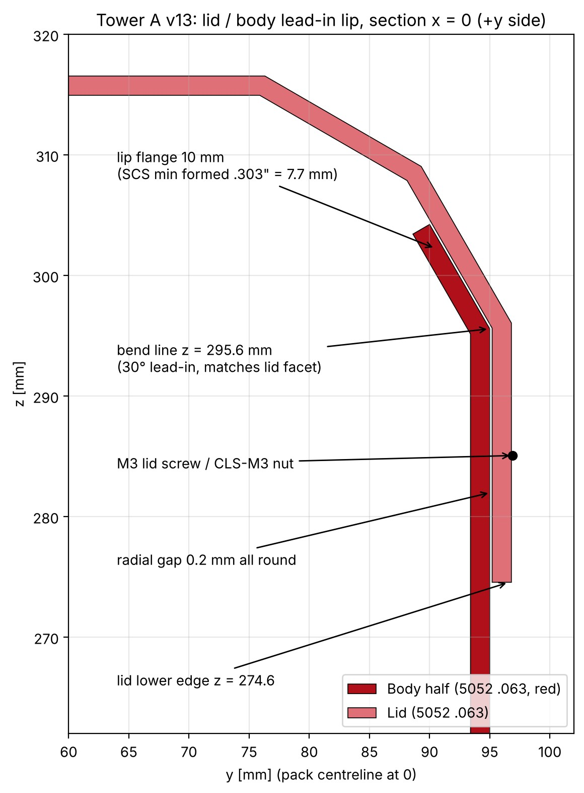
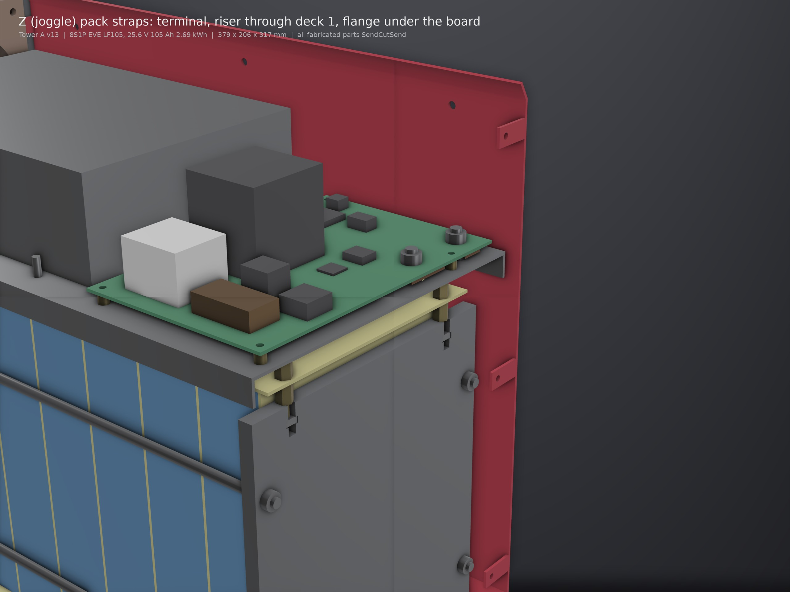

# v13 mechanical changes (2026-11-23)

v13 = v12 plus three changes:
1. A lead-in lip on the body.
2. Tie rods moved to the optimal heights.
3. Pack straps changed from U-shape to Z-shape (joggle).

The interference check passes: 83 parts, no clashes. CAD: `cad/tower13.py`. STEP and renders: `versions/v13-lip-rods-zstraps/`.

## 1. Lid lip

**Why the v2–v4 joggle lip can't be made at SendCutSend.** The lip nested inside the body by offsetting the lid edge with a joggle of 1.7 mm (one sheet thickness plus gap). SendCutSend's specs for 0.063" 5052 set a minimum joggle of 0.324" (8.2 mm) between bend lines (`min_joggle` in [sendcutsend-specs.json](https://cdn.sendcutsend.com/specs/sendcutsend-specs.json)). A 1.7 mm offset is about 5× too small for their press-brake tooling. Hems are also out: the maximum bend angle is 130°.

**v13 solution: a lip on the body, with a 30° lead-in.**
- The top edge of each body half gets one extra 30° inward bend, with a 10 mm flange. SendCutSend's minimum formed flange is 0.303" (7.7 mm).
- The lid already has a 30° corner facet, so the flange sits parallel to the lid facet's inner surface with the same 0.2 mm gap as the side walls.
- Lowering the lid, its facet lands on the angled lip, which centres it, so it slides on instead of dropping onto a sharp edge.
- The lid screws and clinch nuts stay below the bend. The nut hole edge is about 8 mm from the bend line, outside the die zone.

## 2. Tie-rod layout (end-plate stiffness)

Model: a Kirchhoff plate solved with Morley finite elements (`analysis/endplate_fe.py`, scikit-fem).
- End plate: 6061-T6, 7.95 mm thick, 158 × 185.5 mm.
- Load: uniform cell pressure over the 130.3 mm × face height.
- Supports: point supports at the rod nuts (Ø9.2 mm), rods at y = ±72 mm.

Load cases:
- 2.94 kN = the 300 kgf fixture EVE uses for its cycle-life tests.
- 10 kN = assumed end-of-life swelling in a rigid fixture. This figure is my assumption, not a datasheet value.

| Layout (rods per side × rows, rod z) | Max deflection @ 2.94 kN [mm] | Non-uniformity across the cell face [mm] | Peak σ_vm @ 2.94 kN [MPa]* | Max deflection @ 10 kN [mm] |
|---|---|---|---|---|
| **A: v12 (z 28, 94)** | 0.655 | 0.654 | 219 | 2.23 |
| **B: v13, 0.207 h / 0.793 h (z 45, 153)** | **0.078** | **0.075** | 87 | 0.27 |
| C: corners (z 20, 178) | 0.146 | 0.148 | 116 | 0.50 |
| D: 6 rods (z 20, 99, 178) | 0.061 | 0.060 | 71 | 0.21 |
| E: 2 rods (z 99) | 0.414 | 0.409 | 173 | 1.41 |

\*The peak stress sits at the point supports, where a point-support model concentrates it artificially, so it is mesh-dependent. Use it for comparing layouts, not as an absolute value.

- **v12 was wrong.** Both rod rows were in the lower half (pressure centroid at z ≈ 99 mm). The top of the plate cantilevered about 97 mm and deflected 0.65 mm.
- **Optimum with 4 rods.** For two rows of supports under uniform load, placing the rows at 0.207 h and 0.793 h equalises the bending moment at the supports and at mid-span (classic beam-with-overhang result). That gives 8.4× less deflection than v12, with the same 4 rods.
- **Rods 5 and 6 aren't worth it.** They only cut deflection another 22% (0.078 → 0.061 mm), and the plate is already far stiffer than the cells need. Best part is no part.
- **Rod strength isn't the limit.** At 10 kN each M5 rod carries 2.5 kN. An A2-70 stainless M5 rod (14.2 mm² stress area, about 450 MPa proof) holds about 6.4 kN, a 2.6× margin.

## 3. Copper straps: SendCutSend COP-125 (0.125" copper)

SendCutSend bends copper. COP-125 specs from `sendcutsend-specs.json`:

| Spec | Value |
|---|---|
| Bend radius | 0.050" |
| K-factor | 0.34 |
| Bend deduction | 0.205" |
| Min flange before bend | 0.368" |
| Min flange after bend | 0.471" (12.0 mm) |
| Min / max joggle | 0.506" (12.9 mm) / 3.75" |
| Max bend angle | 130° |

**v12 problem.** The straps turned through 180° in total: two 90° bends in the same direction, making a U-channel (terminal leg → riser → flange pointing back over the terminal). A U-channel at SendCutSend needs a base at least 2× its flange length. The riser was 19.2 mm against flanges of 34.5 and 22 mm, so it failed the rule. A single 180° bend (a hem) isn't offered either, because the maximum bend angle is 130°.

**v13 fix: Z-shape (joggle).** The two 90° bends now go in opposite directions, so the top flange points forward instead of back.

| Check | v13 value | Limit | OK |
|---|---|---|---|
| Joggle bend-line spacing (riser) | ≈ 16 mm | ≥ 12.9 mm, ≤ 95 mm | ✓ |
| Terminal leg | 28.5 mm | ≥ 12.0 mm | ✓ |
| Top flange (M6 to the board) | 20 mm | ≥ 12.0 mm | ✓ |
| Bend angles | 2 × 90° | ≤ 130° | ✓ |

Consequences of the move:
- The riser moved 6 mm closer to the front cell: XT = cell_x[7] + 16, with 7.9 mm clearance to the terminal screw head.
- The M6 board bolts sit on the forward flange.
- The front +y board standoff moved to y = 54 so it sits between the two strap flanges.

The 7 series links and the parallel-kit collector plates are flat, so they have no bends to check.

