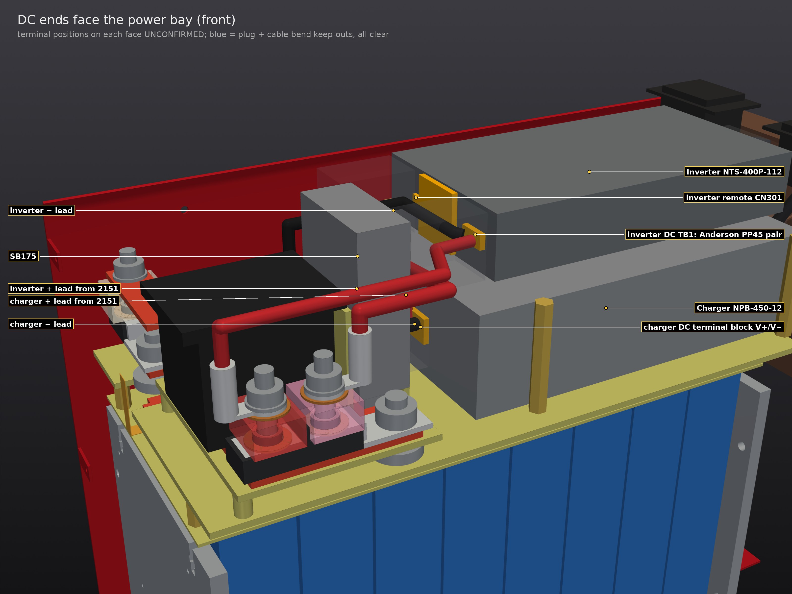
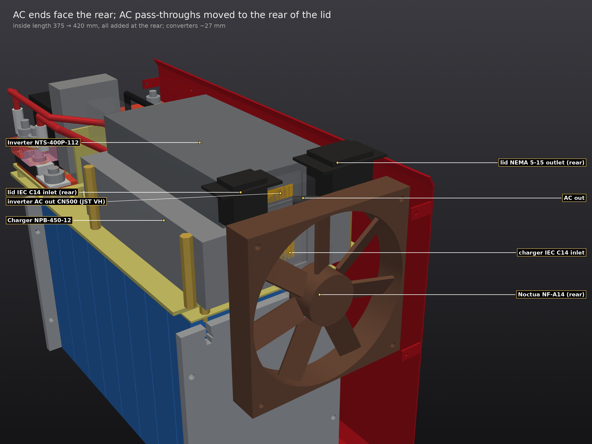

# Power train: fuse, contactor, shunt, conductors, DC output

**Status 2026-11-24 (11:40):** v14 power train rejected. **Owner baselined 175 A DC out (SB175).** Owner prefers busbars to cables for assembly effort. Concept D in CAD as **v15** (`versions/v15-concept-d/`). ⚠️ marks unconfirmed values.

---

## 1. Requirements (first principles), each with its source

### Electrical function
| # | Requirement | Source |
|---|---|---|
| E1 | Carry 210 A continuous, 500 A for 30 s (DC out) | Review D2 ⚠️ cell burst rating unconfirmed (cells.md T4) |
| E2 | Every load and the charger pass through one fuse, one disconnect and one shunt | Protection + coulomb counting |
| E3 | Branch protection for the 6 AWG converter leads (inverter 50 A, charger 30 A) | Wire ampacity |
| E4 | Few series bolted joints (each ≈ 10–30 µΩ ⚠️, ≈ 2.5–7.5 W at 500 A) | Heat, failure points |
| E5 | Precharge before closing onto the inverter's input capacitors | Contactor contact life |

### Protection and failure
| # | Requirement | Source |
|---|---|---|
| P1 | Main fuse as close to the cell as possible: unfused copper is an unprotected fault zone | First principles |
| P2 | Fuse interrupt rating ≥ prospective short-circuit current (5.0–6.9 kA) | Review C2 |
| P3 | Disconnect opens on loss of control power (fail-safe) and on BQ76952 fault independent of firmware | Review M4 |
| P4 | Disconnect hold power small vs. pack self-discharge | EV200 1.66 W = 40 Wh/day = 1.5 %/day |
| P5 | A service disconnect: one part removed = output dead. Install it last, remove it first | Assembly safety |

### Clearance and shorts
| # | Requirement | Source |
|---|---|---|
| C1 | Separate + and − by distance, not by insulation. Plastic is a second barrier, never the first | Owner, 2026-11-24 |
| C2 | No pack conductor passes through a closed hole in chassis metal | Owner (v14 tray slots) |
| C3 | Nothing at pack potential mounts to chassis metal; pack floats (IMD sees the first fault) | N §2 |
| C4 | No single chassis part can touch both + and − copper (that turns two faults into one) | v14 trap T1 |
| C5 | Clearance > the tolerance stack, with margin. 1 mm is less than the stack of 7 cell thicknesses + spacers + bends | v14 trap T2 |
| C6 | Exposed + and − farther apart than a dropped tool can bridge, or shrouded | Assembly safety |

Note on arcing: at ≤ 14.6 V a 1 mm air gap cannot break down (Paschen minimum ≈ 330 V in air). The v14 risk is **mechanical contact** (tolerance, vibration, a burr, chipped powder coat), giving a bolted short of ≈ 6 kA. Arcing matters only when a high current is interrupted.

### Assembly and service
| # | Requirement | Source |
|---|---|---|
| A1 | Top-down assembly: every part drops in vertically, nothing is threaded through a hole | Owner |
| A2 | Every bolt reachable from above with a straight socket after the parts around it are in | Owner |
| A3 | Rigid copper only between points on the same rigid body. Between bodies (module ↔ deck ↔ lid): flexible cable | Over-constraint |
| A4 | Lid removable without unbolting the power path (service loop) | Service |
| A5 | Supplier-made parts only: SendCutSend copper/G10, catalog fuses/contactors, cables crimped to length by a vendor | Owner |
| A6 | Torque on output studs reacted by a plate, never by the M4 cell poles (2 N·m) | Cell terminal strength |

### Measurement and controls
| # | Requirement | Source |
|---|---|---|
| M1 | Tesla shunt in pack−, all load current through it, board ground at node A | tesla-shunt.md, D3 |
| M2 | Short signal harnesses; board gets coil, precharge, shunt SPI, fuse/contactor NTC | — |

## 2. Requirements questioned

| Requirement | What it costs | Question for the owner |
|---|---|---|
| **500 A DC out** (D2) | Class T fuse, EV200, COP-250 risers, M10 studs, boots, G10 plates. Rests on a reseller "3C / 30 s" figure ⚠️ | What actually draws 500 A? (jump-start?) At ≤ 215 A total: MRBF main fuse (10 kA at 14 V), 1/0 cable, Anderson SB175 |
| **DC studs on the lid** | Copper must climb past both converter decks | Keep, or accept a connector? |
| **EV200** | 1.66 W hold (1.5 %/day), needs precharge | Blue Sea ML-RBS 7713: 13 mA when on (0.17 W), auto-release (fail-open), manual LOCKED-OFF knob = service disconnect; but 0.94 kg vs 0.43 kg ⚠️ size |
| **Cell count / config** | — | No change. The lever is current, not cells; 8S1P would halve it but D1 fixed 12 V |

## 3. Candidates

| | v14 (rejected) | A: one bay on the module | B: two bays, poles apart | C: B, downsized to 175 A |
|---|---|---|---|---|
| Idea | Both poles converge in the front bay on tray 1 | Same bay, but mounted to the module on G10; − returns as a cable | Rear bay holds only − (shunt), front bay only + (fuse, contactor); converters in the middle | B with MRBF main fuse and one Anderson SB175 |
| + to − separation | 10 mm (risers), through one Al tray | ≈ 75 mm | **≈ 290 mm** | in one shrouded connector |
| Pass-throughs of chassis metal | 2 tray + 2 lid | 0 | 0 | 0 |
| Module ↔ lid link | Rigid COP-250 | Cable | Cable | Cable |
| Series joints after the cells | 8 | 7 | 6 | 6 |
| Cost | — | Long − cable along the cells | Charger moves ≈ 44 mm forward; rear service bay shrinks ⚠️ check converter connector ends | Gives up the 500 A spec |

## 4. Traps found in v14
| # | Trap | Rule now |
|---|---|---|
| T1 | Both risers in slots of the same Al tray, 10 mm apart, 1 mm clearance: one tray shift = + to − short through the tray | C2, C4 |
| T2 | 1 mm clearance set below the tolerance stack | C5 |
| T3 | Z-strap flanges wider than the slots; the cell screws under the tray can't be reached after the tray is in → unassemblable. The interference check passed because touching-with-1-mm is not an interference | A1, A2. Add an assembly-sequence check and a min-clearance check between opposite potentials and chassis |
| T4 | pack− dragged 300 mm to sit next to pack+, 10 mm from busbar B, 7 mm under an Al tray with only Mylar | C1, C3 |
| T5 | Rigid risers from a tray-mounted contactor through the lid: over-constrained | A3 |
| T6 | Root cause: the original "one PCB for all contactors and shunt" requirement fixed the location; deleting it didn't move the parts | Re-derive layout when a requirement is deleted |

## 5. Sources
- TE EV200 datasheet (catalog 5-1773450-5): 0.13 A hold at 12 V, 1.7 W, M8 studs ✓
- Blue Sea 7713 product page: 500 A continuous, 13 mA on, auto-release, 0.94 kg, 3/8" studs ✓
- Blue Sea / Eaton MRBF: 30–300 A, 10 kA at 14 VDC ✓; must use a terminal fuse block, ring ≥ 3/8" ✓
- Anderson SB175: 175 A, wire up to 1/0 ✓; panel/flange mounting part ⚠️ not yet found
- Cable heating, adiabatic, 500 A for 30 s: 2/0 (67.4 mm²) ΔT = 8.2 K; 1/0 (53.5 mm²) 13.1 K

## 6. Open items
- Owner decisions: 500 A or not; A/B/C; EV200 vs ML-RBS.
- ⚠️ Converter connector ends (B moves the charger forward).
- ⚠️ ML-RBS outline drawing; Anderson SB175 panel mount.
- Add coded checks to `run_tower14.py`: min clearance between opposite-potential copper and to chassis; assembly order.

## 7. Update 2026-11-24: 175 A baselined → Concept D

### Owner inputs
- DC out **175 A** (Anderson SB175). 500 A dropped.
- **Busbars preferred over cables** (assembly effort).
- The control PCB must have a defined zone (v14 left it floating in the middle of the power copper).
- Converter cable runs must be supported.

### Why D replaces B
- The SB175 brings + and − together at one shrouded connector anyway, so B's 290 mm pole separation buys little.
- B needed 3 long cables: SB175 −, inverter −, charger −. D needs one long rigid − bar, with both ends on the module.

### Concept D
| Item | D |
|---|---|
| Decks | Tray 1 → G10 .187, ends at the charger (x ≈ 50). The front bay floor is a G10 power deck on the module. No metal plate over any pack copper. |
| − path | P1 collector → COP-187 bar, 20 mm wide, along the −y cell-top edge (y −60…−80: 14 mm to busbar B, 13 mm to the wall) → rises in the bay → shunt node A; node B → − bus → SB175 − contact + converter − stud |
| + path | P4 collector extended to a tab at the front end (x 147–152), rising at the bay centre → MRBF 250 A (5191 block) → contactor line stud; load stud → + bus → SB175 + contact + dual MRBF 2151 (inverter 50 A, charger 30 A) |
| Polarity zoning | Bay −y half = − (shunt, − bus); +y half = + (contactor, MRBFs). ≥ 25 mm between opposite potentials everywhere ⚠️ verify in CAD |
| Output | SB175 mounted on a G10 bracket on the power deck with Anderson 924 bracket kit; busbar contacts bolted to the + and − buses; the face pokes through a lid opening. **No cables in the main path. Lid carries no power copper.** |
| Control PCB | Vertical, on the −y body wall beside the charger: x −150…+45, z 230–312 (≈ 195 × 82 mm, 3.3× v14's 68 × 72 mm). ≥ 20 mm above the − bar; + hardware ≥ 100 mm away. Short runs: flex tail (−y taps), shunt SPI, charger CAN and inverter remote (DC ends face front), fan (rear), LED board and antenna (front). ⚠️ mounting: PEM standoffs in the body wall vs a G10 bracket, depends on body assembly order |
| Converters | **Both DC ends face the front bay** (checked: the NPB-450 and NTS-400P each have DC and AC on opposite ends). Leads ≤ 150 mm, tied through slots cut in the G10 decks (no added parts). Inverter: Anderson Powerpole PP45 (1327/1327G6, PP15-45 housings; corrected 2026-11-24, was mislabelled PP75) on the unit, so it unplugs. Charger: screw terminal block. AC ends face the rear: charger IEC C14 inlet + fan; inverter CN500 |
| Joints after the cells | 7 |

### MEAN WELL connector check (datasheet photos, 2026-11-24)
| Unit | DC end | Other end | Source |
|---|---|---|---|
| NPB-450-12 | "DC output side": screw terminal block V+/V−, DIP switch, LEDs, DF11-14 signal connector | "AC input side": IEC 320-C14 inlet, on/off switch, fan | MEAN WELL NPB-450-SPEC (2023) p.1 photos ✓ |
| NTS-400P-112 | "DC input side": TB1 Anderson 1327 (red) / 1327G6 (black), contact 261G2-LPBK; CN301 remote on/off | "AC output side": CN500 JST B6P-VH, DIP switch, CN50 TX/RX | NTS-400P-SPEC (2026-03-26) p.1 photos ✓ |

### Main fuse: Class T vs MRBF (prices checked 2026-11-24, USD)
| | Class T (JJN / JLLN) | MRBF + 5191 block |
|---|---|---|
| Price at 200–250 A | JLLN-200 $40 (Zoro), JJN-200 $88–145 | fuse ≈ $22 + block ≈ $27–32 |
| Price at 500 A | JJN-500 $185 (Zoro) to $445 | not available (max 300 A) |
| Interrupt rating | 20 kA at 160 VDC | 10 kA at 14 VDC (5 kA at 32 V) vs 6.5–6.9 kA prospective: 1.45× margin ⚠️ pack max 14.6 V is just above the 14 V rating point |
| Current limiting | Yes: clears in under ½ cycle, low let-through I²t (protects contactor contacts from welding) | Not marketed as current-limiting ⚠️ |
| Mounting | Bolted blades: needs 2 bars + 2 joints | Stacks on a 3/8" stud; ring ≥ 3/8"; must use the terminal block |
| Size | JJN-200: 0.88" × 2.44" | ≈ 25 × 25 × 13 mm |
- **Choice for 175 A: MRBF 250 A.** Max discharge = 175 A out + ≈ 40 A inverter = 215 A. Cheaper by ~$15–120, one bar and one joint fewer, adequate AIC. What you give up is current limiting.

### Contactor on both poles?
No. Two-pole switching is for HV packs (> 60 V DC), where a stuck pole must not leave a lethal touch voltage. At ≤ 14.6 V the pack is SELV, and it floats, so opening + alone breaks every load loop. A second contactor would add a part, a coil, precharge logic and a failure mode, to protect against a single welded contact. That case is covered by the fuse plus the charger and inverter remote-off.

## 8. Control PCB placement: merged into the front LED PCB (proposed 2026-11-24)

| Option | Result |
|---|---|
| Vertical board on the −y wall (§7) | Works, but it's a separate PCB, needs mounting that depends on body assembly order, and needs a harness to the LED board and antenna |
| **Integrated into the front LED PCB** | **Recommended.** One PCB fewer, no LED harness, antenna already at the front light pipe. LED/air-hole side faces out; control components on the back |
| Mezzanine slotted onto the LED PCB | Rejected: the gap from the LED board's back face to the module front end plate is **8.0 mm** (`XL0` − end-plate face in `tower14.py`). A stacked board plus board-to-board connector needs ≈ 15–18 mm ⚠️, so the front plate would move forward ≈ 10 mm (dead length) |

- Board: 187 × 246 mm (±93.4 mm wide, z ≈ 36–282).
- Control zone on the back, z 40–190: in front of the aluminium module end plate, away from the bay copper (bay starts at z 218). That is ≈ 187 × 150 mm vs v14's 68 × 72 mm.
- Back-side height limit: 8.0 mm minus clearance → components ≤ 5 mm ⚠️. ESP32-S3-WROOM-1U is 3.2 mm thick ⚠️ (check the datasheet). Harness connectors must be low-profile right-angle at the board's top edge.
- Air holes: the checkerboard has Ø6 holes on a 7.78 mm pitch. Routing the BQ76952 + ESP32 cluster between them is impractical, so a solid zone of ≈ 60 × 80 mm loses ≈ 40 of ≈ 287 air holes (≈ −14 % inlet area) ⚠️. Re-run the cooling check (N §11).
- Board ground = pack−. Mounting holes into the end-plate standoffs are non-plated, with a ≥ 2 mm copper keep-out (floating pack, IMD).
- Harness lengths: flex tail over the end-plate top into an FPC connector on the back (≈ 40 mm); shunt SPI ≈ 80 mm; contactor coil ≈ 100 mm; converter CAN/remote ≈ 150 mm; fan (rear) ≈ 350 mm; lid button ≈ 150 mm.

## 9. v15 CAD (2026-11-24): what changed from the §7 concept
- **Contactor → Gigavac GX12** (225 A continuous, M10 studs, dual-coil economizer, $125 at Waytek ⚠️ outline not fetched). The EV200 (81 × 66) left no room for the SB175 and both fuses. The M10 studs also take Blue Sea MRBF blocks directly.
- **Shunt stands vertical**, bolted to the − riser tab with horizontal bolts. That lets the riser stand outside the tray outline, so the tray can be lowered after it (the v14 Z-flange trap).
- **+ tab flange sits in a tray notch open to the front edge**, for the same reason.
- **Control circuit on the front PCB's back, facing the bay** (owner, 2026-11-24), not facing the module end plate. The bay side has ≥ 18 mm depth, versus 8 mm in front of the end plate.
- Measured: + to − ≥ 13.7 mm; pack to chassis ≥ 7.4 mm; 0 pass-throughs (`clearance_v15.py`).

## Converter plug room: pack +42 mm at the rear (option A, 2026-11-24)

**Problem.** C1 left too little room in front of the converters' DC ends:
- **Charger:** 3.2 mm to tray 1, the shunt and the plate.
- **Inverter:** 23.8 mm to the SB175 cheek.

The rear had 18 mm to the fan, which is too little for a right-angle C13 (~30 mm ⚠️).

**Requirements** (plug depth + cable bend, ⚠️ estimates):

| Lead | Room needed |
|---|---|
| Charger DC: 8 AWG into a screw terminal + bend | 27 mm |
| Inverter DC: PP45 plug (housing 24.6 mm) + 10 AWG bend | 42 mm |
| Charger AC: right-angle C13 | 30 mm |
| Inverter AC: CN500 VH plug + wires | 20 mm |

**Options:**
- **A. +40 mm, pass-throughs to the rear: chosen.**
- B. +30 mm at the front only: the rear C13 still doesn't fit, and the 300 mm AC run stays.
- C. No growth, pigtails pre-wired on the bench: the bend room is still needed right at the converter.
- D. Shorter converters: not searched.

**What changed (`tower15.py`):**
- `L_IN` 375 → 417 and `REAR_EXTRA` 10 → 52. The front plate and everything in the bay stay where they were.
- Converters at `XR + 58`: they move 27 mm toward the rear, relative to the cells.
- Gap from the converter rear ends to the fan: 33 mm.
- Room in front of the DC ends: charger 30.2 mm, inverter 50.8 mm.
- AC pass-throughs moved to the rear of the lid, in the 33 mm column between the fan and the converter rear ends:
  - NEMA 5-15 outlet at y −40;
  - IEC C14 inlet at y +45;
  - both clear of the CN500 plug, with clinch nuts along y so they stay off the inverter top.
- AC wiring is now about 60 mm, down from ~300.
- AC is at the rear and DC at the front.

**New parts:**
- `converter_terminals()` adds `term_*` markers (positions on each face ⚠️; the charger DC block is in the +y half per the v14 note) and `keepout_*` volumes.
- C1 treats the keep-outs as obstacles.
- The C1 + leads now end at the charger terminal block and the inverter PP45.

**Checks:**
- `run_tower15`: 0 interferences.
- `clearance_v15`: pack to chassis 7.4 mm.
- C1, all 3 variants: 0 interferences, keep-outs clear, + to − 10.5 mm, pack to chassis 7.3 mm, all fuses lift out.

**Open:**
- ⚠️ Exact terminal positions from the MEAN WELL mechanical drawings.
- ✓ PP45 mated length: 41.2 mm (resolved below).
- ⚠️ Right-angle C13 depth (pick a part).
- − leads for both converters not placed.
- Every shell part (body halves, lid, tray 1, G10 floor) gets longer: re-check the SendCutSend sheet limits ⚠️.
- Rear plate fan grid unchanged.
- The pack mass estimate rises slightly.

### Confirmations (2026-11-24, later)

**1. Terminal positions** (✓ drawing / ⚠️ inferred). Read from the MEAN WELL mechanical drawings. Chrome screenshots of the PDFs froze, so I parsed the vector text and outlines with pdf.js on meanwell.com.
- **NPB-450 (NPB-450-SPEC p.15, case 284A), DC end:**
  - The V+/V− screw terminal block sits just +y of centre: about +5 to +21 mm, at about mid-height.
  - The DF11-14 signal connector, DIP switch, Io adj. and status LED are at the −y end.
  - The AC end has the IEC C14 inlet with an ON/OFF switch.
  - ⚠️ Which terminal is V+ and which is V− isn't confirmed.
- **NTS-400P (NTS-400P-SPEC p.6, 2026-03-26), DC end:**
  - TB1 is a red + black pair at y about +25 to +41.
  - CN100 is at about y −3 and the CN301 remote at about y −20.
  - The AC end has CN500 (JST B6P-VH), the DIP switch and CN50.
  - ⚠️ Assumes the drawing's top view is seen from above. If it's the bottom view, mirror these in y.
- Model: `tower15.converter_terminals()`.

**2. The inverter connector is Powerpole PP45, not PP75.**
- Anderson part 1327 (red) / 1327G6 (black) belongs to the PP15-45 family: housing 7.9 × 7.9 × 24.6 mm, mated length 41.2 mm, wire #20 to #10 AWG (Anderson PP datasheet; drawing 1-9597S1).
- Consequences:
  - The inverter lead is **10 AWG max**: lug and cable changed. The 2151 fuse for it stays 50 A.
  - At 400 W / 12 V / 0.91 ≈ 37 A continuous, PP45 (45 A) is within rating. ⚠️ 10 s peak: 800 W ≈ 73 A.
  - Keep-out stays 42 mm: 24.6 mm plug + 10 AWG bend.

**3. Right-angle C13: L-com ACPWRC-C13LR** (rewireable, screw terminals, 14–18 AWG; Digi-Key).
- Its drawing's largest dimensions are 41.9, 37.9 and 35.6 mm. Labels didn't extract, so I assume the depth from the mating face is ≤ 35.6 mm ⚠️.
- Rear gap raised to **36 mm**: `L_IN` 417 → **420**, converters at `XR + 61`.
- Alternative: Quail 3514.024S, a snap-in C14 inlet to right-angle C13 jumper, which would replace the lid inlet with one part.

**4. SendCutSend limits** (sendcutsend.com/materials/processing-min-max, read in Chrome 2026-11-24): all ✓ with margin for the longer shell.

| Item | Limit | Ours |
|---|---|---|
| 5052 .063" bending: flat size | 30" × 44" | body half ≈ 434 mm long (17.1") × ~450 mm flat (~17.7") ⚠️ flat estimated |
| 5052 .063" bending: max bend length | 44" | 17.1" |
| 5052 .063" bending: effective bend radius | .035" | |
| 5052 .063" bending: min flange (after bend) | .303" | |
| Powder coat (5052) | 30" × 36" | fits |
| Copper .125" (Z-strap) | radius .050", min flange .368" flat / .471" (12.0 mm) bent | leg 30.5 mm ✓; foot 12.0 mm, exactly at the limit |

**5. − leads placed.**
- Two M8 carriage bolts through the shunt bar beyond node B: charger at (62, 1), inverter at (82, 1). Both converters' current goes through the shunt.
- 90° lugs: charger barrel toward −x, inverter barrel toward −y (offset 10 mm, 1 mm short of the sense board).
- Leads run to the converter DC terminals.
- Checks, all 3 variants: 0 interferences; + to − 10.5 mm; pack to chassis 7.3 mm; all fuses lift out.

**Still open:**
- ⚠️ V+/V− order on the charger terminal block.
- ⚠️ NTS drawing view orientation.
- ⚠️ ACPWRC-C13LR depth label.
- ⚠️ Inverter − lug is 1 mm from the shunt board.

## 10. v16.1 updates (2026-11-25)
- **NTS-400P-112 ratings** (MEAN WELL NTS-400P-SPEC 2026-03-26): 400 W continuous, 460 W for 3 min, 600 W for 10 s, 800 W for 30 cycles; DC current 40 A typ; input 10–16.5 V; no internal fan: CN100 drives an optional 12 V 0.4 A PWM fan.
- **Derating:** forced air (10 CFM fan, 5 cm from the DC end) 100 % to 40 °C → 40 % at 70 °C; natural convection ≈ 60 % to ≈ 55 °C. The pack fan delivers 0.2–0.6× of that condition: see [cooling.md](cooling.md).
- **Inverter 10 AWG lead: resolved.** 33 CFR 183.425 table 5 / ABYC E-11, 105 °C, single conductor: 60 A at 30 °C, 51 A at 50 °C, vs 40 A = 1.28×. Peaks: 46 A for 3 min, 60 A for 10 s, 80 A for 0.5 s, all inside the 50 A MRBF's curve (Bussmann: >100 h at 100 %, ≤900 s at 135 %, ≤60 s at 200 %).
- **NPB-450-12:** 25 A max, 420 W max power, efficiency 92 % typ (MEAN WELL NPB-450-SPEC 2026-07-06) — the v14 assumption is confirmed.
- **Right-angle C13** (L-com ACPWRC-C13LR): $28.09 at L-com, 2026-11-25 (37 in stock); depth still 35.6 or 37.9 mm ⚠️, the 40 mm gap fits either.

## 9. Precharge resistor (2026-11-27)
**Path.** B+ tap (in-bar, after the main fuse) → 18 AWG lead, 2 A ATM fuse at the copper end → BMS board connector → PCB trace → precharge relay contact → resistor → PCB trace → board connector → 18 AWG lead, 2 A ATM fuse → LOAD+ tap (2151 inverter-fuse stud). **The precharge current does cross the PCB.** It is the only pack-sourced current that does: ≤ 1.5 A for ≈ 0.14 s, which a 1 mm trace carries easily. It is a deliberate exception to "no power current on the PCB".

**Sizing at 4S.** The v14-review numbers (2.9 A, 2.0 J) were for 8S.

| Case | Value |
|---|---|
| Normal: C ≤ 4.7 mF ⚠️ (inverter input, unpublished), V 14.6 V | I_peak = 1.46 A; resistor energy ½CV² = **0.50 J**; 3RC = 0.14 s to 95 % |
| Fault: load bus shorted, firmware 0.5 s timeout | 14.6² / 10 = 21.3 W for 0.5 s = **10.7 J** |

**Candidates.**

| Resistor | Size | Rating that matters | Verdict |
|---|---|---|---|
| **Vishay Draloric AC05, 10 Ω 5 %, cemented wirewound, axial (AC05000001009JAC00)** | Ø7.5 × 18 mm body, 1.9 g | 5 W at 40 ℃. Short-time overload **10 × P for 5 s** (50 W, 250 J ≫ 10.7 J); single-pulse capability at 10 Ω ≈ 3 J ⚠️ (read from the log chart; the axis label says Ws/Ω, the caption says Ws) ≥ 0.5 J | **✓ picked.** Through-hole on the BMS board, lying flat, ≈ 10 mm tall with lead lift, inside the 12 mm height claim. CAD 1.27 qty 1, 6,977 in stock (Newark via [Octopart](https://octopart.com/search?q=AC05000001009JAC00), 2026-11-27) |
| Vishay AC10, 10 W | Ø8 × 44 mm | 10 W | ✗ 2.4× longer for energy that isn't needed |
| Vishay AC03, 3 W | Ø4.8 × 13 mm | overload 30 W for 5 s | Would work on energy; the AC05 gives margin for repeated retries at the same price |
| Chassis-mount aluminium-housed, 10 W (e.g. Vishay RH-10, TE HSA10) | ≈ 30 × 28 × 15 mm + a heatsink plate | 10 W **on a heatsink** | ✗ sized for continuous power; precharge is a pulse. Adds a mounting point and two wires |

**Rules from this:**
- Firmware may retry precharge at most once per button press; a second failure latches a fault. This bounds the resistor's energy to 2 × 10.7 J.
- The charger relay closes only after the GV14 is closed (D39).

Source: Vishay Draloric "AC.. Series, Cemented Wirewound Resistors", doc 28730 rev 13-Jan-14 (pp. 1, 2, 6) ✓. Figures: `docs/img/precharge/`.
