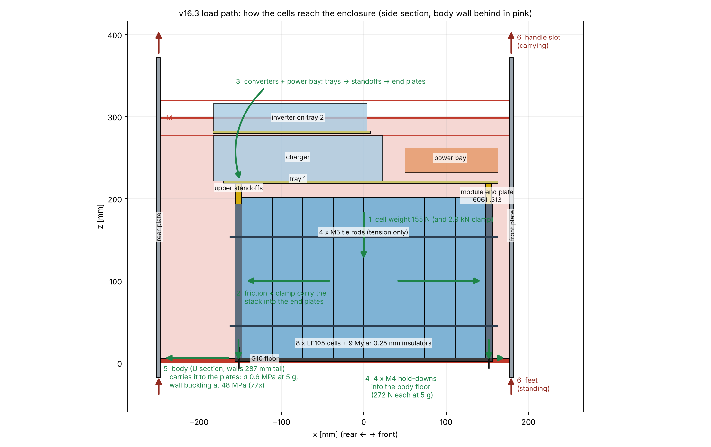

# Structure: how the cells are held, and what carries the pack's weight

Model: `cad/analysis/structure_v16.py` (numbers in [`v16-structure.txt`](v16-structure.txt)); figure: `cad/analysis/structure_fig.py`.

## 1. Requirements
| # | Requirement | Source |
|---|---|---|
| S1 | Pack (≈ 27 kg) stands on its feet and is carried by the two handle slots without yield or buckling, with margin for a drop | Owner question 2026-11-27; 5 g drop as in v14 review |
| S2 | Cells held at EVE's recommended compression, 3–7 kN; never above 10 kN instantaneous | EVE PBRI-LF105-D06-01 rev E, Table 16 |
| S3 | The clamp survives end-of-life swelling (≤ 30 kN in a rigid fixture) | EVE rev E, Table 17 |

## 2. Load path (top-down)
1. **Cells → end plates.** The 8 cells and 9 Mylar insulators are clamped between the two 6061 .313 module end plates by 4 M5 A2-70 rods at 2.94 kN (300 kgf, EVE's own fixture preload). The cells also stand on the G10 floor.
2. **Upper parts → end plates.** Tray 1 (charger), tray 2 (inverter) and the power bay sit on the upper M4 standoffs, which stand on the end plates.
3. **End plates → body.** 4 × M4 screws come up through the body floor into T-nuts in the end-plate feet (x ±151.9, y ±40).
4. **Body → front/rear plates.** The two L-shaped 5052 .063 body halves form a U section (walls 287 mm tall). They carry the load as a beam to the wall tabs, with 7 × M4 per end into the plates.
5. **Plates → ground or hands.** The 6061 .125 front/rear plates carry the feet (standing) and the handle slots (carrying).

**How the two body halves are joined.** There is no fastener on the seam itself. The halves butt at y +24 (0.5 mm gap), under the G10 floor, which covers the seam. They are tied together by three parts:
- the front and rear plates (each half's wall tabs, plus half A's floor tab, all M4);
- the two module end plates (one M4 per half at each end, through the floor into the end-plate T-nuts);
- the lid (3 × M3 clinch nuts per wall).
For vertical loads each L half is its own beam, so the seam carries no shear. (The U-section numbers above count both halves together; each carries about half.) Why two halves: a one-piece U fails SendCutSend's U-channel rule, base 149 mm vs 2 × wall 597 mm (DFM_report.txt).

## 3. Results (1 g / 5 g drop)
| Check | Load | Capacity | Margin |
|---|---|---|---|
| Body bending, wall top (compression when standing) | 0.12 / 0.62 MPa | wall plate buckling (k 23.9, 287 × 1.6 mm) 48 MPa | 386× / 77× |
| Wall shear | 0.14 / 0.70 MPa | shear buckling 10.8 MPa | 77× / 15× |
| Floor flat in compression (pack carried upside down) | 0.08 / 0.41 MPa | 30 MPa | 367× / 73× |
| Module hold-down M4 (floor pull-through, Ø7 head) | 272 N each at 5 g | 4.8 kN | 17.7× |
| Plate → wall tabs, 7 × M4 bearing | 78 N each at 5 g | 2.5 kN | 32× |
| Upper standoffs (Euler, fixed-free) | 57 N at 5 g | 104 kN | 1,800× |

**Nothing external buckles.** The shell is lightly loaded because the stiff module carries its own weight to the end plates, and the 287 mm walls make the body a deep beam. The tie rods are **tension** members: the cells push the end plates apart. Only the cells and their insulators are in compression, face to face over 130 × 196 mm, so there is nothing slender to buckle.

## 4. Cell compression and swelling (EVE rev E)
| Clamp force | Rod stress (4 × M5, A_s 14.2 mm²) | vs A2-70 proof 450 MPa | End-plate deflection (v13 FE, linear) |
|---|---|---|---|
| 2.94 kN preload | 52 MPa | 8.7× | 0.08 mm |
| 7 kN (top of EVE's range) | 123 MPa | 3.7× | 0.19 mm |
| 10 kN (EVE instantaneous max) | 176 MPa | 2.6× | 0.27 mm |
| **30 kN (EVE EOL swelling, rigid fixture)** | **528 MPa** | **0.85× — rods yield** | 0.80 mm |
| 30 kN with **M6 A4-70** (A_s 20.1 mm², v16.3) | 373 MPa | 1.21× | 0.80 mm |

- Frame stiffness: rods 33.9 kN/mm in series with the two plates 18.9 kN/mm = 12.1 kN/mm. The rods reach proof at 25.6 kN, after **1.9 mm** of stack growth past preload (0.64 % of the cell stack).
- **This is a real gap.** v13 sized the module for an assumed 10 kN. EVE's own document now gives ≤ 30 kN at 80 % SOH in a rigid fixture. In a compliant frame like ours the force will be lower, but how much lower depends on the cell's swelling stiffness, which EVE doesn't give.
- **Done (D36, owner approved 2026-11-27): M6 316 A4-70 rods.** Proof 36.2 kN ≥ 30 kN (1.21×); the rods reach proof after 2.46 mm of stack growth. Losing options kept below.
- **Options considered:**
  - **(a)** M6 A4-80 rods (A_s 20.1 mm², proof 600 MPa → 48 kN, ≈ +$5).
  - **(b)** Keep M5, log the stack length at each service and re-shim. Rods that yield only stretch: they relax the clamp, they don't break.
  - **(c)** Add disc springs under the rod nuts to cap the force (one more part per rod).
  - I lean to (a): same hole pattern, 1 mm larger holes in SCS-cut plates, nothing else changes. ⚠️ Not done.

## 5. Sources
- EVE LF105 spec PBRI-LF105-D06-01 rev E, 2023-05-31: Table 2 (3C 30 s), Table 13 (pulse MAP), Table 16 (compression 3–7 kN, max 10 kN), Table 17 (swelling BOL ≤ 3 kN, EOL ≤ 30 kN), §3.3 (fixture: 300 kgf preload, PET film). Copy read 2026-11-27 at static.ticimax.cloud ✓ (EVE document, third-party host).
- 5052-H32: E 70.3 GPa, yield 193 MPa, UTS 228 MPa ✓ (standard values). Plate buckling coefficients k = 23.9 (bending), 4.0 (compression), 5.35 (shear), simply supported ✓.
- Masses: the v16 roll-up (CAD volume × density, catalog weights) ⚠️ ±0.3 kg.

## 6. Open items
- ✓ EOL swelling vs rods: M6 (D36).
- ⚠️ End-plate local stress at the rod nuts at 30 kN: re-run the v13 plate FE with washer-sized supports.
- ⚠️ The handle-slot edge in .125 plate: comfort only, not strength.
