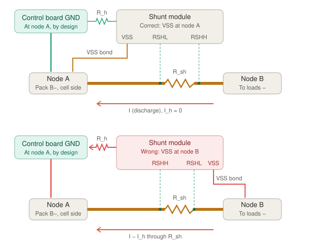

# Tesla Model S shunt module (1016792-00-C): pack integration notes

This is the single source of truth for the shunt in Tower A. Reverse-engineering detail (netlist, protocol, firmware) lives in the shunt repo: [CKalitin/tesla-model-s-2012-shunt-resistor](https://github.com/CKalitin/tesla-model-s-2012-shunt-resistor).

> ⚠️ Values marked **(U)** are **unconfirmed**: first hand measurements or one-count meter readings. Re-measure before freezing CAD or firmware constants.

## 1. Role in the pack (v14: 4S2P, 500 A for 30 s / 210 A continuous)

- Low-side in pack−, between the cells (**node A**) and the load-negative bus (**node B**). Path: cells → node A → bar → node B → inverter, charger, DC-out −.
- The control-board ground connects at node A. The module's J1 GND is the bar itself, so no isolator is needed here: the bar sits at board ground. The shunt repo warns against connecting J1 to a shunt in an HV pack, but that applies when the bar is at a different potential from the reader. In this pack it isn't.
- Kept as the current sensor by owner decision D3 (2026-11-24) over a plain shunt into the BQ76952.

## 2. Physical (U)

| Feature | Value |
|---|---|
| Bar | 1/8" (3.175 mm) copper, **35 × 83.5 mm** |
| Bolts | On the long centre line, **15 mm from each end**, so **53.5 mm** apart. Thread and size **unknown** |
| Module PCB | **2 mm** thick, **25 mm** wide, centred along the bar; overhangs the bar's long edge by **8 mm**, so the footprint is **43 × 25 mm** |
| Component height | **5 mm** above the copper |
| Connector | At one end of the module. Top is **5 mm above the PCB (7 mm above the copper)**. Wires exit **straight up**, normal to the bar. |
| Keepout | Connector footprint × **≥ 35 mm** above the connector top, for the mated plug and the wire bend (estimate) |
| Still unknown | Bolt thread, exact connector part number, which way the connector faces |

## 3. Interface

| Item | Value | Source |
|---|---|---|
| Connector | **10-pin Molex Mini-Fit (U)** with a key slot between pins 1 and 2 (U). The earlier "8-pin" note was wrong or unverified. | Owner, 2026-11-24 |
| J1 pin 1 | VDD +5 V | shunt repo `firmware/README.md` |
| J1 pin 2 | GND (the bar) | same |
| J1 pins 3–6 | NSS, SCK, MISO, MOSI | same |
| J1 pin 7 | OUT1 + OUT2 tied together (LM2903 over-current comparator outputs) | shunt repo `annotations/board/netlist.md` |
| J1 pins 8–10 | Unidentified | — |
| Supply | 5 V (IHM-A-1500 VDDA 4.7–5.3 V; the STM8 runs at 5 V) | IHM datasheet |
| Logic | The STM8 needs VIH = 0.7 × 5 = 3.5 V. The STM32 bench reader worked at 3.3 V anyway, with 5 V-tolerant pins. **The ESP32 is not 5 V-tolerant (absolute max 3.6 V), so it needs a level shifter** on NSS, SCK, MOSI (up) and MISO (down), e.g. a TXU0104. | shunt repo, ESP32 datasheet |
| Protocol | SPI mode 0, MSB first, 500 kHz, 8-byte frames with CRC-8 (poly 0x07); init sequence in `src/shunt.c` | shunt repo |
| Scale | Raw value from command 0x41 ≈ **50 mA per count**: 1, 2 and 3 A read 19.3, 39.1 and 58.9 counts. Calibrated in firmware (offset and scale in the last flash page). | shunt repo commit 2bda143 |

## 4. Electrical

| Quantity | Value | Notes |
|---|---|---|
| R_sh | **≈ 20 µΩ (U)**, range 10–30 µΩ | 0.1 mV bolt to bolt at 5 A, one meter count. Replaces the earlier assumed 100 µΩ. |
| At 500 A for 30 s | 10 mV, **5 W**, 150 J | Negligible heating |
| At 210 A continuous | 4.2 mV, 0.9 W | — |
| Front-end rating | IHM-A-1500: 1,500 A starter (cranking) class, ±300 A continuous | 500 A for 30 s is above the continuous figure but in the starter class. Acceptable on heat. Bench-verify at ≥ 300 A if possible. |
| Resolution | ≈ 50 mA per count | 10,000 counts at 500 A |

## 5. Grounding and orientation (updated for R_sh ≈ 20 µΩ)

*(Figure from the 8S design: the topology is unchanged, but its numbers assume 100 µΩ. Use the table below.)*

- **Correct orientation:** the module's VSS bond sits at node A, the cell side, where the board ground is. Then no current flows in the harness ground wire.
- **Wrong orientation:** the bond sits at node B. The harness ground wire (R_h ≈ 26 mΩ, 22 AWG × 0.5 m) then runs in parallel with R_sh:

$$I_h = I\,\frac{R_{sh}}{R_{sh}+R_h} = I\,\frac{20\,\mu\Omega}{26.02\,\text{m}\Omega} \approx 0.077\,\%\ \text{of } I$$

- $I_h$ = harness ground current [A]
- $I$ = pack current [A]
- $R_{sh}$ = shunt resistance [Ω]
- $R_h$ = harness ground wire resistance [Ω]

| Case | I | I_h | Reading error | Ground offset |
|---|---|---|---|---|
| 500 A burst | 500 A | 0.38 A | −0.08 % | 10 mV |
| 210 A continuous | 210 A | 0.16 A | −0.08 % | 4.2 mV |

- 0.38 A is well within 22 AWG's capacity, so **orientation is no longer a safety item**. Keep the rule anyway (correct orientation is free); it is now about accuracy only.
- The current sign flips with orientation. Fix the sign in firmware from a known-direction bench current.

## 6. Bench tests

**2026-11-24: bonded end and bar resistance (U)**

Setup:
- Bench supply in constant current, 5 A, bolt to bolt.
- DMM on the 200 mV range (0.1 mV resolution).
- COM on J1 GND at the connector.
- Module powered from the NUCLEO (a jumper also reads the STM32).

| Measurement | Current on / off | Reversed current |
|---|---|---|
| Bolt to bolt | 0.1 mV | — |
| J1 GND → bolt "A" (supply − in the first run) | 0.0 / 0.0 mV | 0.0 mV |
| J1 GND → bolt "B" | +0.1 / 0.0 mV | −0.0 mV |

An earlier attempt measured against the NUCLEO GND through a jumper and read about 3.5 mV on both bolts. That's an offset: module supply current through the jumper's resistance. Removed by measuring at the connector and differencing on/off.

**Conclusions (preliminary):**
- R_sh ≈ 20 µΩ.
- Leaning towards VSS bonded at bolt "A". The sign flip on bolt "B" sits below one meter count, so this is **not conclusive**.
- **Action:** physically mark bolt "A".

## 7. Open items (deferred: characterise the shunt properly)

- [ ] 4-wire R_sh with a µV-resolution meter (5½ digit or better), or 20–50 A of test current. Measure at 2+ temperatures for the temperature coefficient.
- [ ] Repeat the bonded-end test with real resolution. Confirm bolt "A".
- [ ] Compare the module's calibrated SPI reading against a reference shunt across 0–300 A.
- [ ] Bolt thread and size; connector part number and orientation; J1 pins 8–10.
- [ ] Decide whether to use J1 pin 7 (hardware over-current comparator) as a second trip input to the contactor driver.
- [ ] Check that the IHM-A-1500 gain range resolves the 10 mV full-scale signal at 500 A well enough at low currents.
