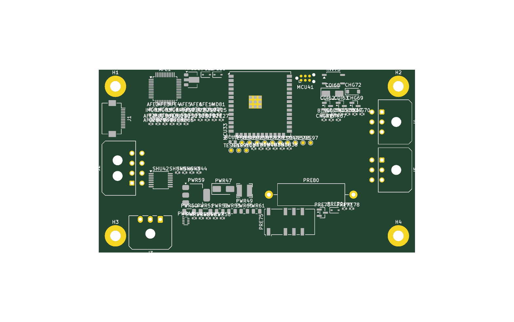
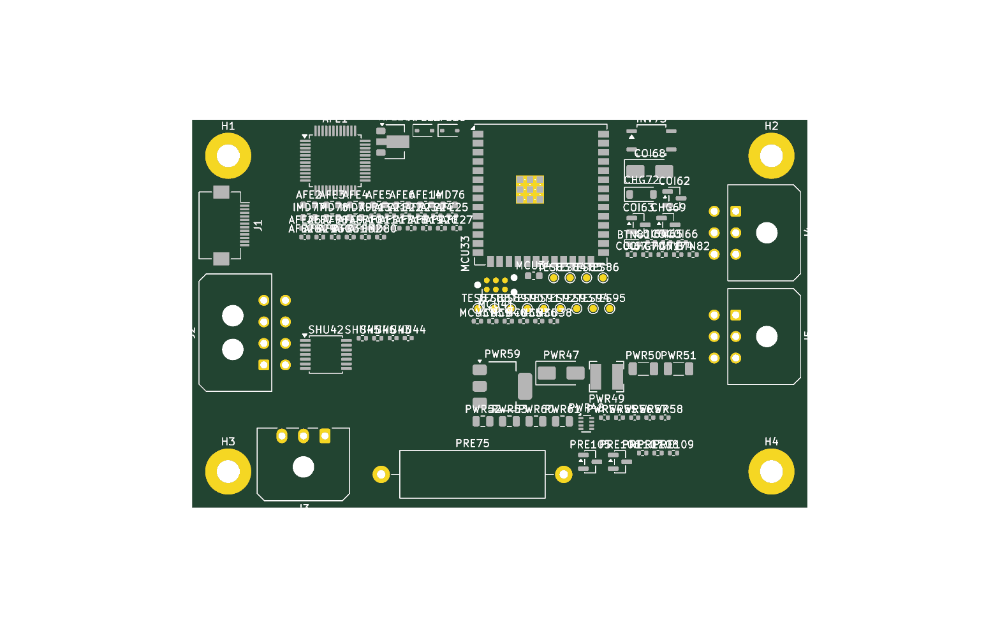

# BMS board: area and height (2026-11-27)

**Final claim: 95 × 55 mm (5,225 mm²); layout target 85.6 × 53.98 mm (credit card) inside it**. Was proposed as: 95 × 55 mm (5,225 mm²), top-side parts ≤ 12 mm, nothing on the bottom.** That's 39 % of the 150 × 90 claim. Every part was placed as a real KiCad 10.0.8 footprint: 109 parts, 0 courtyard overlaps, 49 % occupancy (`bms-size/place.py`). ⚠️ No schematic yet, so the part list is a sizing list, not a design.

The 150 × 90 claim (accepted into `spec/interface.md` §4, `aa40b9f`) is withdrawn. A new request is in `spec/requests/pcb-bms-space-claim.md`. Chris rejected 150 × 90 on 2026-11-27 ("prove you need that space… 50–75 %"), and the proof says less than that.

*Area proof, not a layout: inside each block the parts are packed in rows, not placed at their pins.*

## 1. Requirements
| # | Requirement | From |
|---|---|---|
| A1 | Carry the confirmed scope (BQ76952, ESP32-S3, shunt SPI, GV14 AND driver, precharge, inverter remote, charger-relay coil, buck + 3V3, IMD, button + LED link) | owner-requirements §5 |
| A2 | No bigger than needed; Chris expects ≤ 50–75 % of 150 × 90 | Chris 2026-11-27 |
| A3 | Routable on 4 layers with margin: courtyard occupancy ≈ 40–60 % ("normal, 4-layer comfortable") | studio-edul/pcb-layout-skill §1 occupancy table |
| A4 | Right-angle plugs only on edges that have plug room | spec/interface.md §4 |
| A5 | Parts ≤ 12 mm including mated plugs; nothing on the bottom (3 mm standoffs on the G10 bridge) | spec/interface.md §4 |
| A6 | Full PCBA at PCBWay | owner-requirements §6 |

## 2. Method
1. **Sizing BOM**, one line per function: `bms-size/courtyards.py`. Each line has a real catalog part and its KiCad footprint (table: `bms-size/courtyards_table.md`).
2. **Courtyard area** read from each footprint's F.CrtYd layer in the KiCad library (IPC-7351 courtyards): **2,421 mm²** (2,539 mm² as placed, after rotations).
3. **Placement proof** (`bms-size/place.py W H`): the script loads every footprint into a board, turns each connector so its mating face points out of the board, and packs each block into its region. It fails on any overlap, any part outside the outline, or any part it can't place.

| Block | Courtyard [mm²] | Share |
|---|---|---|
| Connectors (FPC 12, Micro-Fit 2×4, 1×3, 2×3, 2×3) | 866 | 36 % |
| ESP32-S3-WROOM-1U + support + Tag-Connect | 436 | 18 % |
| Precharge (G6S relay 135 + AC05 resistor 195 + driver) | 353 | 15 % |
| BQ76952 + filters + REGIN NPN + NTC caps | 207 | 9 % |
| Power (TVS, TPS62933 buck, 4×4 inductor, SOT-223 LDO, caps) | 174 | 7 % |
| 4 × M3 holes | 164 | 7 % |
| GV14 driver, charger relay, PhotoMOS, IMD, button, 13 test points | 170 | 7 % |
| **Total** | **2,421** | |

## 3. Candidates
| Size [mm] | Area [mm²] | Occupancy | Result |
|---|---|---|---|
| 175 × 90 (main-battery placeholder) | 15,750 | 16 % | ✗ 3× too big |
| 150 × 90 (my first estimate, accepted) | 13,500 | 19 % | ✗ withdrawn; built on guessed allowances (trap T1) |
| 100 × 55 | 5,500 | 46 % | ✓ fits |
| **95 × 55** | **5,225** | **49 %** | **✓ proposed**: fits, 0 overlaps; middle of the 40–60 % band |
| 90 × 55, 90 × 50, 85 × 55, 85 × 50 | 4,950–4,250 | 51–60 % | ✗ in this script only the 28.3 mm AC05 resistor fails to fit its region. Probably achievable by hand ⚠️; not proven |
| 80 × 50 | 4,000 | 63 % | ✗ the ESP32 module no longer fits beside the edge connectors |

**Not tried:**
- double-sided assembly (ruled out by A5);
- a 2-layer board;
- smaller signal connectors (JST GH / PicoBlade instead of Micro-Fit, about −300 mm²);
- a P-MOSFET precharge switch instead of the G6S relay (about −140 mm², and no coil or contact wear; the relay is in Chris's confirmed scope, so it's only a suggestion).

## 4. Edges and placement in the pack
- **Left edge = pack −x (rear):** J2 Tesla shunt 2×4, J1 sense-flex FPC.
- **Right edge = pack +x:** J4 outputs (GV14 coil, charger relay, inverter remote) and J5 lid button + LED link. On a 95 mm board this edge sits at x −10 over the inverter. 25 mm of plug room there (x −10…+15, z 318–333) is free in option D ⚠️ main-battery to confirm.
- **Bottom edge = pack −y, near the −x end:** J3 power (B+, LOAD+, GND).
- Holes: 4 × M3, 5 mm from the edges. One hole is plated: the IMD chassis reference.

## 5. Height (A5)
| Part | Height [mm] | Source |
|---|---|---|
| ESP32-S3-WROOM-1U | 3.2 | third-party copy of Espressif datasheet v1.1 ⚠️ |
| Omron G6S-2G | 9.2–9.4 | DigiKey / Omron excerpts via search ⚠️ |
| Micro-Fit 3.0 right-angle, mated | 10.06 (430450223) | Molex datasheet via search ⚠️ |
| Vishay AC05 lying flat | ≈ 10 with lead lift | main-battery, power-train.md §9 |

## 6. Traps found
| # | Trap | Rule |
|---|---|---|
| T1 | The first estimate (7,110 mm²) used guessed area allowances per block, padded at each step. Real footprints total 2,421 mm²: connectors 1,500 → 866, BQ76952 block 1,400 → 207, power 900 → 174 | **Size a board from a sizing BOM of real footprints and a placement check, never from guesses per block.** Now in the `pcb-design` skill (area-budget reference) |
| T2 | Right-angle connectors placed at their default rotation pointed their mating faces into the board | The placement script turns each connector until the vector from its pads to its courtyard centre points out of the edge |

## 7. Findings for the design (to confirm at schematic time)
- ⚠️ **Level shifter:** SPI needs 3 lines out (NSS, SCK, MOSI) and 1 in (MISO). TXU0104 is 4 lines in one direction; **TXU0304** is 3 + 1 ([TI TXU0304](https://www.ti.com/product/TXU0304), SCES935A). The shunt's OC line comes in at 5 V: a resistor divider.
- ⚠️ **The BQ76952's multifunction pins are fully used:**
  - TS1, TS3, CFETOFF, DFETOFF, HDQ and DCHG take the 6 NTCs;
  - DDSG feeds the GV14 AND gate, ALERT goes to the ESP32, TS2 is the wake button.
  - No pin is left. A 7th NTC would need an ESP32 ADC input.
- **Current sense:** the BQ76952's SRP/SRN inputs are unused (current comes from the Tesla shunt over SPI) and tie to VSS (datasheet SLUSE13B Table 16-3). Its own current-based protections are therefore off; the fuses and firmware cover them.
- **Precharge-complete sense:** the BQ PACK pin measures LOAD+ through a resistor, so the ESP32 needs no divider for it.
- **No board fuse:** the 2 A ATM fuse at the copper end already protects both the wire and the board (best part is no part).
- ⚠️ **GV14 pick-up current:** the coil draws 3.9 A for 75 ms at pick-up, through the B+ tap's **2 A ATM** fuse. Check the ATM fuse's time–current curve near 2× its rating (main-battery's harness).

## 10. Credit-card attempt (85.6 × 53.98 mm, ISO 7810 ID-1), 2026-11-27
Chris asked for credit-card size if it costs little effort and doesn't force a layout that won't work.

| Variant | Courtyards [mm²] | Occupancy | Result |
|---|---|---|---|
| G6S precharge relay | 2,539 | 55 % | ✗ the 8.8 × 15.3 relay has no room beside the AC05 in the bottom strip |
| **P-MOSFET precharge** (2 × SOT-23 + 3 × 0402 replace the relay and its driver) | 2,411 | **52 %** | **✓ 109 parts, 0 overlaps** (`PRE=fet LAYOUT=cc python3 bms-size/place.py 85.6 53.98`) |

**Decided (Chris, 2026-11-27):** the **95 × 55 space claim is final** and stays reserved. The layout targets 85.6 × 53.98 inside it.

**Precharge: 2 P-MOSFETs in series** (Chris, 2026-11-27), replacing the G6S relay. Same orientation (both sources toward B+), so either FET alone blocks B+ → LOAD+: a single shorted FET cannot energise the bus. Trade-off: the body diodes still conduct LOAD+ → B+ through the 10 Ω. That only happens if LOAD+ > B+, i.e. a welded charger relay with the contactor open. The current is self-limited (< ≈ 1 A, into the battery) and firmware sees it. Back-to-back would block reverse current but lose single-fault tolerance forward, and forward is the safety case (a live bus with the contactor open). Each FET gets its own gate driver from its own control signal ⚠️ (details at schematic). Area proofs show area and edges fit, not routability (§11).

## 11. What the area proof does and doesn't prove
- **Placed at real positions:** what decides fit (connectors on their edges and mating direction, M3 holes, the ESP32 module, the AC05, the TQFP-48).
- **Not at real positions:** about 70 small passives (≈ 10 % of the area). Moving them to their pins doesn't change their area, but it does decide routing channels and pin escape. Their critical spot is the BQ76952's cell filters and NTC caps around the TQFP.
- **Routability is estimated, not proven:** from occupancy (52–55 %, the "normal, 4-layer comfortable" band). It becomes proven only at the placement gate, with satellites at their pins and the ratsnest from the real schematic.
- **If credit card fails there:** fall back to 95 × 55, which is already reserved.

## 8. Sources
- KiCad 10.0.8 footprint libraries (`/usr/share/kicad/footprints`, PPA `kicad-10.0-releases`) ✓
- TI BQ76952 datasheet SLUSE13B (Nov 2021): Table 16-3 unused pins, Figure 16-1 application ✓
- TI TPS6293x SLUSEA4D: 3.8–30 V input, 12 µA Iq, 2 µA shutdown, SOT-583 ✓ (search excerpt; read the full PDF at part selection)
- Occupancy bands: studio-edul/pcb-layout-skill (MIT) §1 ⚠️ rule of thumb

## 9. Open
- main-battery: accept 95 × 55 and confirm the +x plug room.
- Schematic: the real part list will move the area. Re-run `place.py` after each part change.
- ⚠️ Board temperature above the inverter: not analysed.
- Antenna: U.FL coax ≈ 150–200 mm to the front-plate flex antenna (spec/interface.md §4).
