# Tower A: version history

Thirteen iterations, from a shoebox concept to a SendCutSend-manufacturable 2.69 kWh tower. Each folder has a `README.md` covering what changed from the previous version, why, the calculations behind it, and renders.

**[v13](v13-lip-rods-zstraps/README.md) is the current design and carries the full justification.**

Sources: `cad/packmodel.py` (v1), `cad/tower.py` / `tower2.py` (v2–v4), `cad/towerN.py` (v5 onward).

| | Version | Cells | Energy | Key change | Why it moved on |
|---|---|---|---|---|---|
| 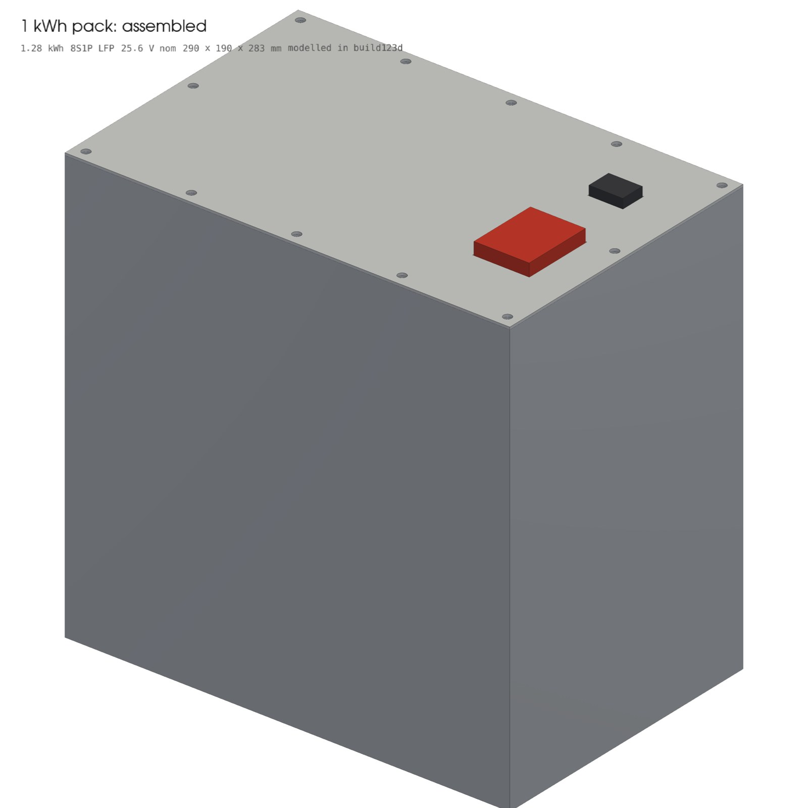 | [**v01** Pack concept](v01-pack-concept/README.md) | LF50K 8S1P | 1.28 kWh | Shoebox shell, MJF carrier, electronics above the module | Tower A design brief |
| 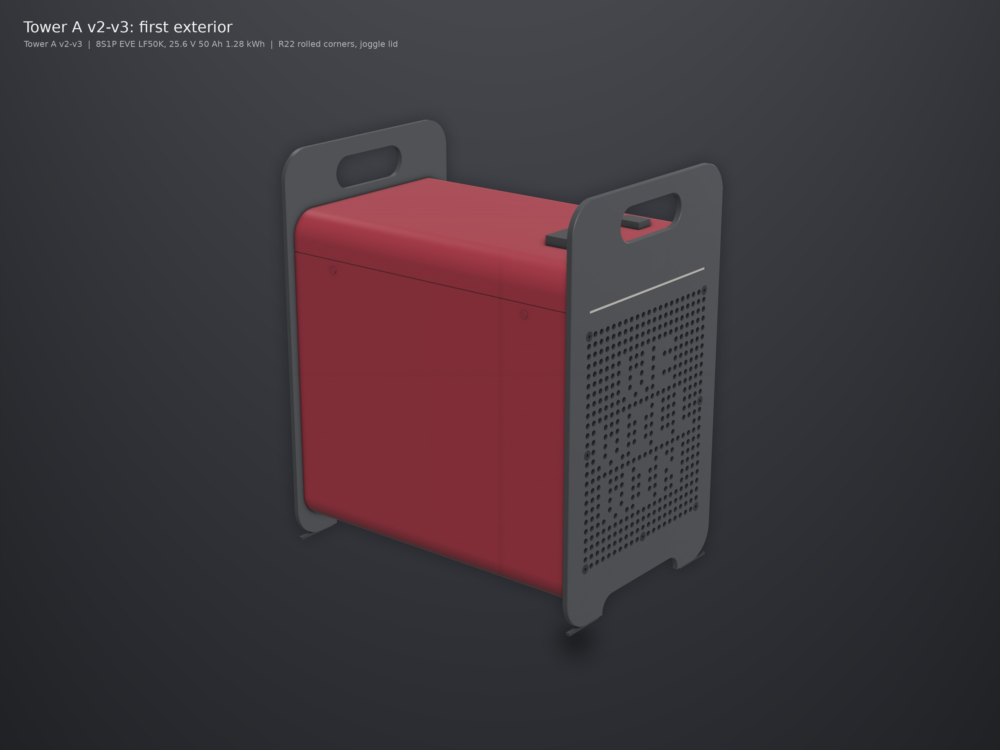 | [**v02–v03** Tower A](v02-v03-tower/README.md) | LF50K 8S1P | 1.28 kWh | U-body, structural end plates with handles, converters on decks | R22 rolled corners and joggle lid can't be made at SendCutSend |
| 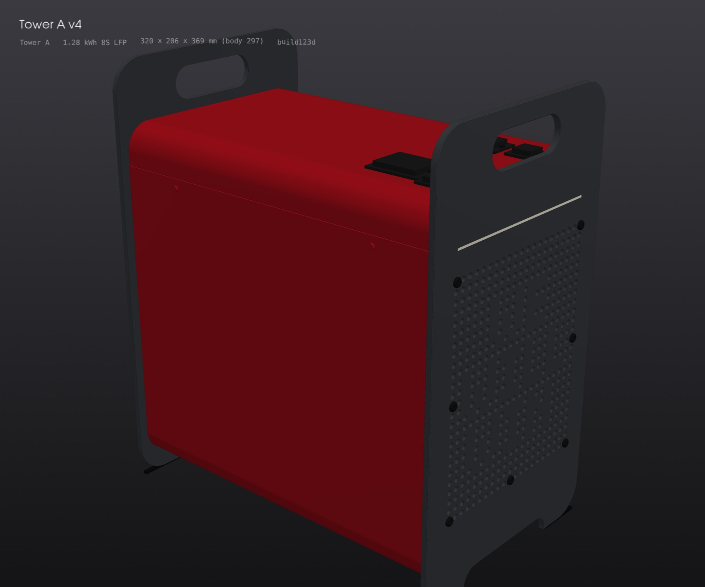 | [**v04** PEM hardware](v04-tower-pem/README.md) | LF50K 8S1P | 1.28 kWh | Clinch nuts, studs, T-slot nuts; full exploded build | Several parts outside SendCutSend's processes |
| 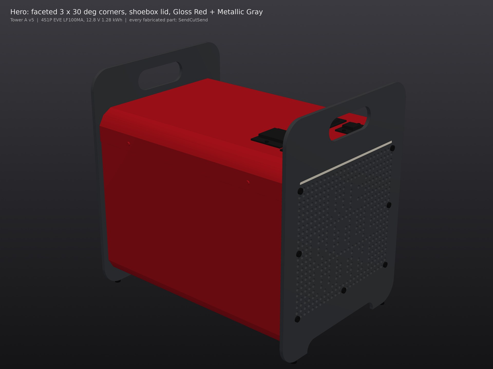 | [**v05** All SendCutSend](v05-scs-lf100/README.md) | LF100MA 4S1P | 1.28 kWh | 3 × 30° bends per corner, L-halves, DXFs, **$1,458 quote** | Too fat (222 mm body) |
| 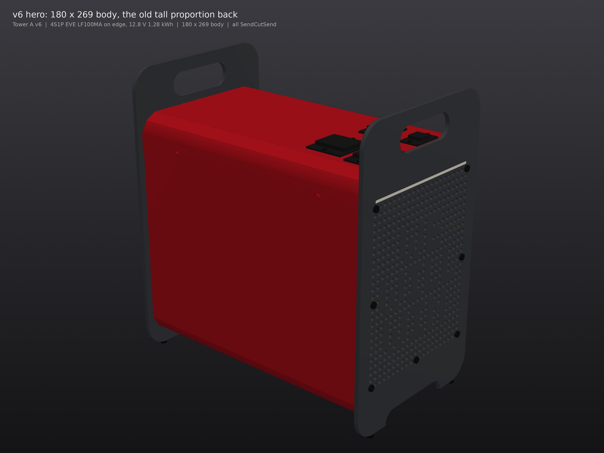 | [**v06** Cells on edge](v06-cells-on-edge/README.md) | LF100MA 4S1P | 1.28 kWh | 180 mm body | Busbars on the side (rejected) |
| 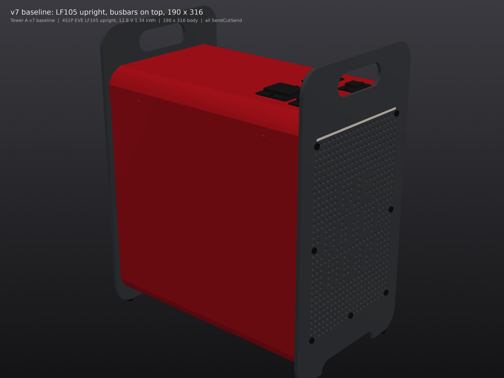 | [**v07** LF105](v07-lf105-4s/README.md) | **LF105** 4S1P | 1.34 kWh | Tall, thin cell: 190 mm body, busbars on top | Dead length in front |
| 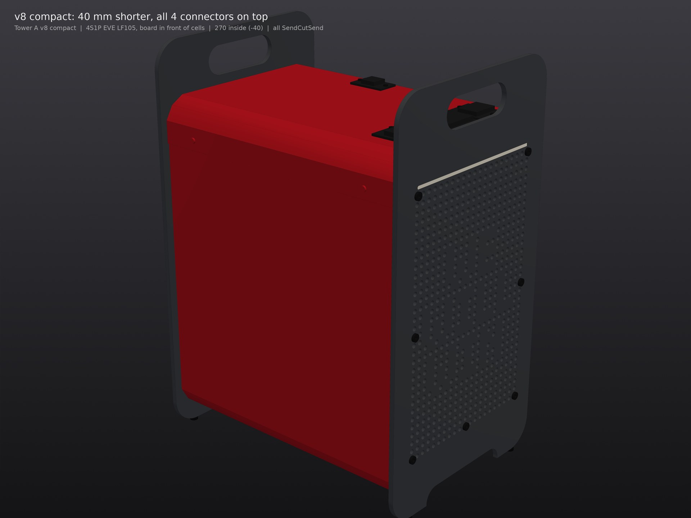 | [**v08** Compact](v08-compact-4s/README.md) | LF105 4S1P | 1.34 kWh | −40 mm length; board upright in front of the cells | Try the inverter in the front bay |
| 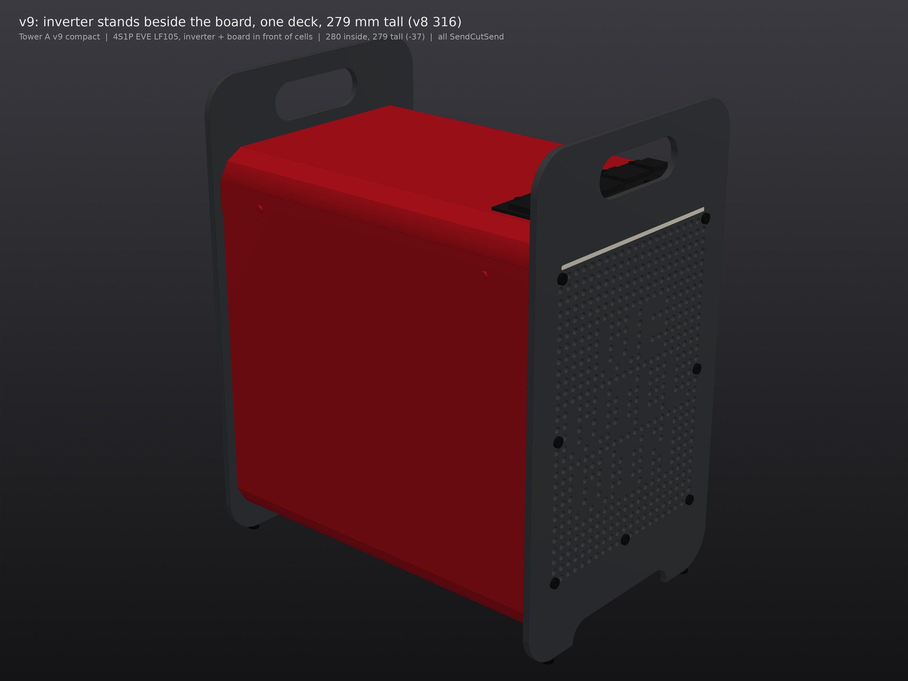 | [**v09** Inverter front bay](v09-inverter-front-bay/README.md) | LF105 4S1P | 1.34 kWh | One deck, −37 mm height, 16.4 kg; `module_renders/` | 8S costs $1.15/Wh vs $1.94/Wh |
| 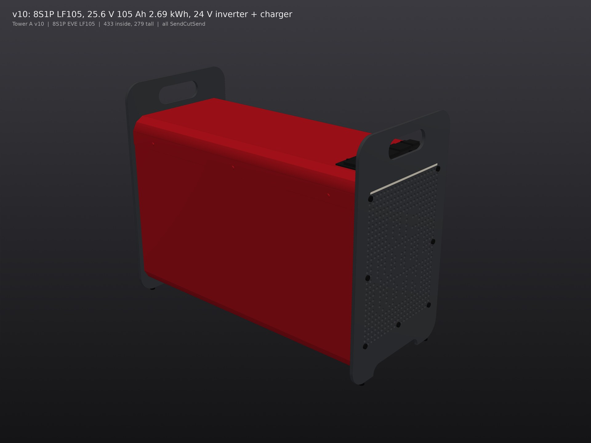 | [**v10** 8S, 24 V](v10-8s-inverter-front-bay/README.md) | LF105 **8S1P** | **2.69 kWh** | 24 V gear, ½ the current of 4S2P | Wanted the converters on top |
| 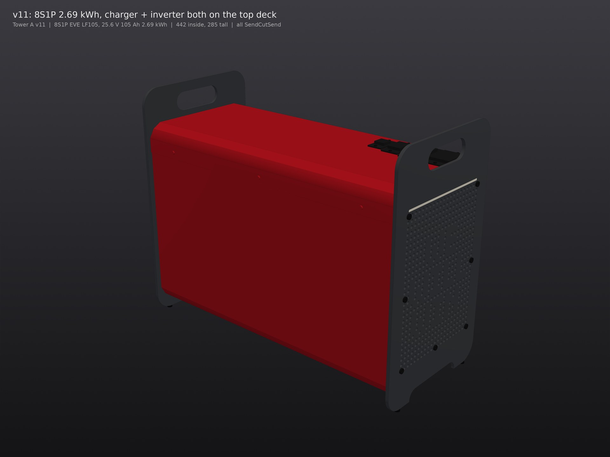 | [**v11** Single deck](v11-8s-single-deck/README.md) | LF105 8S1P | 2.69 kWh | Converters end to end; 6 mm device standoffs | 77 mm longer than stacked |
|  | [**v12** Stacked + board on deck](v12-8s-stacked-board-on-deck/README.md) | LF105 8S1P | 2.69 kWh | Final architecture, 379 mm long, 26.2 kg | Review: strap U-rule, rod heights, lid lead-in |
| 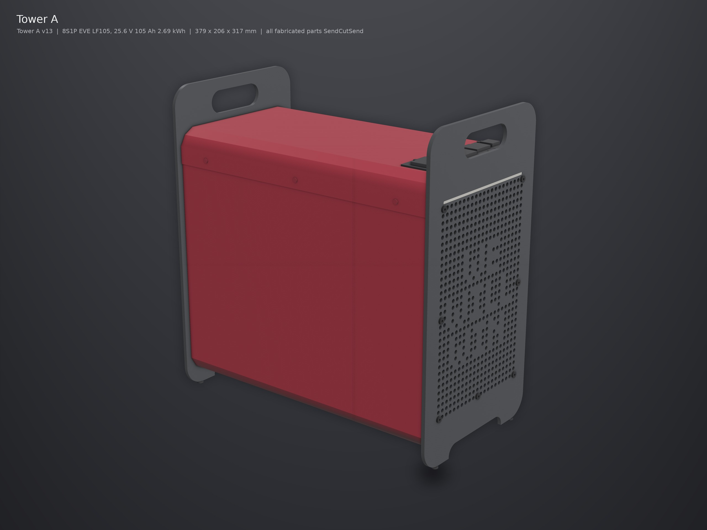 | [**v13** Current](v13-lip-rods-zstraps/README.md) | LF105 8S1P | 2.69 kWh | Lead-in lip, rods at 0.207 / 0.793 h, Z-straps | — |

## How the design converged

```
v01 concept ──► v02–v04 Tower A form ──► v05 SendCutSend rules ──► v06–v07 cell choice (LF105)
                                                                        │
          v13 review fixes ◄── v12 stacked converters ◄── v10–v11 8S layout ◄── v08–v09 compaction
```

Supporting docs:
- [`docs/control-board-electrical.md`](../docs/control-board-electrical.md): dual-mode electrical architecture.
- [`docs/v14-design-notes.md`](../docs/v14-design-notes.md): baselined decisions for the next version (sense flex mount, floating pack, IMD, converter isolation).
- [`docs/v14-design-review.md`](../docs/v14-design-review.md): full pre-CAD audit of v13 (7 critical, 9 major findings, 3 owner decisions).
- [`docs/tesla-shunt.md`](../docs/tesla-shunt.md): Tesla shunt integration (single source of truth).
- [`docs/telemetry-ideas.md`](../docs/telemetry-ideas.md): running telemetry list and dashboard plan.
- [`docs/blog-notes.md`](../docs/blog-notes.md): running notes for the project blog post.
- [`docs/mechanical-v13.md`](../docs/mechanical-v13.md): v13 change notes.
