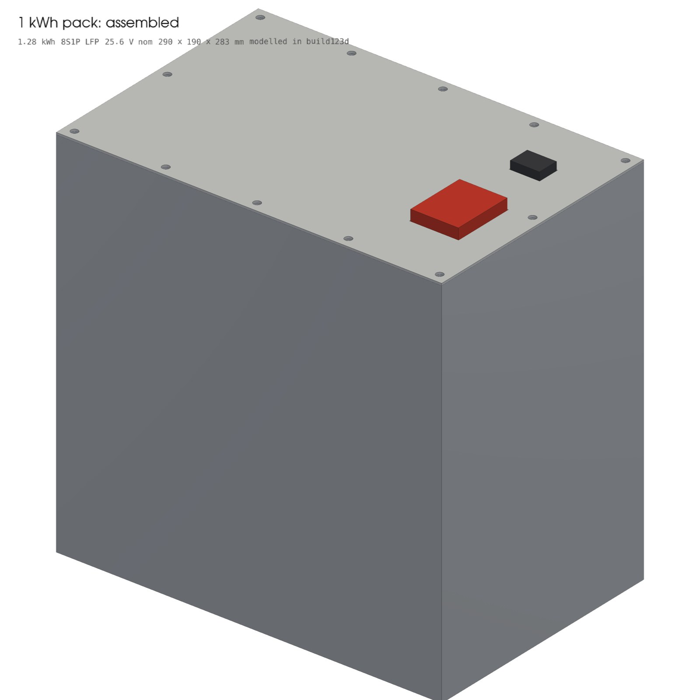
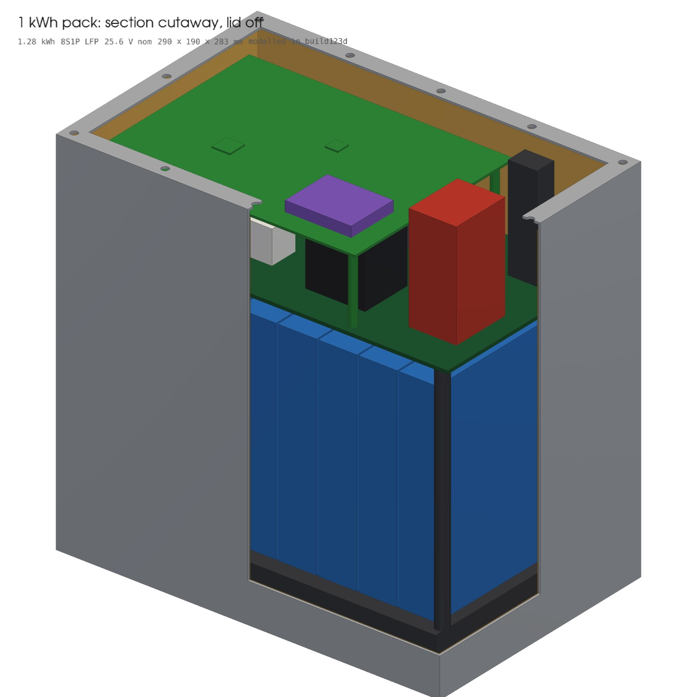
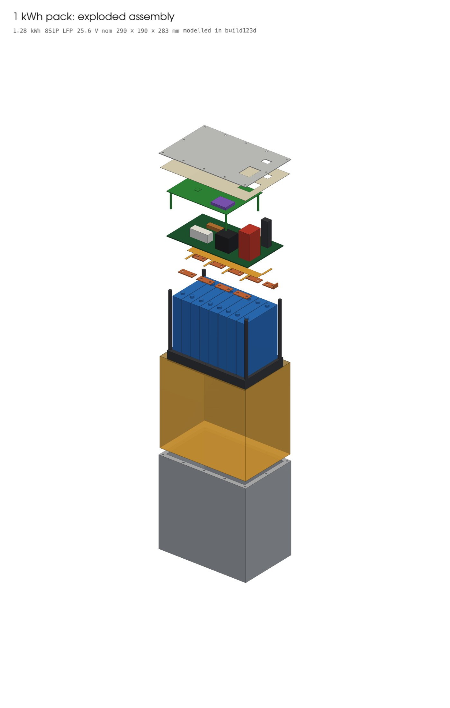
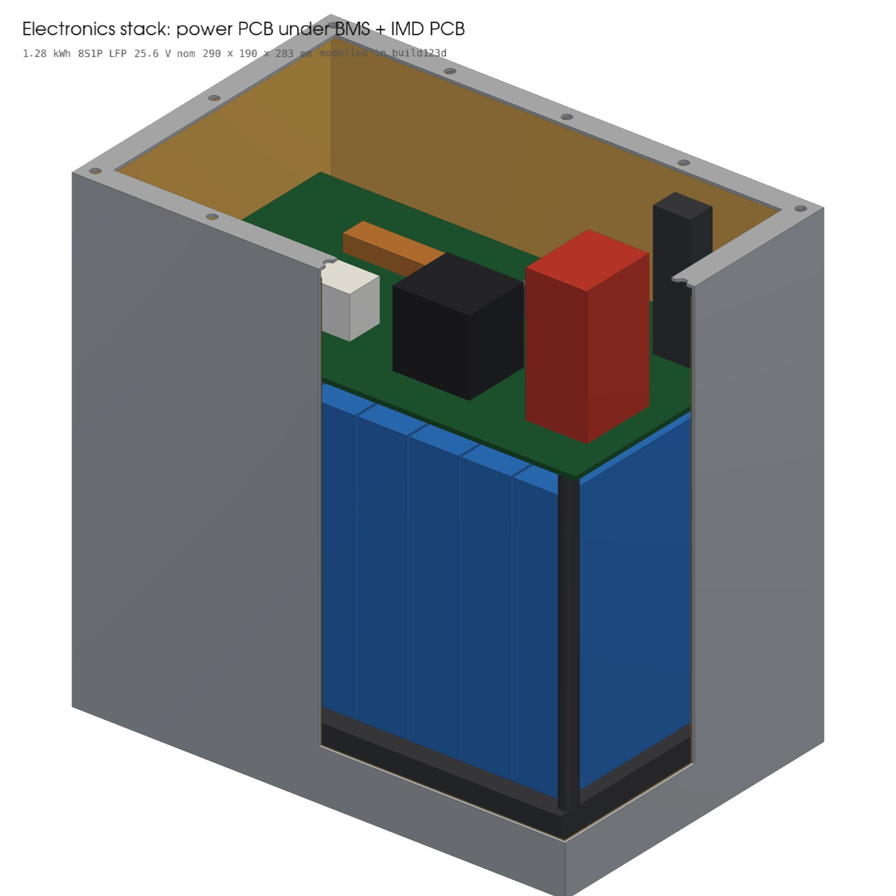
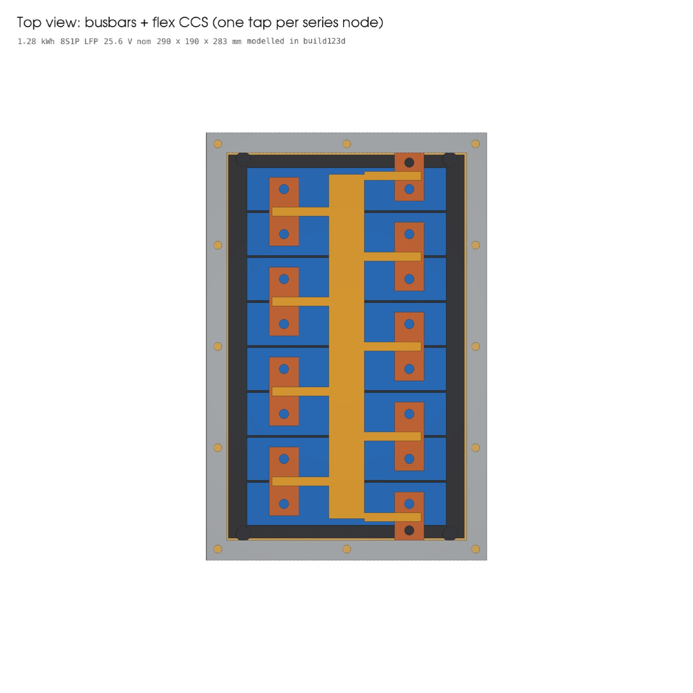

# v01 · Pack concept

> **First complete stack:** eight prismatic LFP cells in a sheet-metal shoebox, with all electronics stacked above the module.

| At a glance | |
|---|---|
| Cells | 8 × EVE LF50K, **8S1P** |
| Pack | 25.6 V nominal · 50 Ah · **1.28 kWh** |
| Envelope | 290 × 190 × 291 mm (16.1 L) |
| Enclosure | 5052 sheet shell + lid, Formex liner, mica barrier |
| Module | MJF PA12 cell carrier, 8 mm 6061 end plates, M5 tie rods, 1 mm insulation sheets |
| Electronics | Power PCB (contactor, fuse, shunt, precharge, output connector), with a BMS + IMD PCB stacked on top |
| CAD | `cad/packmodel.py` (build123d) |

---

## What this version established

This is the baseline. There's no earlier version to compare against, so this section records the decisions that later versions kept or overturned.

| Decision | v01 choice | Fate |
|---|---|---|
| Chemistry | Prismatic LFP | **Kept through v13.** LFP is thermally stable and prismatic cells give the fewest joints per kWh. |
| Electronics placement | Everything *above* the module, nothing beside it | **Kept.** v13 still puts the board and converters on decks above the cells. |
| Compression | End plates with tie rods | **Kept.** The rod heights were finally optimised in v13. |
| Cell carrier | MJF PA12 3D-printed carrier | Dropped in v05: not a SendCutSend process. |
| Shell form | Shoebox | Replaced by the tower form in v02. |

## Energy check

$$E = N_s \cdot V_\text{nom} \cdot C = 8 \times 3.2 \times 50 = 1280\ \text{Wh}$$

- $E$ = pack energy [Wh]
- $N_s$ = cells in series [–]
- $V_\text{nom}$ = cell nominal voltage, 3.2 V for LFP [V]
- $C$ = cell capacity [Ah]

1.28 kWh meets the 1 kWh requirement with a 28 % margin.

## Gallery

| | |
|---|---|
|  |  |
| Cutaway: carrier, cells, busbars, PCB stack | Exploded stack |
|  |  |
| Power PCB and BMS PCB above the module | Top view |

## Why it moved on

The project goal shifted from "a box that works" to the **tower** design brief: end plates that double as handles and feet, plus a recognisable silhouette. v02 kept this internal stack unchanged and wrapped the new exterior around it.

---
[Version index](../README.md) · next → [v02–v03](../v02-v03-tower/README.md)
