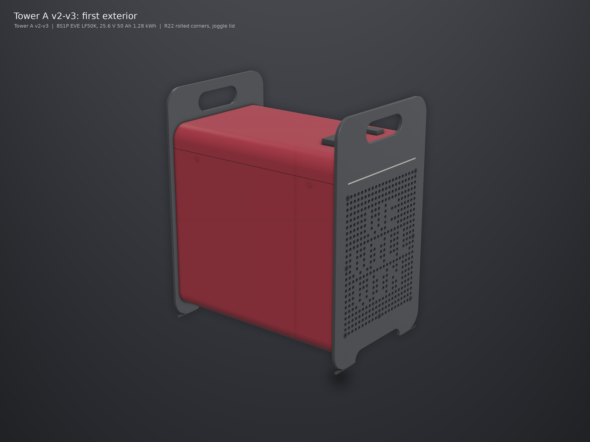
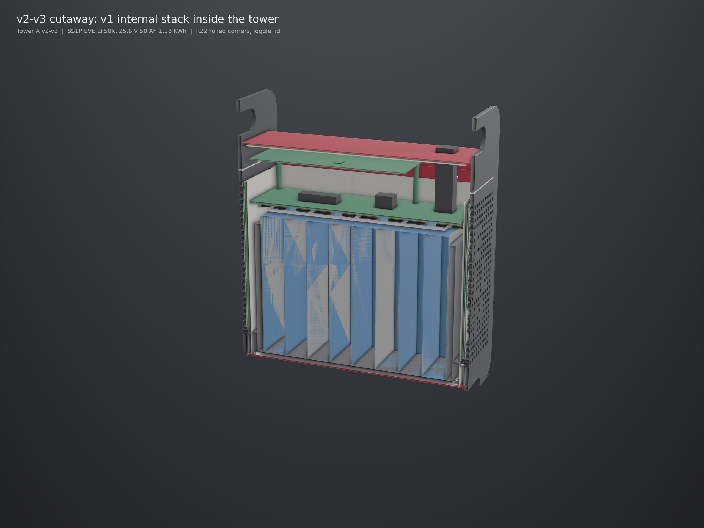

# v02–v03 · Tower exterior

> **The design gets its identity:** a red U-body between two aluminium end plates that act as both handles and feet. v03 adds the 120 V charger and inverter on decks above the cells.

| At a glance | v02 | v03 |
|---|---|---|
| Cells | 8 × EVE LF50K, 8S1P, 1.28 kWh | same |
| Envelope | 300 × 206 × 349 mm | 324 × 206 × 369 mm |
| Body | 1.6 mm 5052 U, **R22 rolled corners** | same |
| End plates | 5 mm 6061 with handle cut-outs and feet | same |
| Lid | 1.6 mm 5052, **1.7 mm joggle lip, 12 mm deep**, nests inside the U | same |
| Power conversion | — | MEAN WELL **NPB-450-24** charger on tray 1, **NTS-400P-124** 400 W inverter on tray 2 |
| CAD | `cad/tower.py` | `cad/tower2.py` |

---

## What changed from v01

| Aspect | v01 | v02–v03 |
|---|---|---|
| Exterior | Shoebox shell | U-body plus two structural end plates (tower form) |
| Carrying | None | Handle slots in both end plates, 52 mm above the body |
| Standing | Shell floor | End-plate feet, 18 mm below the body |
| Lid joint | Flanged lid | Joggle lip that sits flush inside the U |
| Front plate | — | LED status matrix and light pipe |
| Rear plate | — | Vent hole grid |
| Mains I/O | — | Charger, inverter and lid panel connectors (v03) |

## Why

- **The end plates carry the loads.** A 13 kg pack lifted by its handles loads the 5 mm plates directly, so the thin sheet body only has to close the box.
- **One cooling path.** Air comes in through the rear grid and leaves through the front, past both converters.
- **Converters stacked vertically (v03).** The charger is 205 × 135 mm and the inverter 186 × 100.5 mm. Both are wider than half the 190 mm body, so they can't sit side by side. Stacking them keeps the length set by the cells. v12/v13 come back to this layout for the same reason.

## Vertical budget (v03)

$$z_\text{tray1} = z_\text{cell top} + t_\text{G10} + h_\text{standoff},\qquad z_\text{tray2} = z_\text{tray1} + t_\text{tray} + h_\text{chg} + 1.8$$

- $z$ = height above the body floor [mm]
- $t_\text{G10}$ = top-plate thickness, 3.175 mm [mm]
- $h_\text{standoff}$ = upper standoff, 9 mm [mm]
- $t_\text{tray}$ = 1.6 mm [mm]
- $h_\text{chg}$ = charger height, 55 mm [mm]
- 1.8 = clearance gap [mm]

## Gallery

| | |
|---|---|
|  | The v01 internal stack inside the Tower shell. The STEP for this stage is `tower_a_assembly.step`. |

## Why it moved on

The R22 rolled corners and the 1.7 mm joggle lip **can't be made at SendCutSend**:
- They don't roll form.
- Their minimum joggle in 0.063" 5052 is 0.324" (8.2 mm).

The MJF carrier is also outside SendCutSend. v04 refined the hardware first, then v05 rebuilt everything to SendCutSend rules.

---
← [v01](../v01-pack-concept/README.md) · [index](../README.md) · next → [v04](../v04-tower-pem/README.md)
