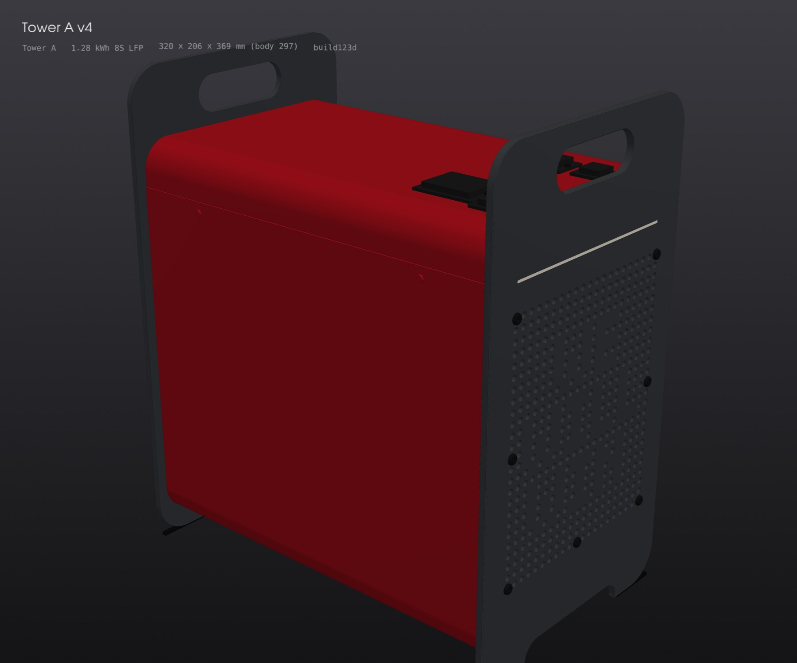
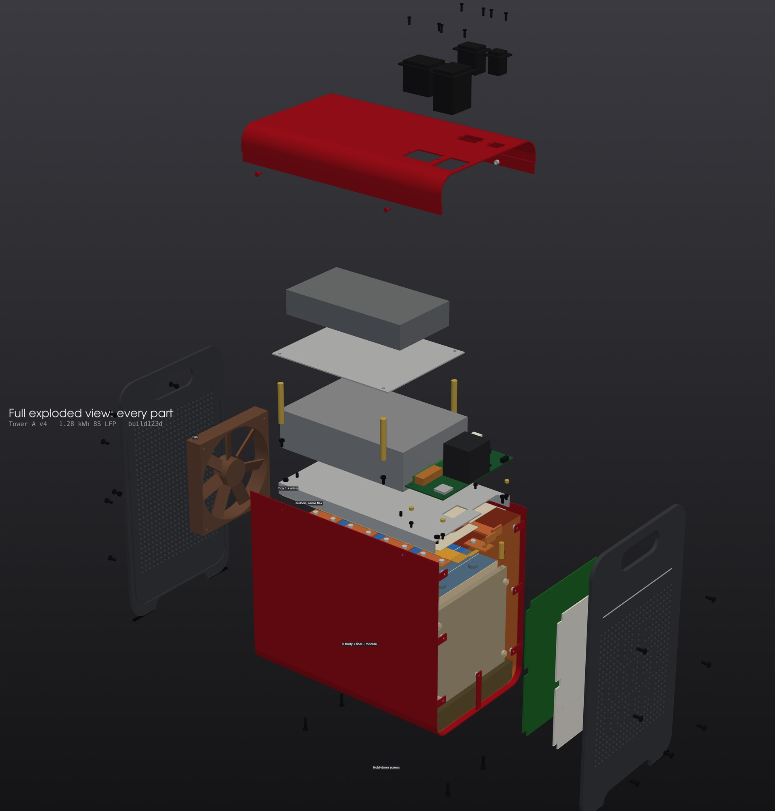
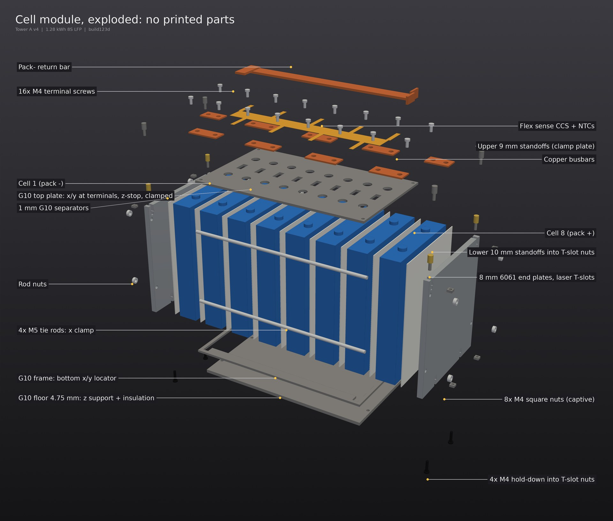
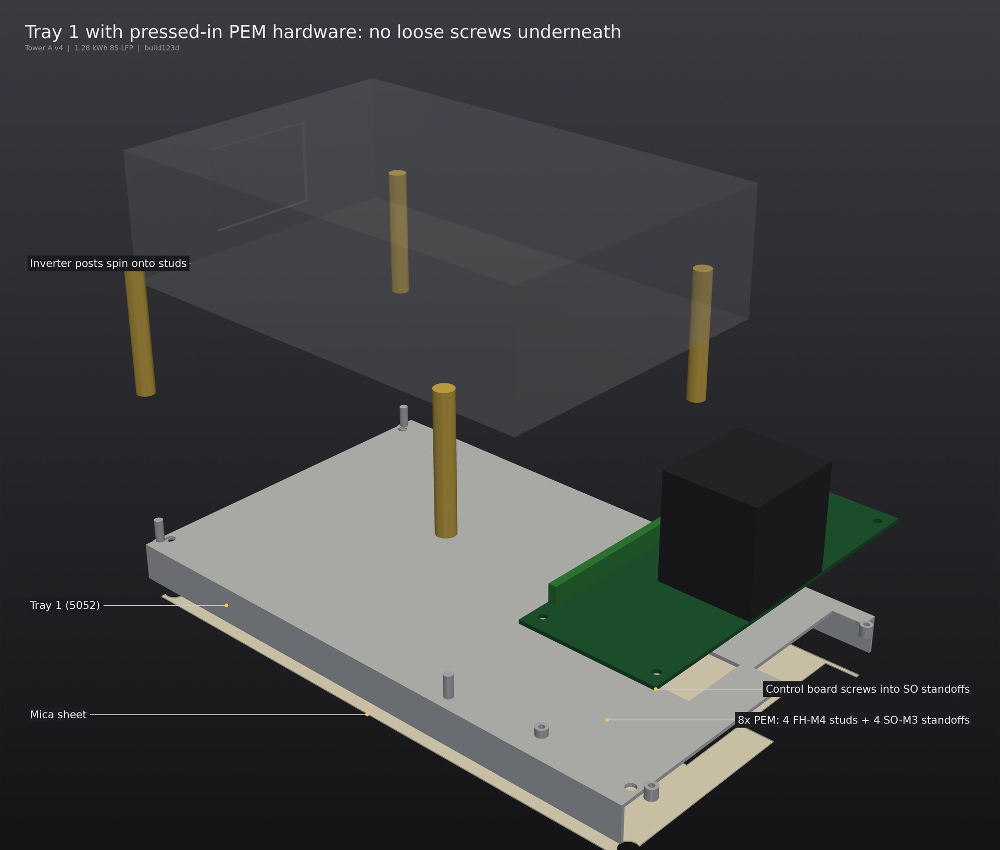
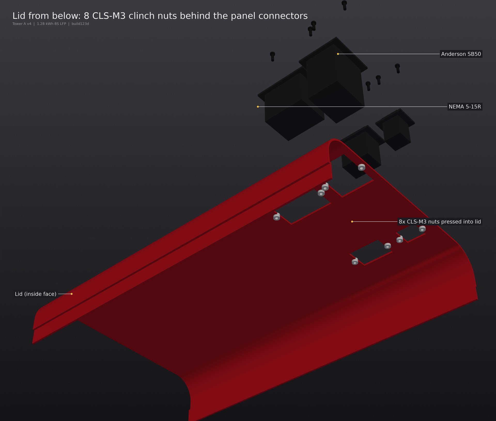
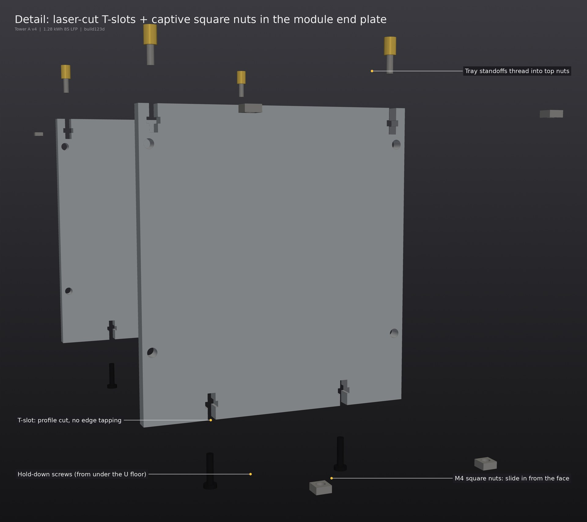
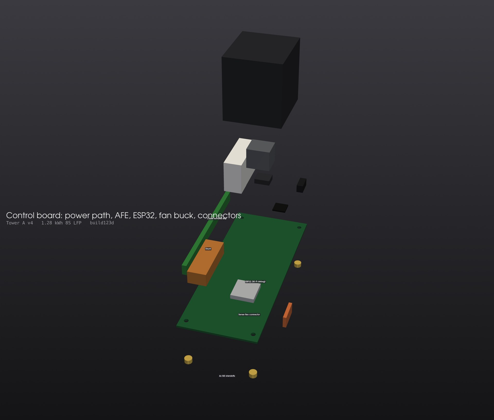
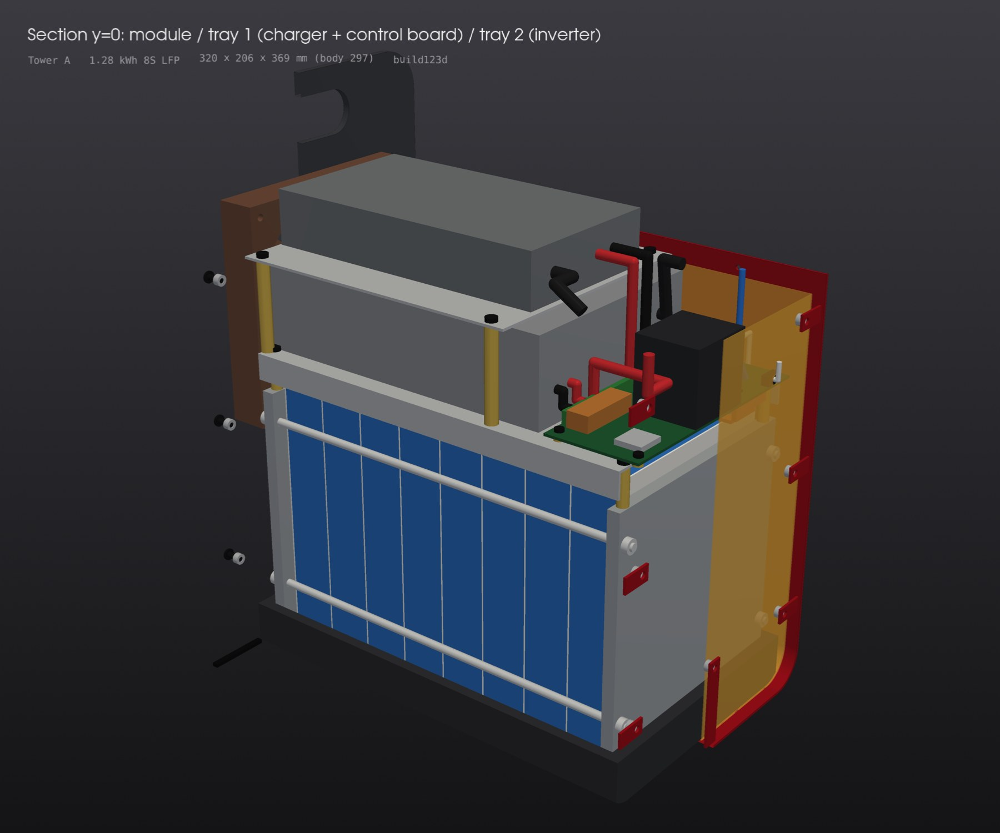
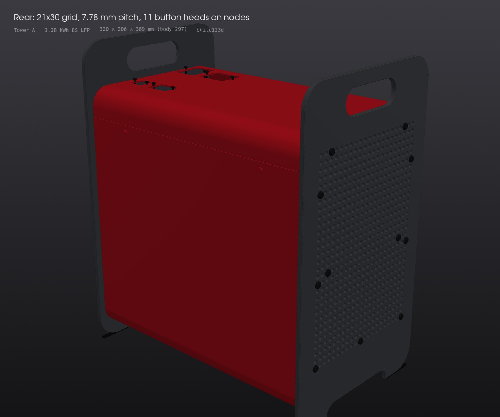

# v04 · PEM hardware and a full exploded build

> **Designing for assembly:** every loose nut is replaced by press-in (PEM) hardware, and the build is documented as a sequence of exploded views.

| At a glance | |
|---|---|
| Cells | 8 × EVE LF50K, 8S1P, 1.28 kWh |
| Envelope | 324 × 206 × 369 mm |
| Fasteners | PEM clinch nuts in the lid lip and tray 1, threaded tabs, T-slot nuts in the module frame |
| Electronics | Charger on tray 1, inverter on tray 2, single control board at the front |
| STEP | `out_tower2/tower_a_v4_assembly.step` (not in the repo; regenerate with `cad/run_tower2.py`) |

---

## What changed from v03

| Aspect | v03 | v04 |
|---|---|---|
| Lid fixing | Screws into loose nuts | M3 PEM nuts pressed into the lid lip |
| Tray fixing | Loose hardware | PEM studs and standoffs in tray 1 |
| Module frame | Through-bolts | T-slot nuts held captive in the G10 frame |
| Documentation | A few renders | 27 views: enclosure, module, electronics, wiring and lid connectors, each exploded |

## Why

The governing requirement is **"assembly at most about a night of wrench work"**:
- A loose nut needs a second tool and a second hand.
- A PEM nut is pressed in by the fabricator and needs only one driver.
- T-slot nuts let the module frame go together flat on a bench, with no access to the back side.

## Gallery

| | |
|---|---|
|  |  |
| Full exploded assembly | Cell module exploded |
|  |  |
| Tray 1 PEM hardware | Lid PEM nuts from below |
|  |  |
| T-slot nut detail | Control board |
|  |  |
| Cutaway | Rear vent |

## Why it moved on

The fabrication review found several parts that **SendCutSend can't make**:
- the R22 rolled corners (no roll forming);
- the 1.7 mm joggle lip (their minimum joggle is 8.2 mm);
- the MJF PA12 carrier (not a SendCutSend process).

v05 rebuilt the whole enclosure to SendCutSend's published rules.

---
← [v02–v03](../v02-v03-tower/README.md) · [index](../README.md) · next → [v05](../v05-scs-lf100/README.md)
