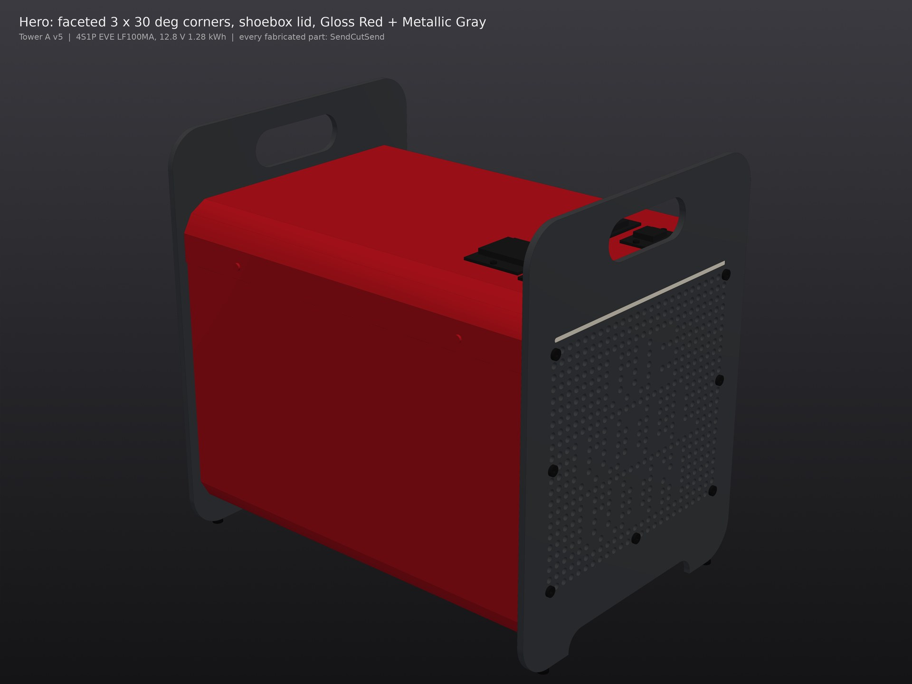
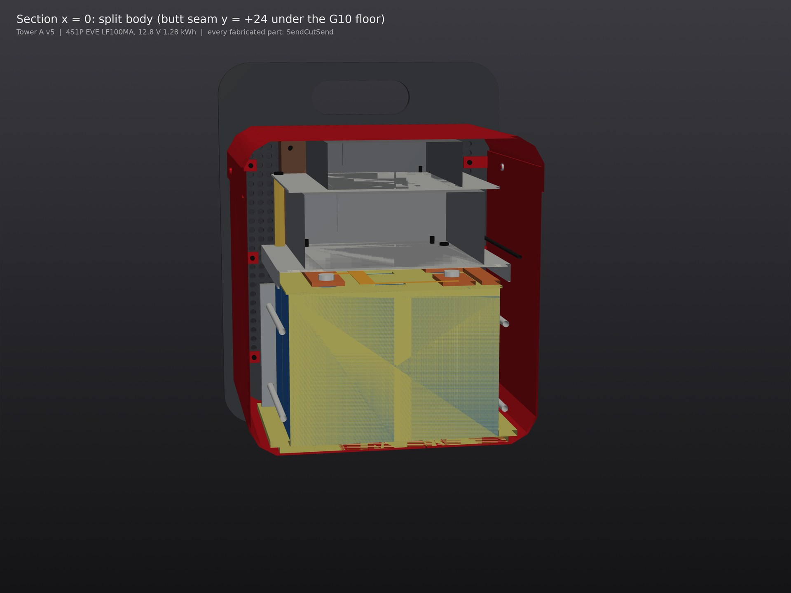
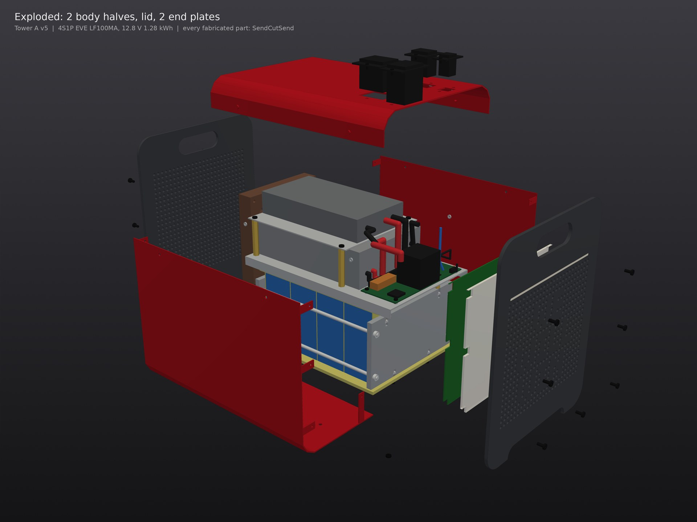
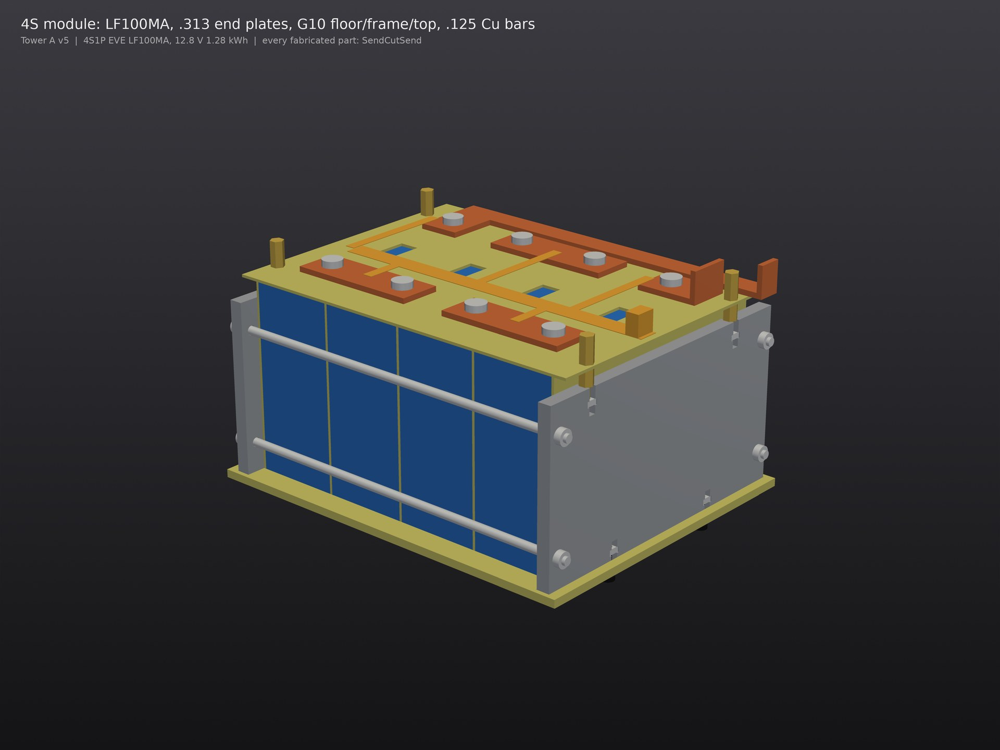
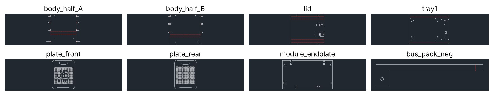
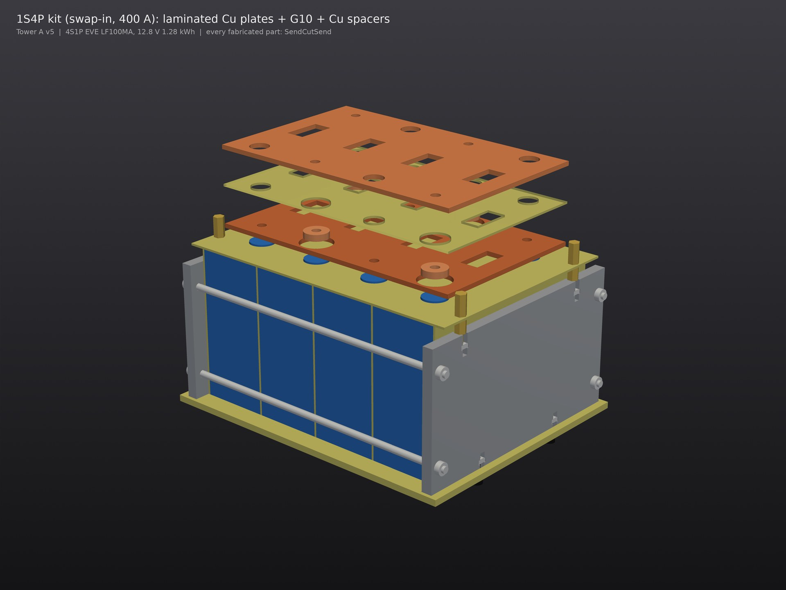
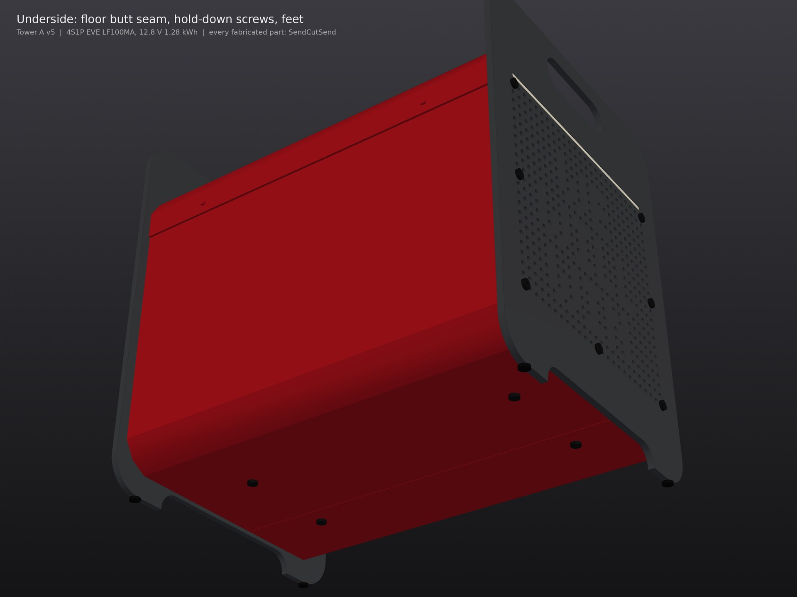

# v05 · Every part SendCutSend-manufacturable

> **The fabrication reset.** The enclosure is redesigned around SendCutSend's published bending and cutting rules, the flat patterns are generated, and a real cart is priced: **$1,458.18**.

| At a glance | |
|---|---|
| Cells | 4 × EVE **LF100MA** (160 W × 50.1 T × 118.5 H mm), **4S1P** |
| Pack | 12.8 V · 100 Ah · **1.28 kWh** |
| Envelope | 324 × 238 × 308 mm (body W 222, body H 236) |
| Parts | 74 in CAD; 17 line items in the SendCutSend cart |
| Electronics | 12 V MEAN WELL NPB-450-12 / NTS-400P-112 |
| CAD | `cad/tower5.py`, flats `cad/flats5.py` → `scs_dxf/` |

---

## What changed from v04

| Aspect | v04 | v05 | Rule that forced it |
|---|---|---|---|
| Body corners | R22 rolled | **3 × 30° press-brake bends per corner** | No roll or bump forming |
| Body | One-piece U | **Two L-halves**, floor butt seam at y = +24 | U-channel base ≥ 2 × flange |
| Lid | 1.7 mm joggle lip inside the U | **Shoebox lid over the body**, 42 mm skirt | Minimum joggle 0.324" (8.2 mm) |
| Cell carrier | MJF PA12 | G10 floor, frame and spacers | MJF is not a SendCutSend process |
| Fasteners | Countersunk in places | Button heads only | Countersink edge-distance rule |
| Lid nuts | PEM nuts 5.5 mm from the edge | Lid height raised 34 → 42 mm | Clinch nut needs ≥ 6 mm to the edge |
| Cells | 8 × LF50K, 8S | 4 × LF100MA, 4S | Same 1.28 kWh with half the cells and joints |

## Calculations

### Corner made from three 30° bends

$$C_\text{nr} = F(\cos 30^\circ + \cos 60^\circ) = 15\,(0.866 + 0.500) = 20.49\ \text{mm}$$

- $C_\text{nr}$ = horizontal (and vertical) extent of the faceted corner, the equivalent of R20.5 [mm]
- $F$ = facet width between bends [mm]

### Flat-pattern bend deduction (5052, 0.063", SendCutSend constants)

$$BA = \theta\,(R + K T),\qquad OSSB = \tan\tfrac{\theta}{2}\,(R + T),\qquad BD = 2\,OSSB - BA$$

- $BA$ = bend allowance [mm]
- $OSSB$ = outside setback [mm]
- $BD$ = bend deduction [mm]
- $\theta$ = bend angle [rad]
- $R$ = inside radius, 0.035" = 0.889 mm [mm]
- $K$ = 0.42 [–]
- $T$ = 1.6 mm [mm]

| θ | BA [mm] | OSSB [mm] | BD [mm] |
|---|---|---|---|
| 30° | 0.817 | 0.667 | **0.517** |
| 90° | 2.452 | 2.489 | **2.526** (0.0994", vs SendCutSend's calculator value of 0.096") |

The 90° result matches SendCutSend's own calculator to within 0.0034", which validates the constants used for every flat pattern.

### Why the body had to split

A one-piece U is 222 mm across with 213 mm legs. SendCutSend's rule requires base ≥ 2 × flange, i.e. 222 ≥ 426, which is false. Each L-half has only one long flange, so it passes.

## SendCutSend cart (2026-11-22)

| Part | Material | Total [$] |
|---|---|---|
| Body half A / B | 5052 .063, Gloss Red | 148.43 / 130.38 |
| Lid | 5052 .063, Gloss Red | 115.11 |
| Front / rear plate | 6061 .187, Metallic Grey (459 / 625 holes) | 256.74 / 299.48 |
| Tray 1 / tray 2 | 5052 .063 | 58.33 / 22.57 |
| G10 floor / frame | G10 .187 | 87.08 / 83.05 |
| Module end plates ×2 | 6061 .313 | 78.58 |
| Copper links ×3, pack− / pack+ straps | Cu .125 | 45.18 + 55.22 + 27.42 |
| Diffuser, light pipe, mylar, spacers | acrylic, mylar | 50.61 |
| **Cart total** | | **1,458.18** |

Full CSV: [`SCS_quote_2026-11-22.csv`](SCS_quote_2026-11-22.csv). DXFs and the DFM report are in [`scs_dxf/`](scs_dxf/).

The two perforated end plates are 38 % of the cost. Switching them to 5052 .125 would save about $150.

## Gallery

| | |
|---|---|
|  |  |
| Section | Exploded |
|  |  |
| Module; tie rods at z 28 / 94 suit the 118.5 mm cell | Generated flat patterns |
|  |  |
| Optional 1S4P busbar kit | Underside |

## Why it moved on

**Too fat.** The LF100MA is 160 mm wide, so the body grew to 222 mm and lost the slim tower proportion.

---
← [v04](../v04-tower-pem/README.md) · [index](../README.md) · next → [v06](../v06-cells-on-edge/README.md)
