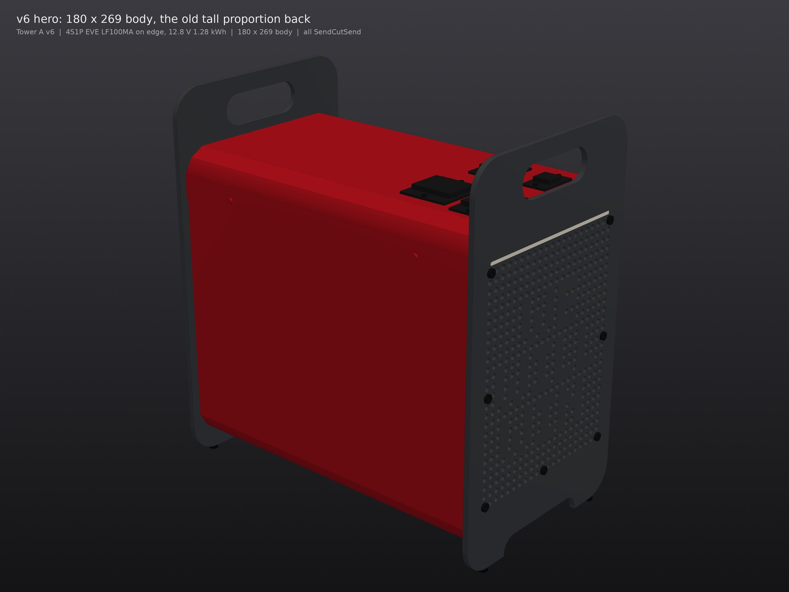
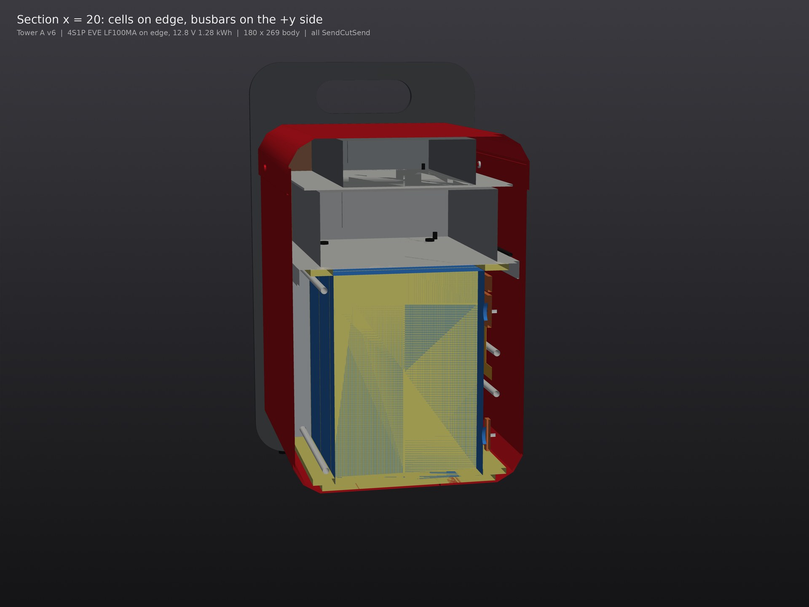
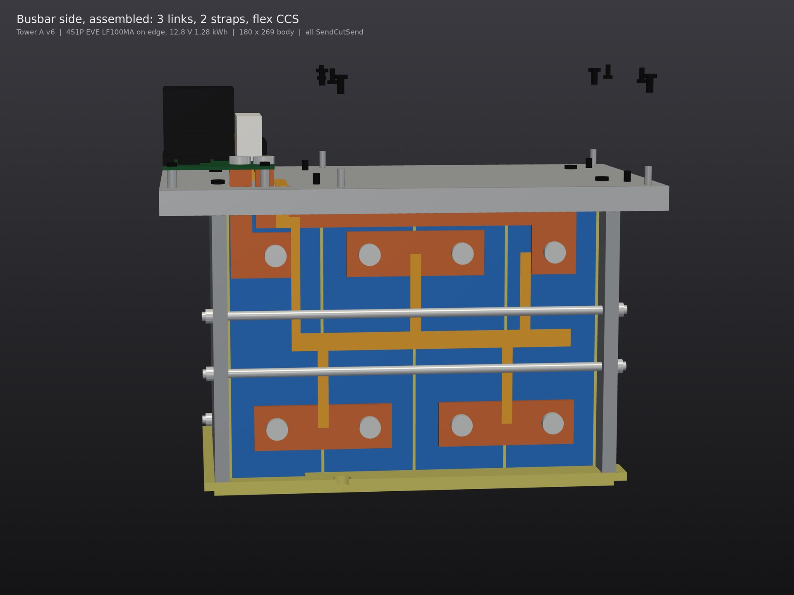
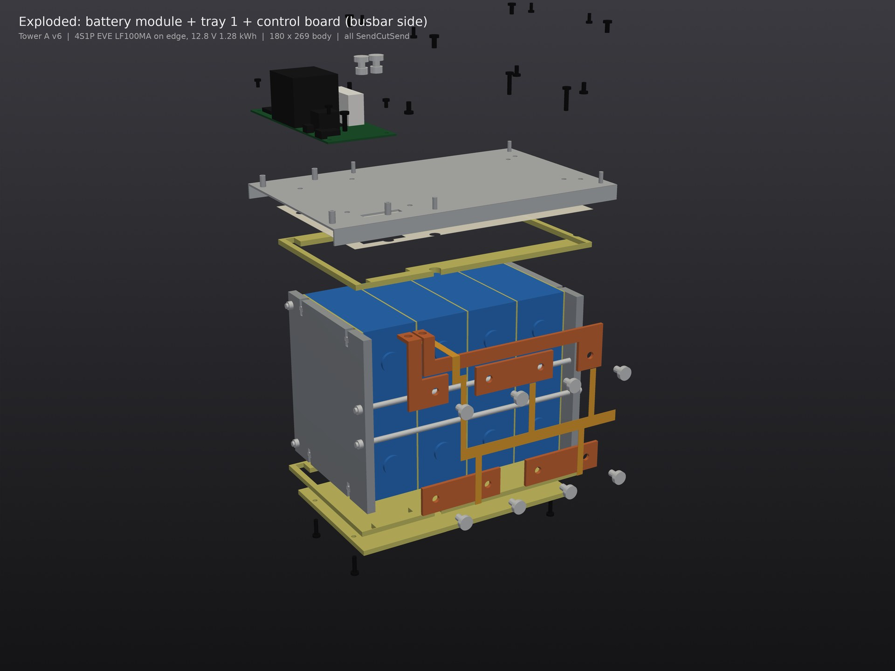
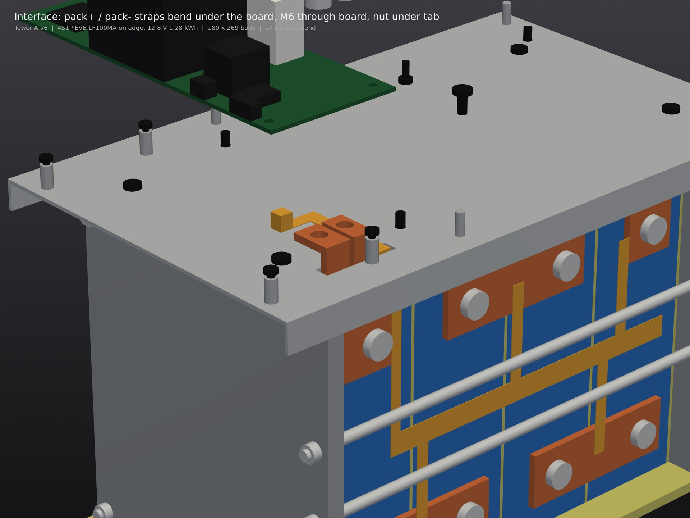

# v06 · Cells on edge (rejected)

> **An attempt to win back the width:** the LF100MA cells are laid on their narrow edge, which takes the body from 222 mm to 180 mm.

| At a glance | |
|---|---|
| Cells | 4 × EVE LF100MA, 4S1P, 1.28 kWh, **lying on edge** with terminals facing the +y wall |
| Envelope | 324 × 196 × 341 mm (body W 180, H 269) |
| CAD | `cad/tower6.py` |

---

## What changed from v05

| Aspect | v05 | v06 |
|---|---|---|
| Cell orientation | Upright: 160 W × 118.5 H | On edge: 160 vertical, 118.5 across the width |
| Body width | 222 mm | **180 mm (−42 mm)** |
| Body height | 236 mm | 269 mm (+33 mm) |
| Busbars | On top | **On the side wall** |

## Width calculation

$$W_\text{body} \approx H_\text{cell} + 2\,(t_\text{wall} + g) + \text{busbar stack}$$

- $W_\text{body}$ = body outer width [mm]
- $H_\text{cell}$ = cell height including terminals, 118.5 mm [mm]
- $t_\text{wall}$ = 1.6 mm [mm]
- $g$ = internal clearance [mm]

This beats the upright layout's $W_\text{cell} = 160$ mm.

## Gallery

| | |
|---|---|
|  |  |
| Section | Busbars on the side wall |
|  |  |
| Exploded module | Board interface |

## Why it was rejected

Owner's decision: **"bus bars belong on top."**
- Side busbars sit against the enclosure wall, so they're harder to inspect and torque.
- They're closer to the grounded shell.
- They put the terminal joints in the plane where a dropped tool lands.

The fix was a different cell, not a different orientation. See v07.

---
← [v05](../v05-scs-lf100/README.md) · [index](../README.md) · next → [v07](../v07-lf105-4s/README.md)
