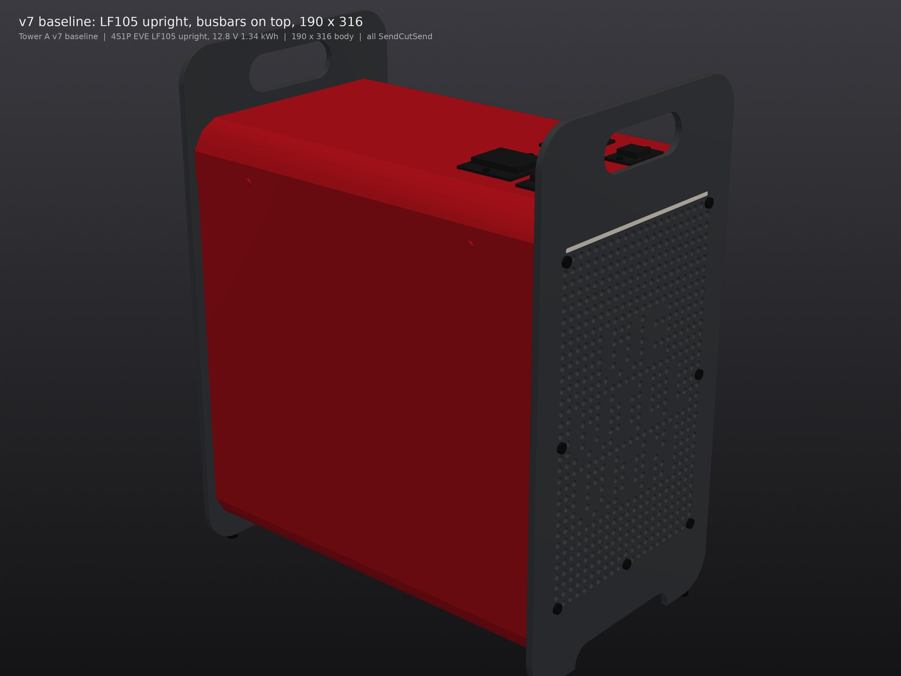
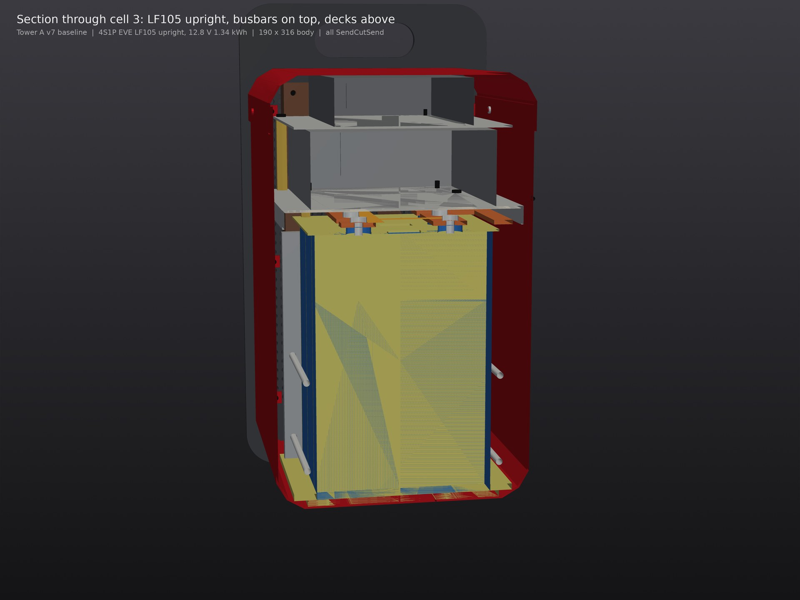
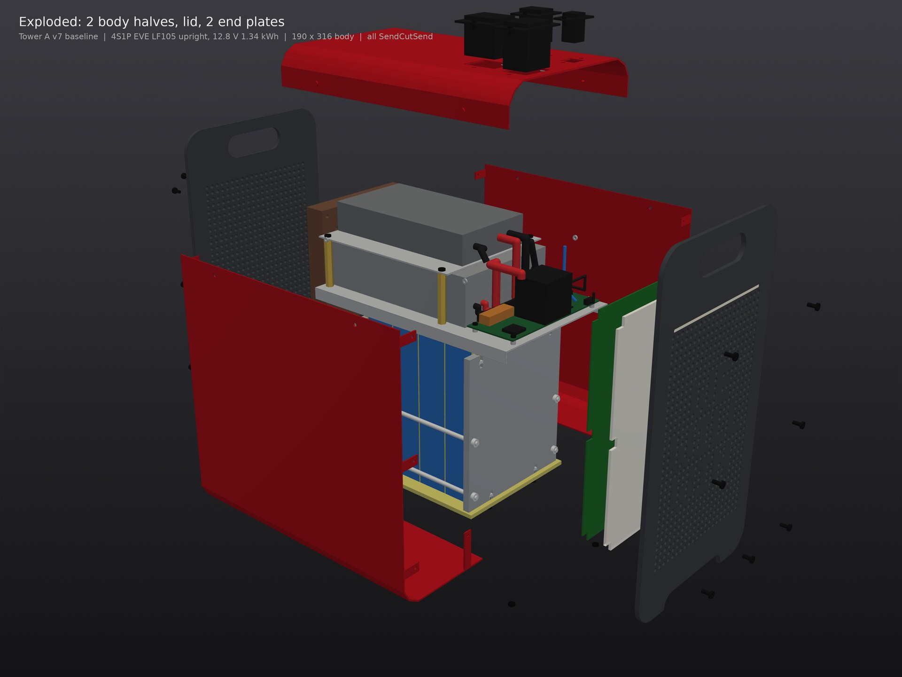
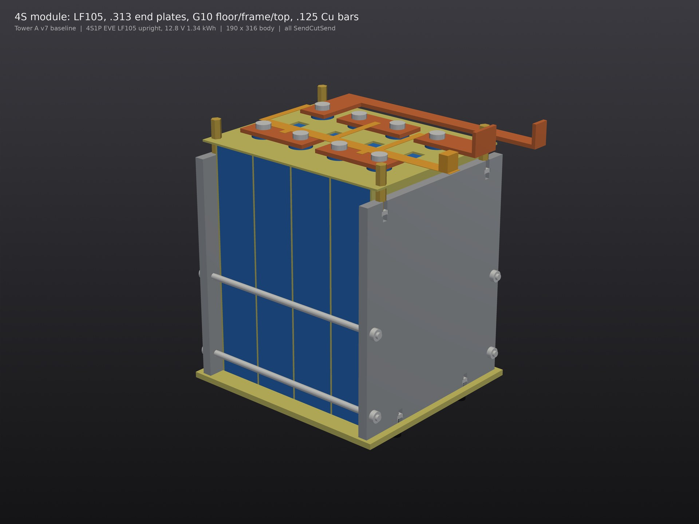
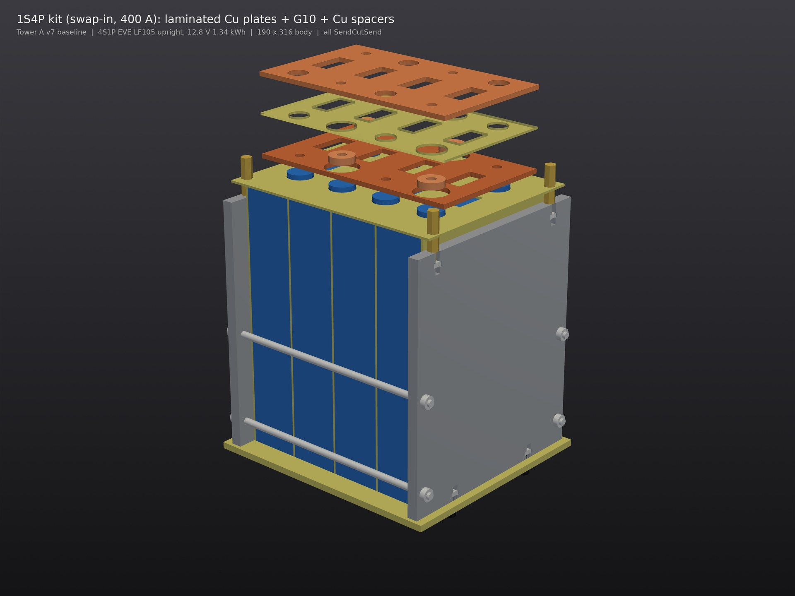

# v07 · EVE LF105: tall, thin, busbars on top

> **Choosing the cell to suit the shape.** The LF105 is tall and thin, so the pack can be narrow *and* keep its busbars on top.

| At a glance | |
|---|---|
| Cells | 4 × **EVE LF105** (130.3 W × 36.7 T × 200.5 H mm, 1.98 kg), **4S1P**, upright |
| Pack | 12.8 V · 105 Ah · **1.344 kWh** |
| Envelope | 324 × 206 × 388 mm (body W 190, H 316) |
| Stack length | 170.7 mm (was 224.3 mm) |
| Sourcing | Full Battery, shipped to a parcel depot in Blaine, WA, and carried across the border |
| CAD | `cad/tower7.py` |

---

## What changed from v06

| Aspect | v06 (LF100MA on edge) | v07 (LF105 upright) |
|---|---|---|
| Cell footprint | 160 × 50.1 mm | **130.3 × 36.7 mm** |
| Body width | 180 mm | 190 mm |
| Busbars | Side wall | **Top** ✓ |
| Stack length (4 cells and end plates) | 224.3 mm | **170.7 mm (−24 %)** |
| Energy | 1.28 kWh | 1.344 kWh (+5 %) |

## Why LF105

| Requirement | LF100MA | LF105 |
|---|---|---|
| Busbars on top *and* body ≤ 190 mm | ✗ (160 mm wide, so 222 mm body) | ✓ (130 mm wide, so 190 mm body) |
| Tall, narrow tower proportion | ✗ | ✓ (200 mm tall) |
| Energy per cell | 320 Wh | 336 Wh |
| Burst rating | — | 3C for 30 s (315 A) |

Width: $W_\text{body} = W_\text{cell} + 2\times 29.85 = 130.3 + 59.7 = 190$ mm. The 29.85 mm per side covers the tie rods at y = ±72, wall clearance and the 1.6 mm wall.

## Known carry-over bug (fixed in v13)

The tie-rod heights z = 28.35 / 94.35 mm were copied from v05, where they suited a **118.5 mm** cell. On the **195.5 mm** LF105 both rows sit in the lower half of the end plate, so the top ~97 mm overhangs unsupported. See [v13](../v13-lip-rods-zstraps/README.md) for the FE analysis: 0.655 mm deflection, against 0.078 mm with the corrected layout.

## Gallery

| | |
|---|---|
|  |  |
| Section | Exploded |
|  |  |
| LF105 module, busbars on top | 1S4P kit |

## Why it moved on

There was empty length in front of the module. v08 tightened the box and gave the control board a dedicated place.

---
← [v06](../v06-cells-on-edge/README.md) · [index](../README.md) · next → [v08](../v08-compact-4s/README.md)
