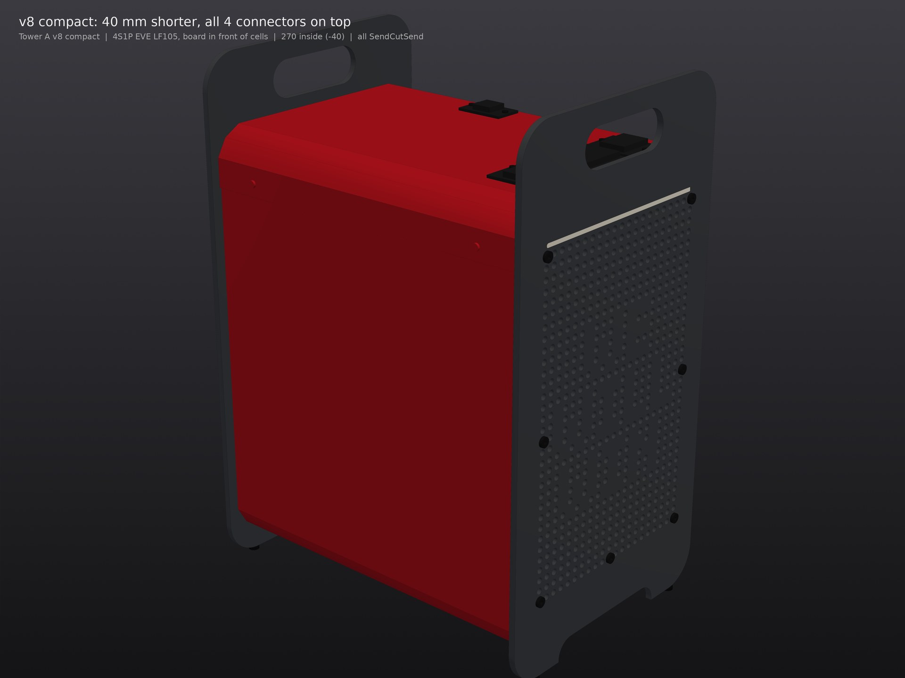
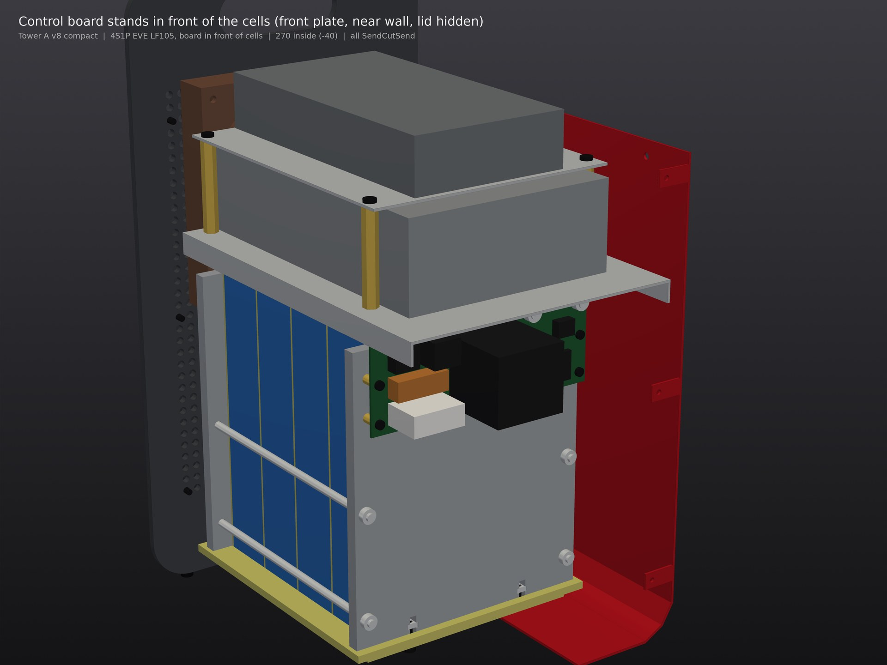
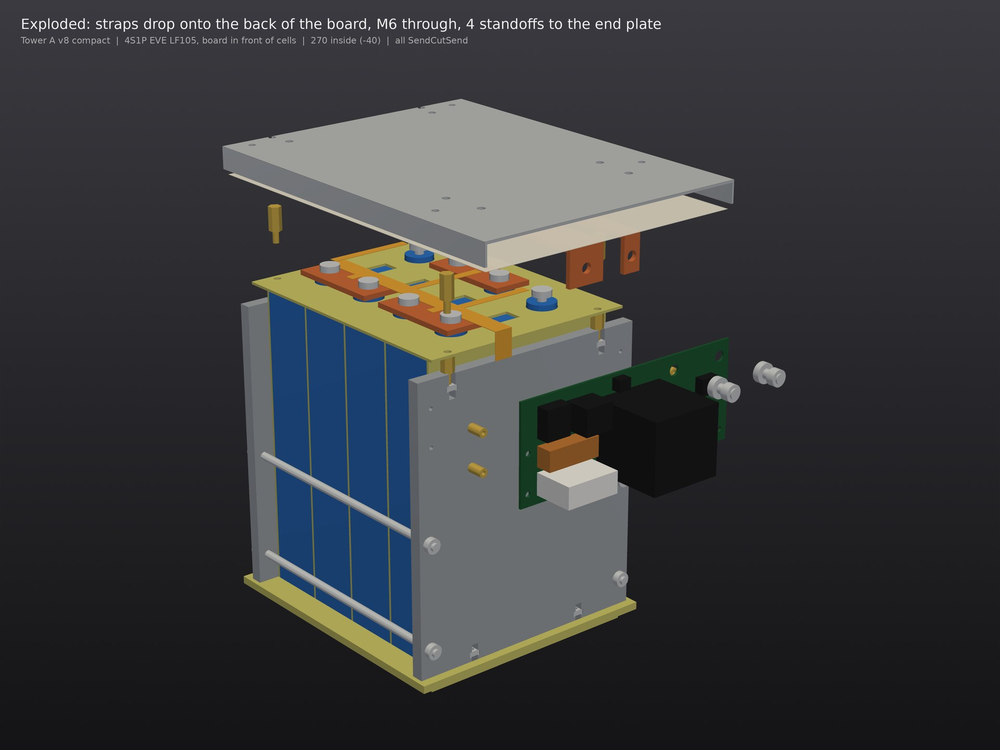
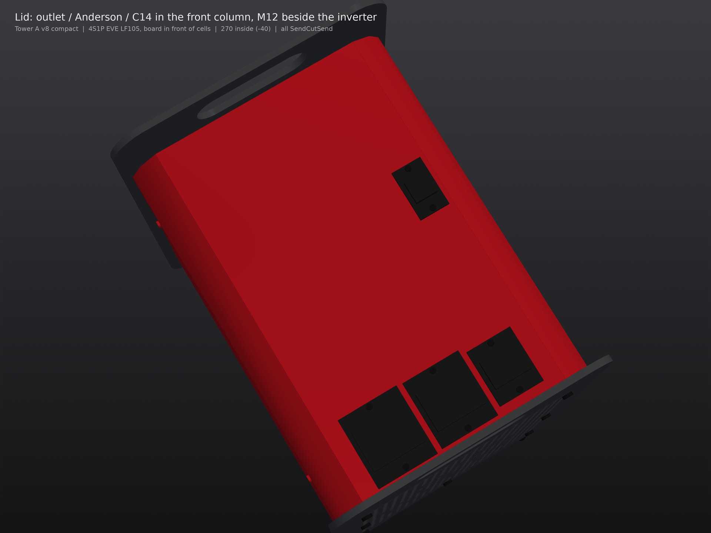
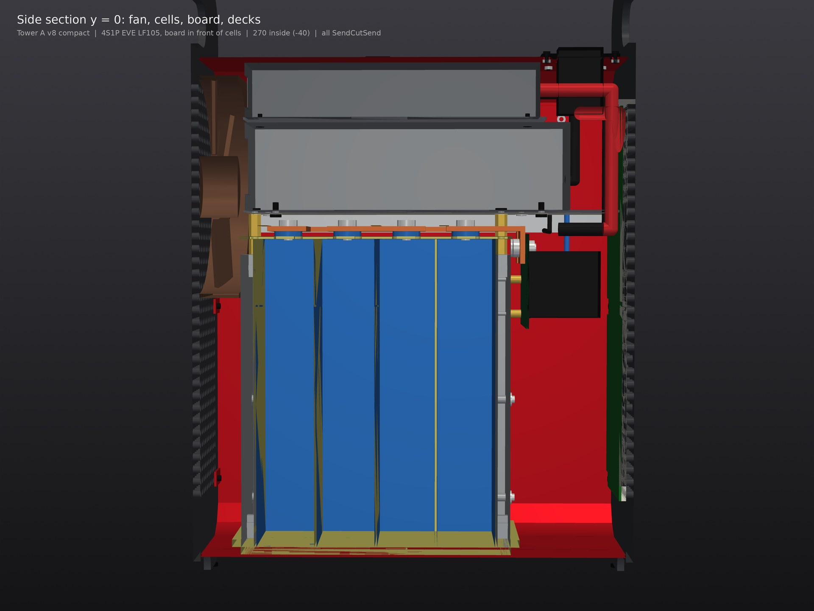

# v08 · Compact 4S

> **Removing dead space.** The module moves forward, the box loses 40 mm of length, and the control board stands upright in front of the cells.

| At a glance | |
|---|---|
| Cells | 4 × EVE LF105, 4S1P, 12.8 V · 105 Ah · 1.344 kWh |
| Envelope | **284** × 206 × 388 mm (body 270 inside) |
| Decks | Charger on tray 1; inverter on tray 2 above it |
| Board | 150 × 60 mm, vertical, on 4 M3 standoffs off the front module end plate |
| Connectors | All 4 in one front column on the lid |
| CAD | `cad/tower8.py` |

---

## What changed from v07

| Aspect | v07 | v08 |
|---|---|---|
| Inside length | 310 mm | **270 mm (−40 mm)** |
| Module position | Centred in the box | Rear-anchored, behind a 25 mm fan bay |
| Control board | On a deck | **Upright in front of the cells** |
| Straps | Flat to the deck | Drop onto the back of the board, M6 through |

## Length budget

$$L_\text{in} = L_\text{stack} + g_\text{fan} + g_\text{front} = 170.7 + 26 + 73.3 = 270\ \text{mm}$$

- $L_\text{in}$ = distance between the inner faces of the end plates [mm]
- $L_\text{stack}$ = cells, spacers and module end plates [mm]
- $g_\text{fan}$ = rear fan bay, including 1 mm clearance [mm]
- $g_\text{front}$ = front bay for the board, components and straps [mm]

## Gallery

| | |
|---|---|
|  |  |
| Board in front of the cells | Straps landing on the board |
|  |  |
| Lid connectors | Side section: two decks |

## Why it moved on

The owner liked the front bay and asked to try the **inverter** there as well (v09).

---
← [v07](../v07-lf105-4s/README.md) · [index](../README.md) · next → [v09](../v09-inverter-front-bay/README.md)
