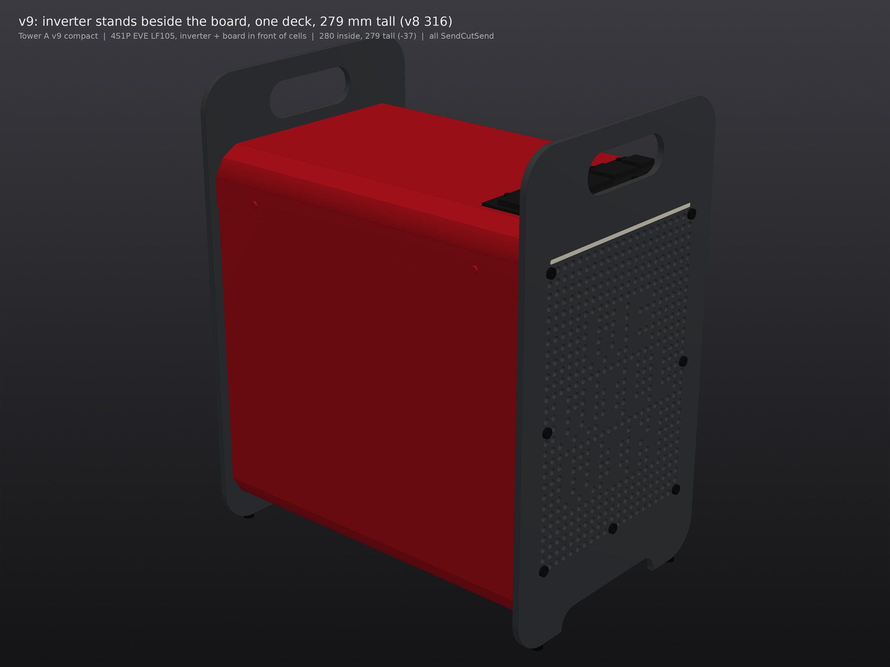
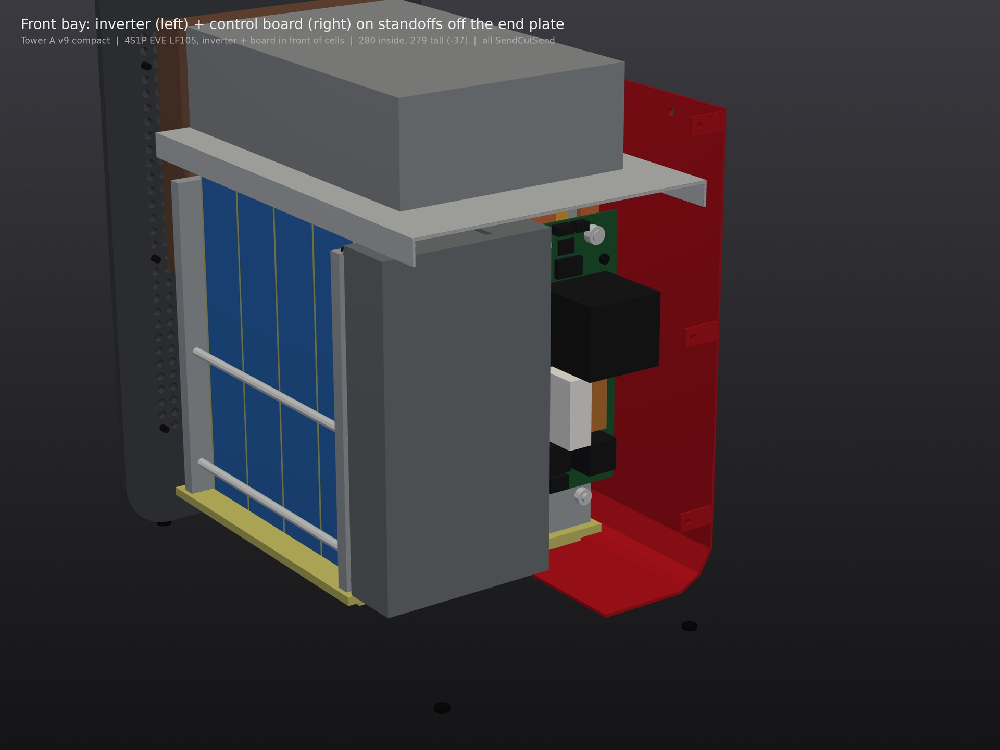
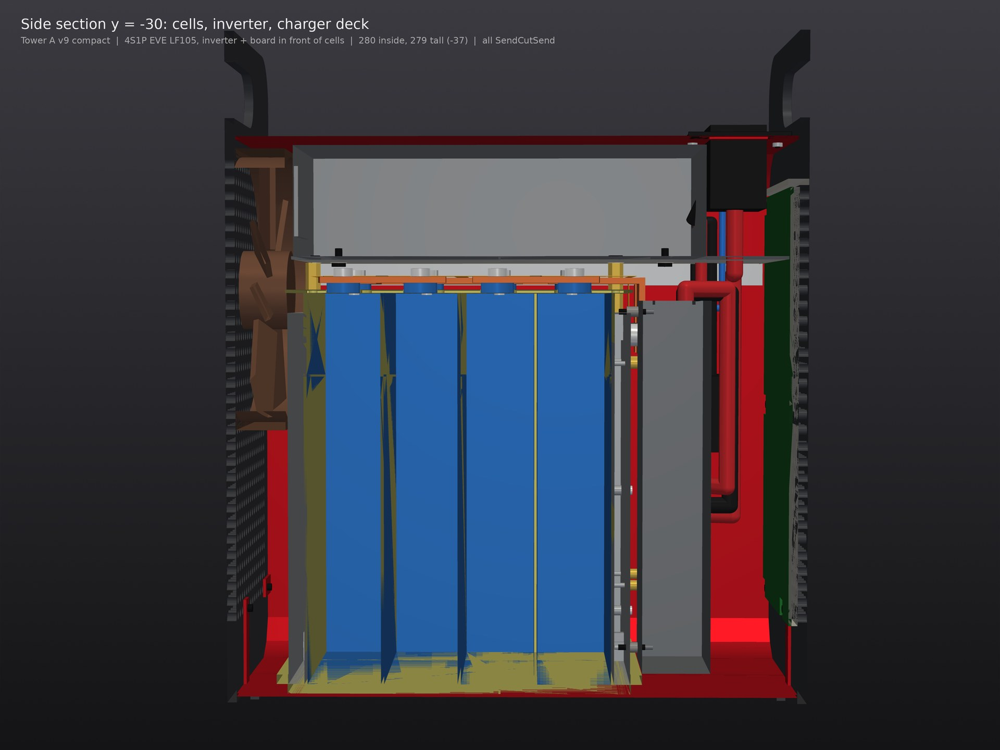
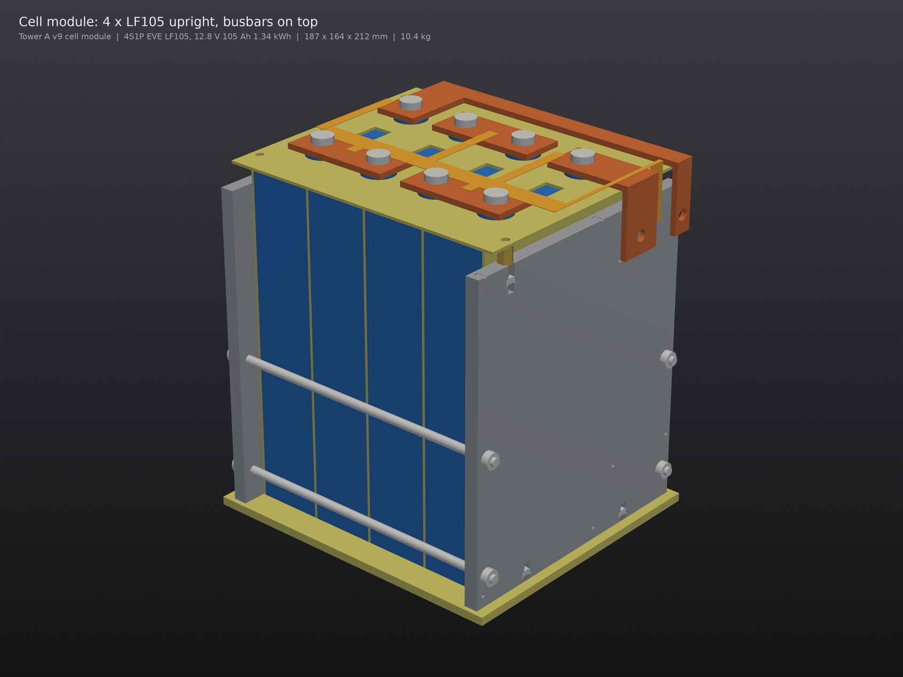
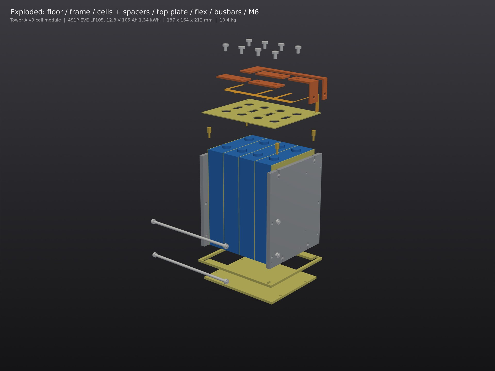
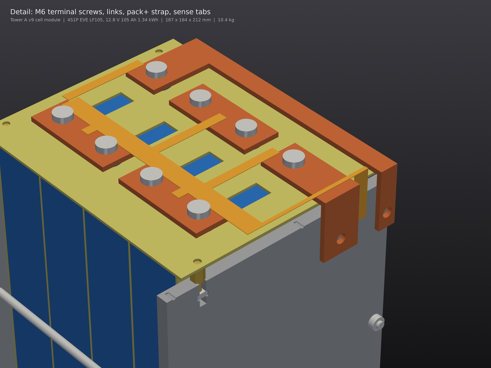
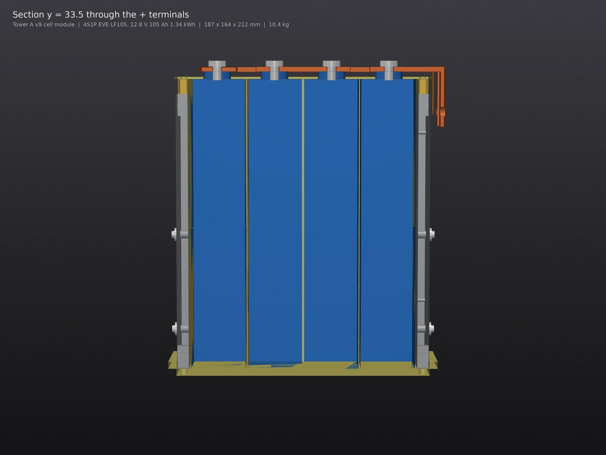

# v09 · Inverter in the front bay

> **Trading length for height.** The inverter stands upright beside the control board, deck 2 disappears and the box drops 37 mm in height.

| At a glance | |
|---|---|
| Cells | 4 × EVE LF105, 4S1P, 12.8 V · 105 Ah · 1.344 kWh |
| Envelope | 294 × 206 × 352 mm (body **279** tall, 280 inside) |
| Mass | **16.4 kg** (cell module 10.4 kg) |
| Estimated cost | ≈ $2,600 USD (±10 %) |
| CAD | `cad/tower9.py`; module renders `cad/render_module9.py` |

---

## What changed from v08

| Aspect | v08 | v09 |
|---|---|---|
| Inverter | Flat on deck 2, above the charger | **Upright in the front bay**, 186 × 100.5 face, on 6 mm M3 standoffs |
| Decks | 2 | **1** (charger only) |
| Body height | 316 mm | **279 mm (−37 mm)** |
| Inside length | 270 mm | 280 mm (+10 mm, for the connector column) |
| Control board | 150 × 60 mm, horizontal | 60 × 150 mm, vertical, beside the inverter |

## Height budget

$$H = z_\text{T1,top} + h_\text{chg} + 4.4 = 220.05 + 55 + 4.4 = 279.45\ \text{mm}$$

- $H$ = lid top height [mm]
- $z_\text{T1,top}$ = top of tray 1 [mm]
- $h_\text{chg}$ = NPB-450 charger height [mm]
- 4.4 = clearance for the lid's clinch nuts [mm]

## Cell-module mass (from CAD volume × density, cells from the datasheet)

| Part | g |
|---|---|
| Cells, 4 × 1,980 | 7,920 |
| Module end plates, 2 × 7.95 mm 6061 | 1,240 |
| G10 spacers, floor, frame, top | 718 |
| Copper (3 links + 2 straps) | 285 |
| Tie rods + nuts | 125 |
| Screws, standoffs, T-nuts, flex | 69 |
| **Module total** | **10,360** |
| **Pack total** (+ 3.03 kg enclosure, 3.05 kg electronics) | **≈ 16.4** kg |

## Gallery

| | |
|---|---|
|  |  |
| Front bay: inverter and board | Side section |
|  |  |
| Cell module | Cell module, exploded |
|  |  |
| Terminal detail | Module section through the + terminals |

## Why it moved on

A cost review showed the enclosure, charger, inverter and board make up about 80 % of the cost, while 4 more cells add only about $300.

| | 4S (v9) | 8S |
|---|---|---|
| Energy | 1.34 kWh | 2.69 kWh |
| Cost | ≈ $2,600 | ≈ $3,100 |
| Cost per Wh | $1.94/Wh | **$1.15/Wh** |

The owner's verdict: "We're being a little silly here, let's just increase capacity, 8 cells!" → v10.

---
← [v08](../v08-compact-4s/README.md) · [index](../README.md) · next → [v10](../v10-8s-inverter-front-bay/README.md)
