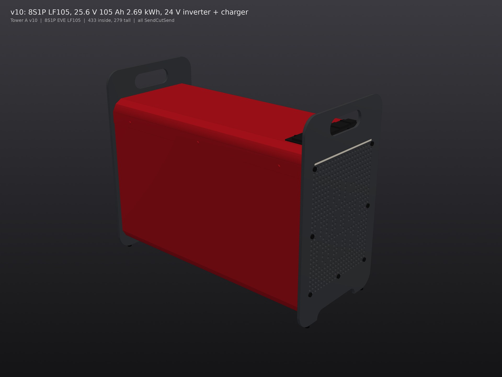
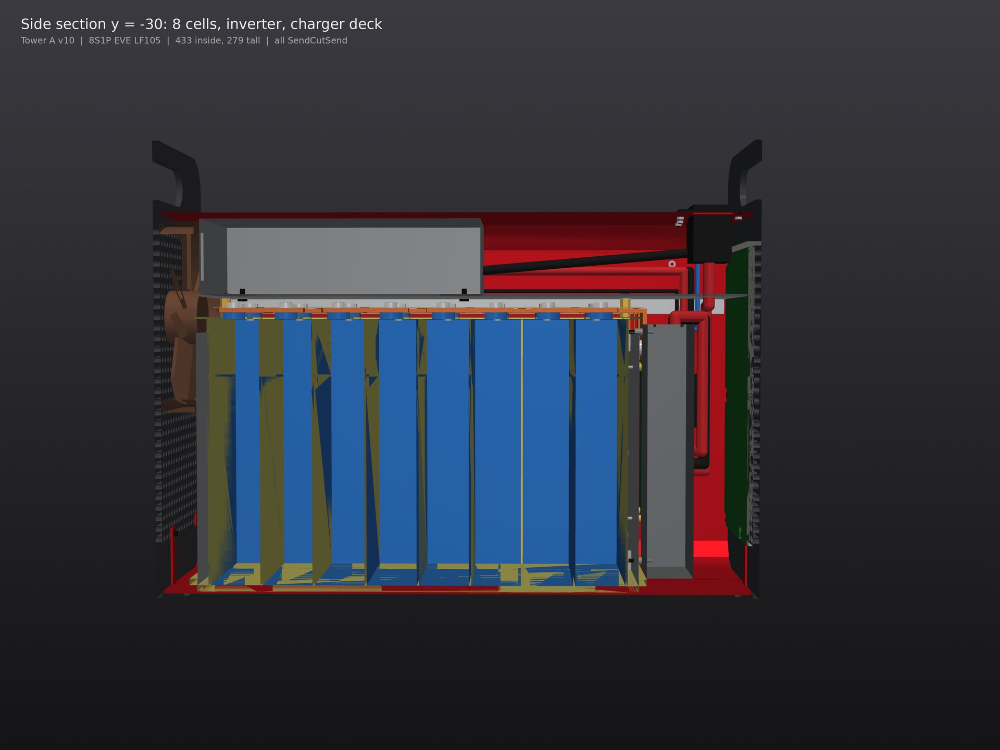
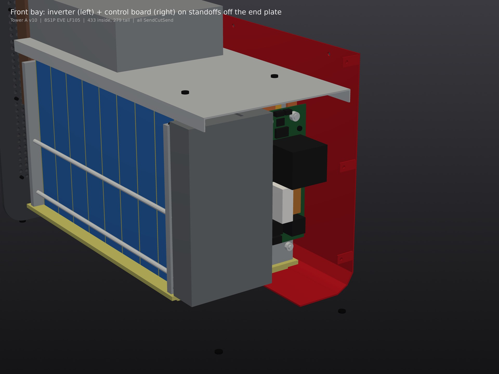

# v10 · 8 cells, 24 V

> **Doubling the energy.** Eight LF105s in series give 25.6 V and 2.69 kWh, so the converters move to their 24 V versions.

| At a glance | |
|---|---|
| Cells | 8 × EVE LF105, **8S1P** |
| Pack | **25.6 V** (20.0–29.2 V) · 105 Ah · **2.69 kWh** |
| Converters | MEAN WELL **NPB-450-24** charger, **NTS-400P-124** inverter |
| Envelope | 447 × 206 × 352 mm (433 inside) |
| CAD | `cad/tower10.py` |

---

## What changed from v09

| Aspect | v09 | v10 |
|---|---|---|
| Cells | 4 | **8** |
| Stack length | 170.7 mm | **323.9 mm** |
| Inside length | 280 mm | 433 mm |
| Voltage class | 12 V | **24 V** |
| Busbar links | 3 | 7 (generated in code: `links = [(k, k−1) for k in N−1…1]`) |

## Why 8S1P rather than 4S2P

Both use 8 cells and store the same 2.69 kWh. Series wins on current.

$$I_\text{batt} = \frac{P_\text{AC}}{\eta\,V_\text{batt}}$$

- $I_\text{batt}$ = battery current [A]
- $P_\text{AC}$ = inverter output, 400 W [W]
- $\eta$ = inverter efficiency, 0.90 assumed [–]
- $V_\text{batt}$ = battery voltage [V]

| | 4S2P (12.8 V) | 8S1P (25.6 V) |
|---|---|---|
| $I_\text{batt}$ at nominal voltage | 34.7 A | **17.4 A** |
| $I_\text{batt}$ at the 2.5 V/cell cutoff | 44.4 A | 22.2 A |
| Relative I²R loss in cables, contactor and shunt | 4× | **1×** |
| Parallel busbars | Yes (4 parallel pairs) | None |
| Inverter headroom | 1 kW → 87 A | 1 kW → 43 A |

The BQ76952 monitor handles 3–16 cells in series, so 8S needs no change in the monitoring chip.

## Mass

8 × 1.98 = 15.84 kg of cells, about 22 kg for the whole pack. The cells alone stay below the 30 kg limit for a single passenger-carried container under the TDG 1.15 exemption.

## Gallery

| | |
|---|---|
|  |  |
| Side section | Front bay: inverter and board |

## Why it moved on

The owner wanted the converters on top, not standing in the front bay, since an 8-cell stack leaves the whole top deck free.

---
← [v09](../v09-inverter-front-bay/README.md) · [index](../README.md) · next → [v11](../v11-8s-single-deck/README.md)
