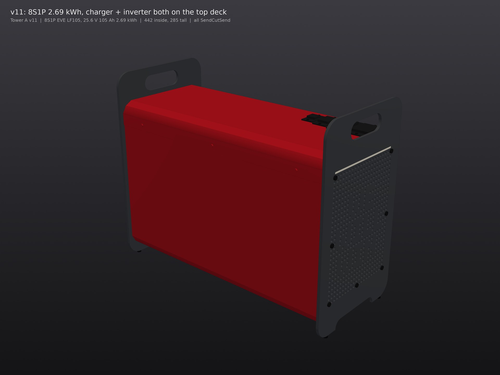
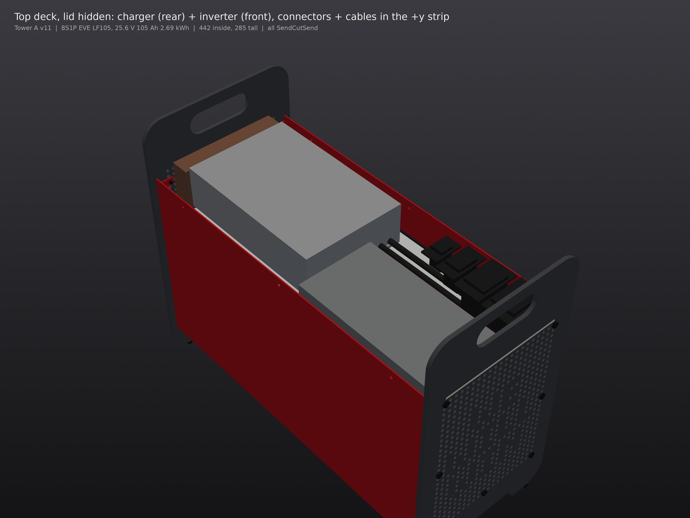
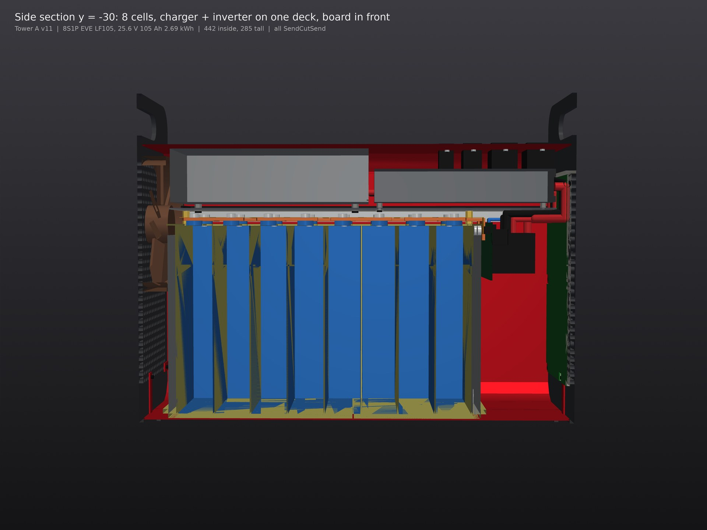

# v11 · Both converters on one deck

> **Using the long top deck.** The charger and inverter sit end to end on deck 1, and the connectors and cables run in a 48 mm strip beside the inverter.

| At a glance | |
|---|---|
| Cells | 8 × EVE LF105, 8S1P, 2.69 kWh |
| Envelope | 456 × 206 × 358 mm (442 inside, body 285 tall) |
| CAD | `cad/tower11.py` |

---

## What changed from v10

| Aspect | v10 | v11 |
|---|---|---|
| Inverter | Upright in the front bay | **Flat on deck 1, in front of the charger** |
| Inverter position | Centred | Offset to −y, leaving a 22–70 mm strip for connectors and cables |
| Device mounting | Directly on the tray | **6 mm M-F hex standoffs** |
| Inside length | 433 mm | 442 mm |

## Why the standoffs: a latent clash found here

In v08 the button heads of the tray-to-module screws sat **under the charger**. The interference check had been told to ignore screw-to-charger pairs, so it never reported this.

$$h_\text{head} = 2.2\ \text{mm} < h_\text{standoff} = 6\ \text{mm}$$

- $h_\text{head}$ = M4 button head height [mm]
- $h_\text{standoff}$ = device standoff height [mm]

Raising the devices on 6 mm standoffs clears the heads by 3.8 mm.

## Length budget

$$L_\text{deck} = 29 + 205 + 6 + 186 + 16 = 442\ \text{mm}$$

These are the rear fan bay, charger, gap, inverter, and the cable drop to the board [mm].

## Gallery

| | |
|---|---|
|  |  |
| Deck: charger and inverter end to end | Side section |

## Why it moved on

The owner preferred the converters **stacked** as in v08. Placed end to end they force a box 77 mm longer than necessary.

---
← [v10](../v10-8s-inverter-front-bay/README.md) · [index](../README.md) · next → [v12](../v12-8s-stacked-board-on-deck/README.md)
