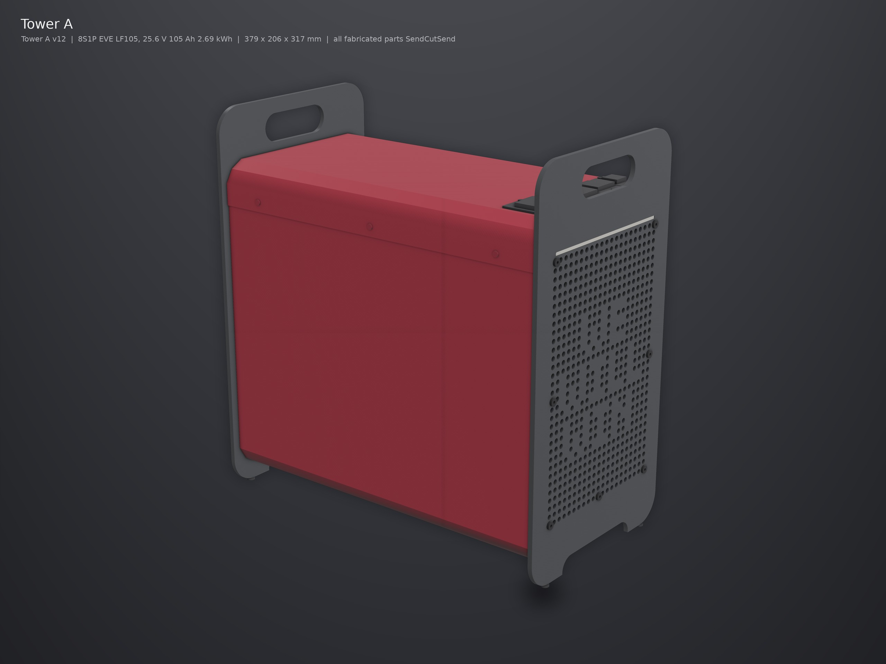
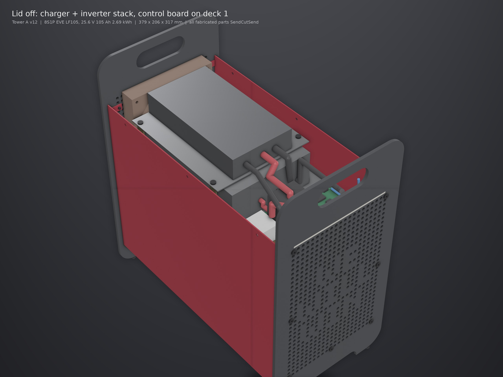
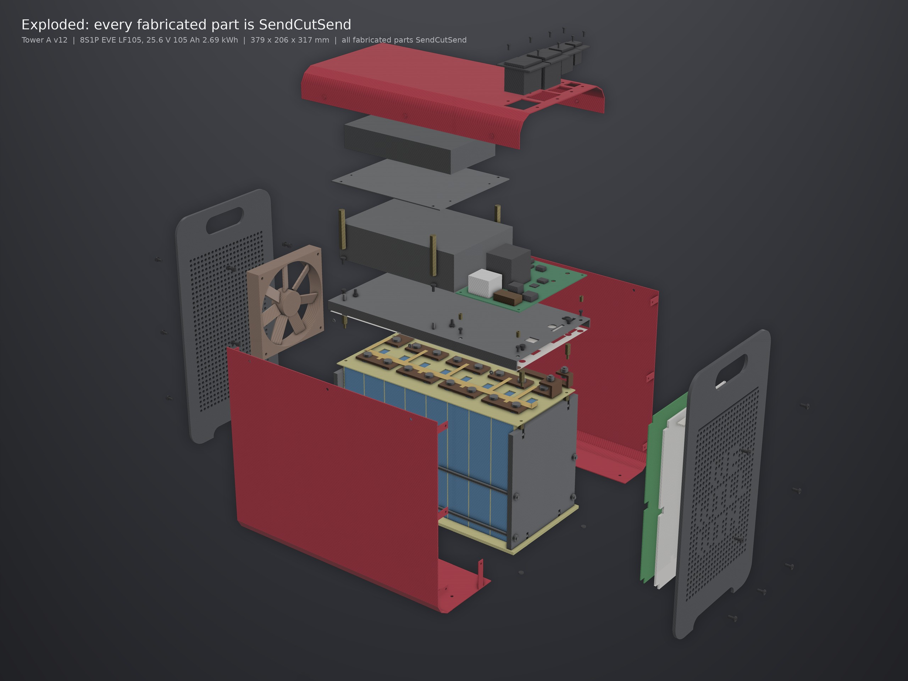
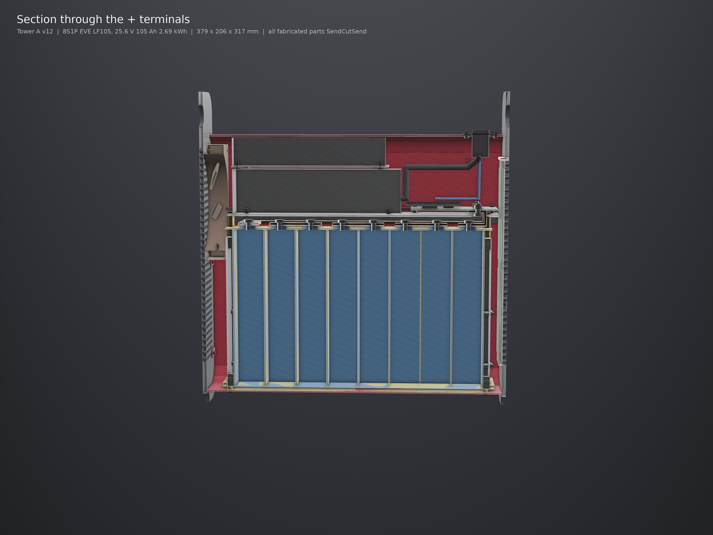
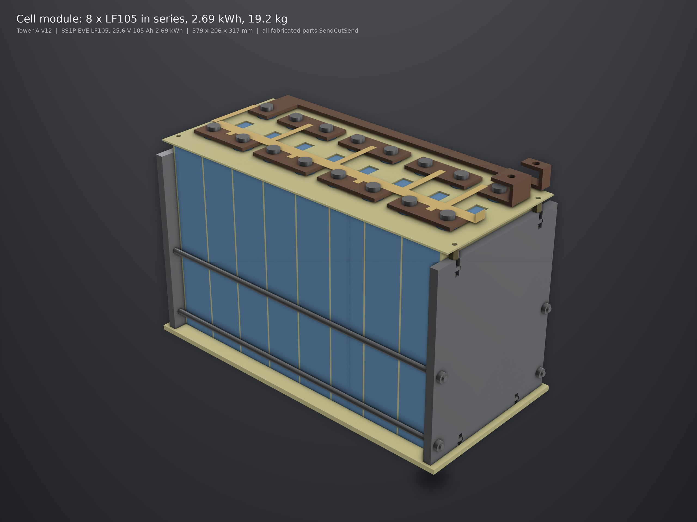
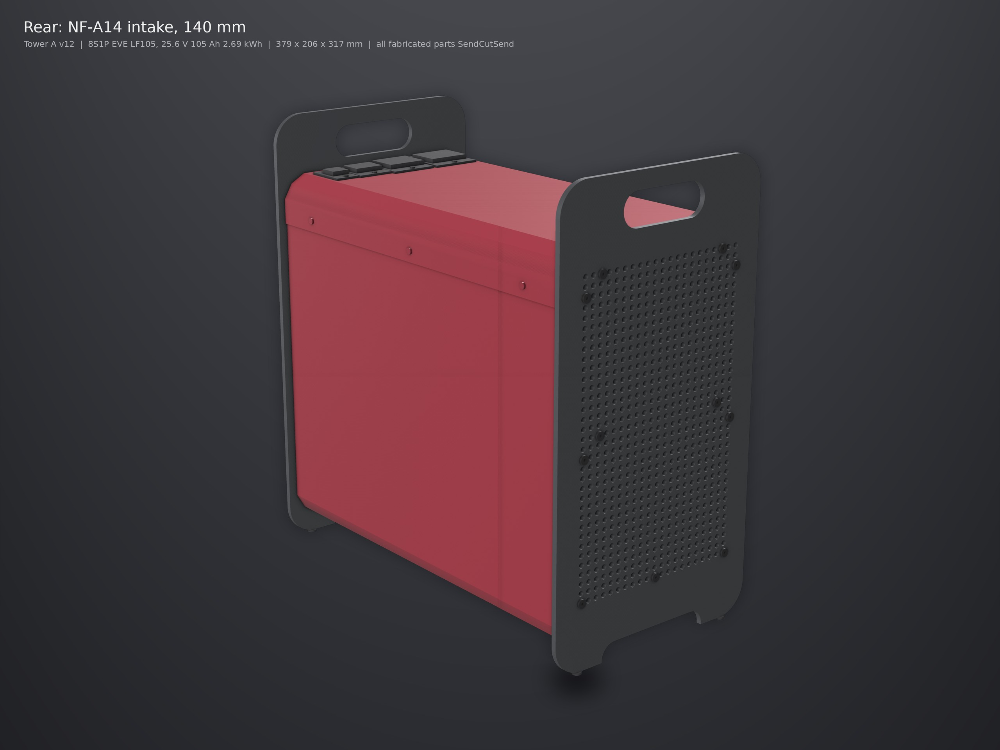
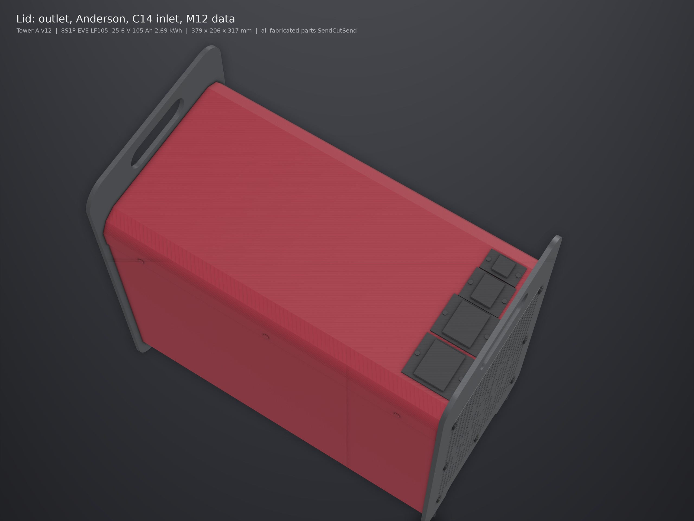

# v12 · Stacked converters, board on the deck

> **The final architecture.** The inverter is stacked on the charger, and the control board lies flat on deck 1 in front of them. The pack straps rise straight up to the board.

| At a glance | |
|---|---|
| Cells | 8 × EVE LF105, 8S1P, 25.6 V · 105 Ah · 2.69 kWh |
| Envelope | **379** × 206 × 389 mm (body 317 tall, 365 inside) |
| Mass | **26.2 kg** |
| Estimated cost | ≈ $3,100 USD (±10 %); SendCutSend parts ≈ $1,700, covered by a $2,000 SendCutSend sponsorship |
| STEP | [`tower_a_v12_assembly.step`](tower_a_v12_assembly.step) |
| CAD | `cad/tower12.py`; studio renders `cad/render_v12_nice.py` |

---

## What changed from v11

| Aspect | v11 | v12 |
|---|---|---|
| Converters | End to end on one deck | **Stacked**: charger on deck 1, inverter on deck 2 |
| Control board | Upright in the front bay | **Flat on deck 1**, about 113 × 160 mm, on 4 SendCutSend flush standoffs |
| Pack straps | Drop onto the back of the board | **Rise through slots in deck 1** to flanges under the board, M6 vertical |
| Inside length | 442 mm | **365 mm (−77 mm)** |
| Charger position | x₀ = XR + 29 | XR + 35, clearing the rear tray screw heads |
| Deck 2 gap | 1.8 mm | 2.5 mm (screw heads cleared the charger by −0.2 mm in v08) |

## Why

$$L_\text{in} = 35 + 205 + 12 + 113 \approx 365\ \text{mm}$$

These are the fan bay, the converter stack, the cable drop and the board [mm].

The board's footprint now fits inside the length that was already needed for the cells, so the front bay is gone.

## Mass breakdown

| Group | kg |
|---|---|
| Cells | 15.84 |
| Module structure | 2.82 |
| Enclosure sheet metal | 2.05 |
| Front and rear plates | 1.62 |
| Charger / inverter | 1.02 / 0.75 |
| Control board and parts | 0.68 |
| Copper | 0.48 |
| Fan, hardware, cables | 0.93 |
| **Total** | **26.2** |

## Gallery

| | |
|---|---|
|  |  |
| Lid off | Exploded |
|  |  |
| Section | Cell module |
|  |  |
| Rear fan | Lid connectors |

## What a review found (fixed in v13)

1. **Straps broke SendCutSend's U-channel rule.** Two 90° bends in the same direction make a U whose 19.2 mm base is shorter than 2 × its 34.5 mm and 22 mm flanges.
2. **Tie rods in the wrong place.** z = 28/94 mm was inherited from the 118.5 mm LF100MA, so the top of the end plate deflected 0.65 mm.
3. **No lid lead-in.** The owner wanted the lid to slide on along an angled lip.

---
← [v11](../v11-8s-single-deck/README.md) · [index](../README.md) · next → [v13](../v13-lip-rods-zstraps/README.md)
