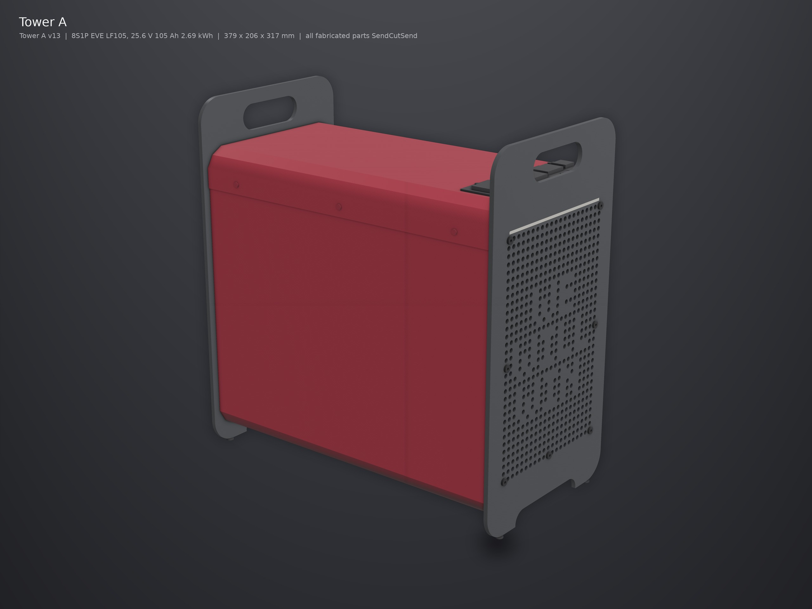
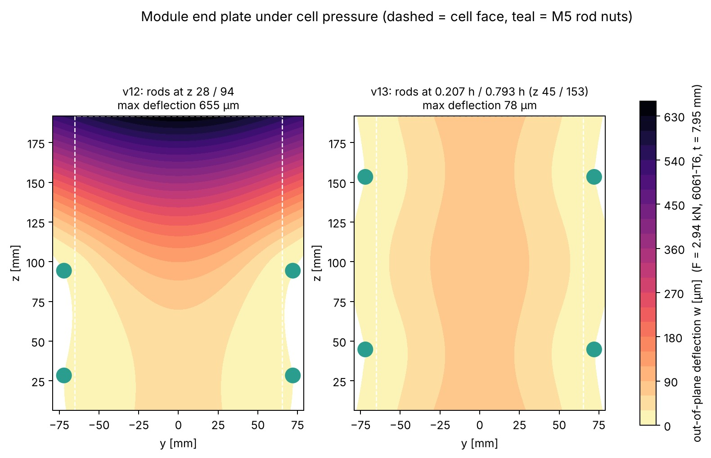
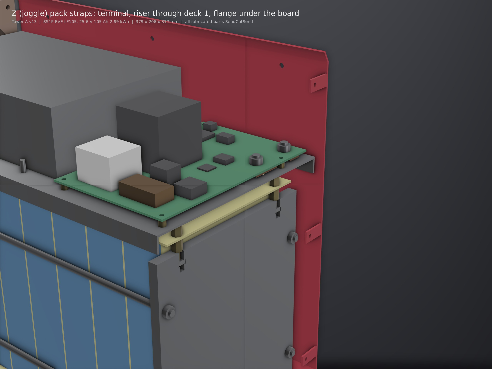
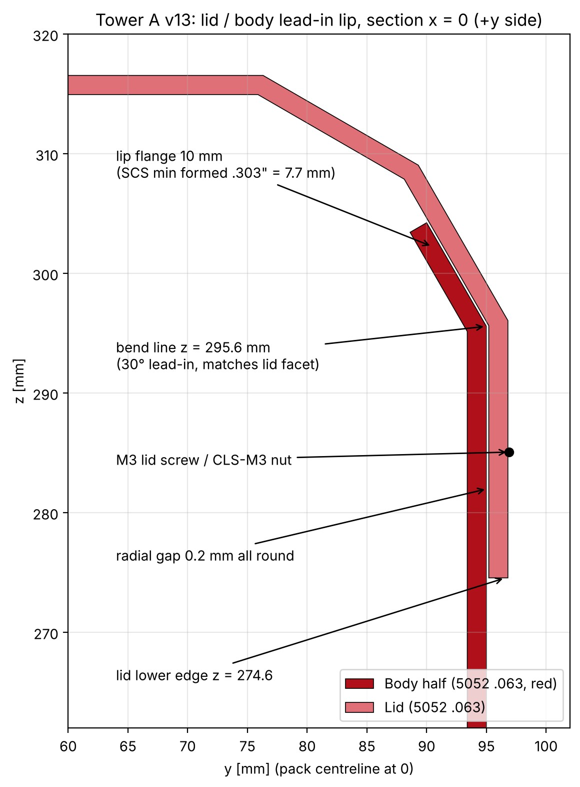
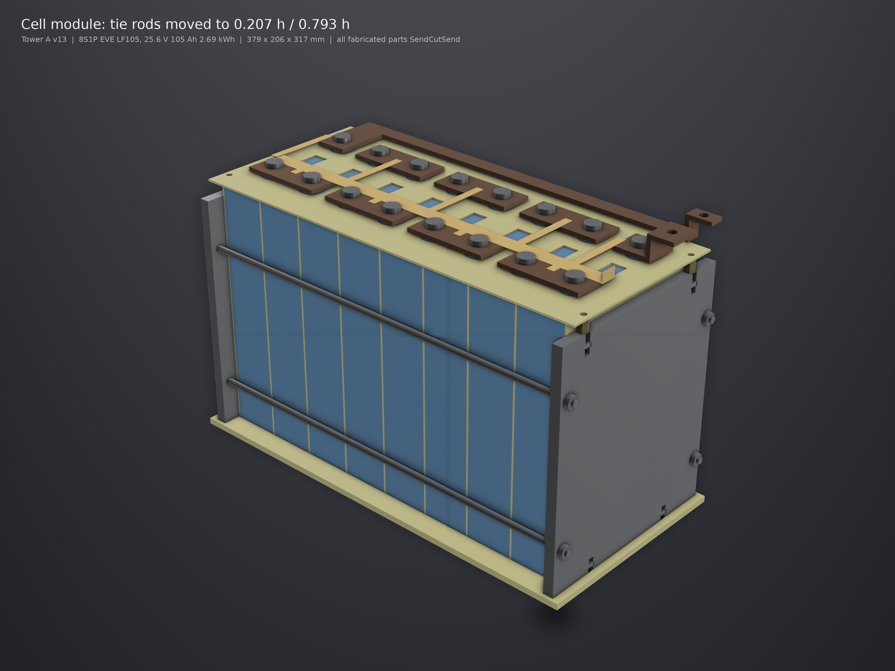
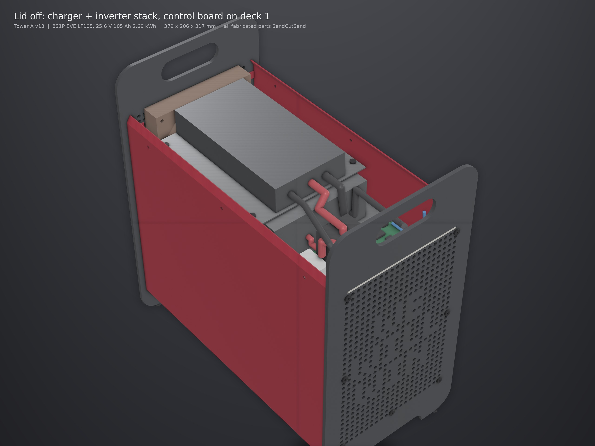
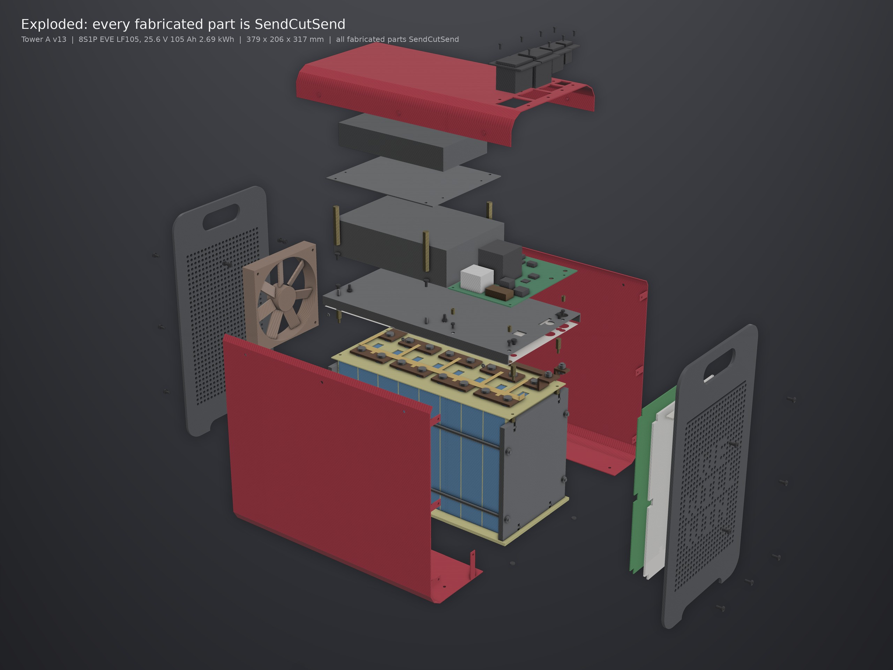
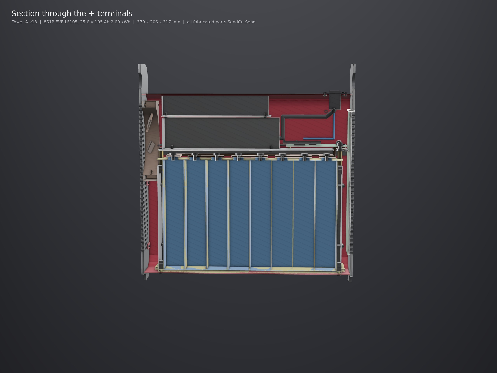
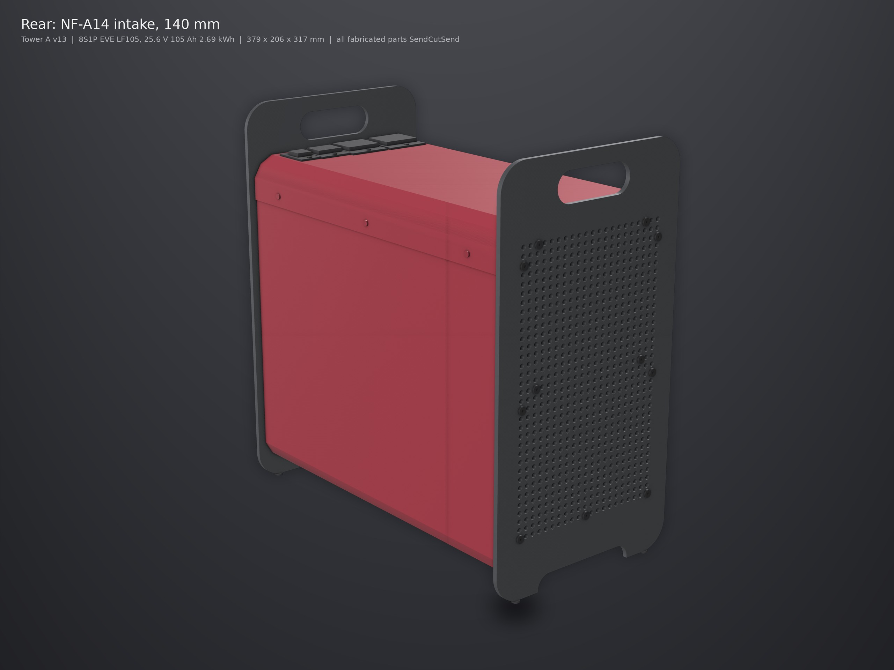
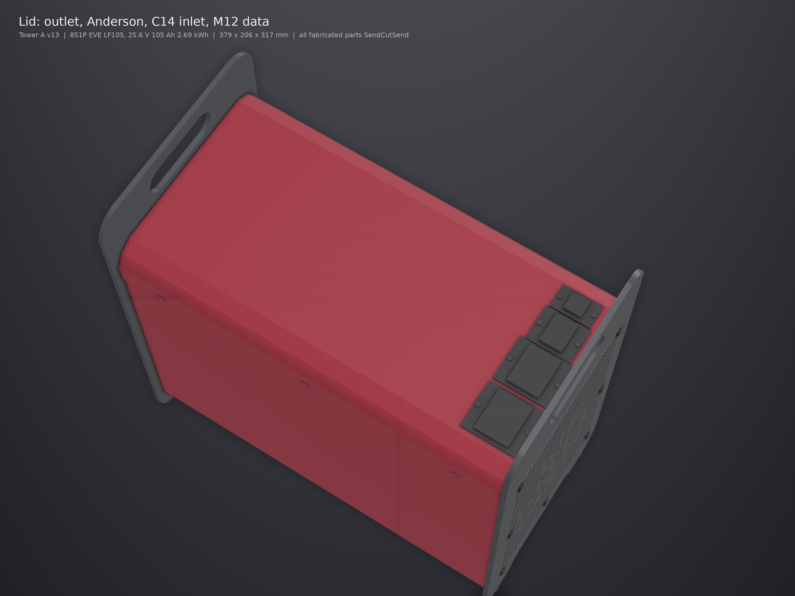

# v13 · Current design: full justification

> **Tower A, 8S1P EVE LF105, 2.69 kWh.** Built entirely from SendCutSend parts and off-the-shelf electronics. Every decision below is traced to a requirement and checked with a calculation.

| At a glance | |
|---|---|
| Cells | 8 × EVE LF105 LiFePO₄, **8S1P** |
| Pack | **25.6 V** nominal (20.0–29.2 V) · 105 Ah · **2.69 kWh** |
| Current | 105 A continuous (1C) · **315 A for 30 s (3C)** |
| AC | 400 W pure sine out (NTS-400P-124) · 450 W charger in (NPB-450-24) |
| DC | Anderson output; optional 1S8P kit for 2.5 kA bursts (see `docs/control-board-electrical.md`) |
| Envelope | 379 × 206 × 389 mm overall (body 365 inside × 190 × 317 tall) |
| Mass | **26.2 kg** |
| Cost | ≈ $3,100 USD (±10 %), of which SendCutSend parts ≈ $1,700, covered by a $2,000 SendCutSend sponsorship |
| Parts | 83 CAD bodies, interference check clean |
| Files | [`tower_a_v13_assembly.step`](tower_a_v13_assembly.step) · `cad/tower13.py` · `analysis/endplate_fe.py` |

**Contents:** [1 Requirements](#1-requirements-and-how-v13-meets-them) · [2 Cell](#2-cell-selection) · [3 Configuration](#3-configuration-8s1p) · [4 Electrical](#4-electrical-ratings) · [5 Module](#5-cell-module-and-compression) · [6 Copper](#6-busbars-and-pack-straps) · [7 Enclosure](#7-enclosure-built-to-sendcutsends-rules) · [8 Layout and thermal](#8-layout-and-thermal) · [9 Mass and cost](#9-mass-and-cost) · [10 What changed from v12](#10-what-changed-from-v12) · [11 Open items](#11-open-items)

---

## 1. Requirements and how v13 meets them

| # | Requirement | v13 | Status |
|---|---|---|---|
| R1 | About 1 kWh | 2.69 kWh, 2.7× the target; the owner chose to raise the target (v09 → v10) | ✓ exceeded |
| R2 | Minimum assembly time ("one night of wrench work") | PEM hardware, captive T-nuts, button-head screws only, no loose nuts in blind spots | ✓ |
| R3 | All fabricated parts from SendCutSend (Protolabs only if ≤ 1.5× cost) | Every sheet, plate, G10 and copper part follows SendCutSend's published rules (§7) | ✓ |
| R4 | One PCB carrying the BMS, contactor and shunt | Flat control board on deck 1; contactor, shunt and straps bolted, never through PCB copper | ✓ |
| R5 | 120 V in with built-in charger, 120 V outlet | NPB-450-24 and NTS-400P-124, IEC C14 inlet, NEMA 5-15 outlet | ✓ |
| R6 | Anderson DC out | Lid-mounted Anderson | ✓ |
| R7 | Wi-Fi debug | ESP32 on the control board | ✓ |
| R8 | Off-the-shelf monitoring chip (AFE) | TI BQ76952 (3–16 cells in series) | ✓ |
| R9 | No parts that need emailing vendors; no doubtful datasheets | EVE, MEAN WELL, TI, Panasonic, all with web checkout | ✓ |
| R10 | Busbars on top | Upright LF105, series links on top of the module | ✓ |
| R11 | Tall, narrow Tower A look, Roadster red | 190 mm body, Gloss Red RAL 3002 powder coat, end plates as handles | ✓ |

## 2. Cell selection

| Candidate | Size W × T × H [mm] | Ah | Why not / why |
|---|---|---|---|
| EVE LF50K (v01–v04) | 135.3 × 29.3 × 185.3 | 50 | Needs 2× the cells and joints for the same energy |
| EVE LF100MA (v05–v06) | 160 × 50.1 × 118.5 | 100 | 160 mm wide → 222 mm body; on its edge the busbars end up on the side (rejected) |
| **EVE LF105 (v07–v13)** | **130.3 × 36.7 × 200.5** | **105** | Narrow enough for a 190 mm body with busbars on top, and tall enough for the tower proportion |

LF105 data (EVE spec F):
- 3.2 V nominal, 2.5–3.65 V window.
- 1.98 kg.
- 1C continuous, 3C for 30 s.
- AC impedance ≤ 0.5 mΩ.
- EVE's cycle-life tests use a 300 kgf clamping fixture.

Sourcing: Full Battery, shipped to a parcel depot in Blaine, WA, and carried across the border into Canada.
- Canada charges 7 % duty on lithium-ion batteries.
- The cells are carried under the TDG 1.15 exemption for purchasers: ≤ 150 kg in total and ≤ 30 kg per container.
- 15.8 kg of cells is within both limits.

## 3. Configuration: 8S1P

Eight cells could be wired 8S1P (24 V class) or 4S2P (12 V class). Battery current for the same AC load:

$$I_\text{batt} = \frac{P_\text{AC}}{\eta\, V_\text{batt}}$$

- $I_\text{batt}$ = battery current [A]
- $P_\text{AC}$ = AC output power [W]
- $\eta$ = inverter efficiency, 0.90 assumed [–]
- $V_\text{batt}$ = battery voltage [V]

| At 400 W | 4S2P, 12.8 V | **8S1P, 25.6 V** |
|---|---|---|
| Nominal | 34.7 A | **17.4 A** |
| At the 2.5 V/cell cutoff | 44.4 A | **22.2 A** |
| Cable and contactor loss, ∝ I² | 4× | **1×** |

8S1P halves the current, so it quarters the conduction loss, and it needs no parallel busbars. A future 1 kW inverter would draw 43 A rather than 87 A.

## 4. Electrical ratings

**Energy**

$$E = N_s\, V_\text{nom}\, C = 8 \times 3.2 \times 105 = 2688\ \text{Wh}$$

- $E$ = pack energy [Wh]
- $N_s$ = cells in series, 8 [–]
- $V_\text{nom}$ = cell nominal voltage, 3.2 [V]
- $C$ = capacity, 105 [Ah]

**AC runtime at the full 400 W**

$$t = \frac{E\,\eta}{P} = \frac{2688 \times 0.90}{400} = 6.0\ \text{h}$$

- $t$ = runtime [h]
- $P$ = AC load [W]

**Charge time.** The NPB-450-24 delivers 28.8 V at 13.5 A.

$$t_\text{chg} \approx \frac{C}{I_\text{chg}} = \frac{105}{13.5} = 7.8\ \text{h}$$

- $t_\text{chg}$ = charge time [h]
- $I_\text{chg}$ = charge current [A]

This is the constant-current phase plus a short constant-voltage tail. It corrects the 6.6 h estimate given in v12, which wrongly assumed a 450 W input rather than the 13.5 A output limit.

**Pack resistance and loss**

$$R_\text{pack} = N_s R_\text{cell} + 7 R_\text{link} + 16 R_\text{joint} = 8(0.5) + 7(0.0083) + 16(0.025) = 4.46\ \text{m}\Omega$$

- $R_\text{pack}$ = pack resistance [mΩ]
- $R_\text{cell}$ = cell DC resistance, about 0.5 [mΩ]
- $R_\text{link}$ = one 38 mm link, $\rho L/A = 1.72\times10^{-8}\cdot 0.0383 / 79.4\times10^{-6}$ = 8.3 [µΩ]
- $R_\text{joint}$ = one bolted M6 terminal joint, assumed 25 [µΩ]

| Current | Voltage drop | I²R heat |
|---|---|---|
| 17 A (inverter at full load) | 0.08 V | 1.3 W |
| 105 A (1C) | 0.47 V | 49 W |
| 315 A (3C, 30 s) | 1.40 V | 443 W, i.e. 13 kJ over 30 s, mostly inside the cells |

Control, sensing and the dual-mode architecture are documented in [`docs/control-board-electrical.md`](../../docs/control-board-electrical.md):
- Tesla shunt grounding.
- Panasonic EV-B contactor.
- Kelvin current sensing for the 1S8P kit.

## 5. Cell module and compression

The 8 cells sit between two 7.95 mm 6061-T6 end plates, separated by 1.6 mm G10 spacers, and are tied together by 4 M5 rods at y = ±72 mm.

**Load cases**
- 2.94 kN: the 300 kgf fixture EVE uses for its cycle-life tests.
- 10 kN: assumed end-of-life swelling in a rigid fixture. This is a conservative assumption, not a datasheet figure.

**Pressure on the end plate**

$$q = \frac{F}{w\,h} = \frac{2943}{130.3 \times 185.5} = 0.122\ \text{MPa}$$

- $q$ = pressure [MPa]
- $F$ = clamp force [N]
- $w$ = cell width [mm]
- $h$ = end-plate height [mm]

**Plate stiffness**

$$D = \frac{E t^3}{12(1-\nu^2)} = \frac{68\,900 \times 7.95^3}{12(1-0.33^2)} = 3.24\times10^{6}\ \text{N·mm}$$

- $D$ = flexural rigidity [N·mm]
- $E$ = 68.9 GPa [MPa]
- $t$ = 7.95 [mm]
- $\nu$ = 0.33 [–]

**FE results.** Kirchhoff plate model with Morley elements (scikit-fem), 80 × 94 node grid, nuts treated as Ø9.2 mm rigid supports.

| Layout | $w_\max$ @ 2.94 kN | $w_\max$ @ 10 kN | Peak σ_vm @ 2.94 kN* |
|---|---|---|---|
| v12: rods at z 28 / 94 | 0.655 mm | 2.23 mm | 219 MPa |
| **v13: rods at z 45 / 153** | **0.078 mm** | **0.27 mm** | **87 MPa** |
| 4 rods in the corners (z 20 / 178) | 0.146 mm | 0.50 mm | 116 MPa |
| 6 rods (z 20 / 99 / 178) | 0.061 mm | 0.21 mm | 71 MPa |
| 2 rods (z 99) | 0.414 mm | 1.41 mm | 173 MPa |

\*Stress peaks at the idealised point supports, so the absolute value depends on mesh size; use it to compare layouts. 6061-T6 yields at 276 MPa.

**Why 0.207 h / 0.793 h.** Treat the plate as a beam under uniform load on two supports with overhangs. The largest bending moment is smallest when the moment over each support equals the moment at mid-span. Solving that condition puts the supports at $a = (\sqrt2 - 1)/2 \cdot h = 0.207\,h$ from each end. With $h = 185.5$ mm, the rods go at z = 6.35 + 38.4 = **44.7 mm** and z = 6.35 + 147.1 = **153.5 mm**.

**Why not 6 rods.** They improve deflection by only another 22 % (0.078 → 0.061 mm), and both values are under 0.1 mm. Two more rods, four more nuts and four more holes aren't worth it. Best part is no part.

**Rod tension**

$$\sigma_\text{rod} = \frac{F_\text{EOL}/4}{A_s} = \frac{2500}{14.2} = 176\ \text{MPa}$$

- $\sigma_\text{rod}$ = rod stress [MPa]
- $F_\text{EOL}$ = 10 kN [N]
- $A_s$ = M5 tensile stress area [mm²]

A2-70 stainless has about 450 MPa proof strength, so the margin is 2.6×.

## 6. Busbars and pack straps

Material: SendCutSend COP-125 copper, 0.125" (3.175 mm) thick.

**Current density and short-burst heating.** For 30 s the heat stays in the copper (adiabatic), so:

$$\Delta T = \frac{J^2 \rho\, t}{c_v}$$

- $\Delta T$ = temperature rise [K]
- $J$ = current density [A/m²]
- $\rho$ = 1.72×10⁻⁸ [Ω·m]
- $t$ = 30 [s]
- $c_v$ = 3.45×10⁶ [J/(m³·K)]

| Conductor | Section | J @ 105 A | J @ 315 A | ΔT, 30 s @ 315 A |
|---|---|---|---|---|
| Series link (25 wide) | 79.4 mm² | 1.32 A/mm² | 3.97 A/mm² | 2.4 K |
| Pack− strap (12 wide) | 38.1 mm² | 2.76 A/mm² | 8.27 A/mm² | 10.2 K |

Both are comfortably cool. The narrow pack− strap is the hottest piece of copper, which is acceptable.

**Bending to SendCutSend's COP-125 rules**

| Check | v13 | Rule | ✓ |
|---|---|---|---|
| Shape | Z (two 90° bends in opposite directions) | U-shapes need base ≥ 2× flange, and v12 failed that | ✓ |
| Distance between the two bend lines | ≈ 16 mm | min_joggle 0.506" = 12.9 mm, max 95 mm | ✓ |
| Shortest flange | 20 mm | min formed flange 0.471" = 12.0 mm | ✓ |
| Bend angle | 90° | max 130° | ✓ |

## 7. Enclosure built to SendCutSend's rules

| Feature | Rule | How v13 complies |
|---|---|---|
| Rounded corners | No roll or bump forming | 3 × 30° bends, 15 mm facets: $C_\text{nr} = 15(\cos30°+\cos60°) = 20.49$ mm |
| Body | U-channel base ≥ 2 × flange | Two L-halves with a butt seam under the G10 floor |
| Flat patterns | K = 0.42, R = 0.035" | BD₉₀ = 2.526 mm (SendCutSend calculator: 2.44 mm); BD₃₀ = 0.517 mm |
| Lid joint | Min joggle 8.2 mm, max bend 130° | Shoebox lid over the body, plus the new body lead-in lip (below) |
| Clinch nuts | ≥ 6 mm to the edge | Lid skirt 42 mm deep; CLS-M3 hole edge 8 mm from the lip bend |
| Holes | No countersinks near the vent grid | Button heads throughout |

**New in v13: body lead-in lip.** Each body half's top edge gets one extra 30° inward bend with a 10 mm flange (SendCutSend minimum 7.7 mm). The lip runs parallel to the lid's inside corner facet, with the same 0.2 mm gap as the walls. Lowering the lid, its facet lands on the angled lip and centres itself.

Where the lip bend sits. Offset the lid's facet inward by the wall thickness plus the gap, and find where that line meets the body's outer wall:

$$z_k = H - C_\text{nr} - d\sin30^\circ + d\,\frac{(1-\cos30^\circ)\cos30^\circ}{\sin30^\circ} = H - C_\text{nr} - 0.482\ \text{mm} = 295.58\ \text{mm}$$

- $z_k$ = height of the lip bend line [mm]
- $H$ = 316.55 [mm]
- $C_\text{nr}$ = 20.49 [mm]
- $d = T + g$ = 1.6 + 0.2 = 1.8 [mm], wall thickness plus gap

## 8. Layout and thermal

**Layout**
- **Converters stacked, board in front (from v12).** Charger (205 × 135 × 55 mm) on deck 1, inverter (186 × 100.5 × 34 mm) on deck 2 above it. Both are wider than half the 186.8 mm interior, so they can't sit side by side. Stacking makes the box 77 mm shorter than placing them end to end (v11).
- **Fan.** The 140 mm NF-A14 in the rear plate pulls air from the front grid, over the board and both converters, and out the back.
- **Wiring.** The converter terminals face the board across a 12 mm cable drop, so every DC run is under 80 mm.

**Heat to remove at full AC load**

$$P_\text{loss} = P_\text{out}\left(\frac{1}{\eta}-1\right)$$

- $P_\text{loss}$ = heat [W]
- $P_\text{out}$ = output power [W]
- $\eta$ = efficiency [–]

| Source | Heat |
|---|---|
| Inverter, 400 W out, η = 0.90 assumed | 44 W |
| Charger, 450 W out, η = 0.93 (distributor listing) | 34 W |
| Pack I²R at 17 A | 1.3 W |

Under 80 W in total, and the inverter and charger never run at full power together in normal use. An NF-A14 moves well over 100 m³/h of air. With the duct restriction unmeasured, assume about 40 m³/h; the exhaust then rises about 6 K:

$$\Delta T = \frac{P}{\rho_\text{air}\, c_p\, Q}$$

- $\Delta T$ = air temperature rise [K]
- $P$ = 80 [W]
- $\rho_\text{air}$ = 1.2 [kg/m³]
- $c_p$ = 1005 [J/(kg·K)]
- $Q$ = 40/3600 [m³/s]

## 9. Mass and cost

| Group | kg |
|---|---|
| Cells | 15.84 |
| Module structure (end plates, G10, rods, nuts, standoffs) | 2.82 |
| Enclosure sheet metal (body, lid, trays) | 2.05 |
| Front and rear plates | 1.62 |
| Charger | 1.02 |
| Inverter | 0.75 |
| Control board and parts (contactor 0.43) | 0.68 |
| Copper | 0.48 |
| Fan, hardware, feet, LEDs | 0.83 |
| Cables (estimate is low; real 6 AWG adds about 0.3–0.5) | 0.10 |
| **Total** | **26.2** |

The total is above the 23 kg recommended limit for a two-handed lift (NIOSH). The two end-plate handles make it a carry-across-the-room pack, not a hand-carry pack; the owner accepted this in exchange for 2× the energy.

| Cost item (USD) | Estimate |
|---|---|
| SendCutSend parts (sponsored, $2,000 credit) | 1,700 |
| 8 × LF105 at $65, plus duty and GST | 590 |
| Charger and inverter | 240 |
| PCB, contactor, fuse, shunt, flex | 370 |
| Fan, connectors, hardware, wire | 205 |
| **Total / out of pocket** | **≈ 3,100 / ≈ 1,400** |

## 10. What changed from v12

| Aspect | v12 | v13 | Why |
|---|---|---|---|
| Lid joint | Plain shoebox overlap | **30° lead-in lip on the body** | Smooth, self-centring lid fit; the original joggle lip can't be made |
| Tie rods | z 28 / 94 (carried over from LF100MA) | **z 45 / 153** | End-plate deflection 0.655 → 0.078 mm (8.4×) |
| Pack straps | U-shape | **Z-shape (joggle)** | v12 broke SendCutSend's U-channel rule; v13 passes every COP-125 check |
| Strap riser x | cell₈ + 22 | cell₈ + 16 | Keeps the forward flange under the board |
| Front +y board standoff | y = 75 | y = 54 | Sits between the two strap flanges |

| | |
|---|---|
|  |  |
| Module with the corrected rod heights | Lid off |
|  |  |
| Exploded | Section |
|  |  |
| Rear | Lid connectors |

## 11. Open items

- [ ] Confirm the LF105 terminal thread (M4 vs M6) on the test cell, and add permanent terminal studs.
- [ ] Generate v13 SendCutSend flat patterns and get a checkout quote to replace the ±10 % estimate.
- [ ] Control-board schematic: buck-boost (≈ 2.5–30 V in), sense connector J1 pinout, Tesla shunt SPI port.
- [ ] 4-wire test to find which end of the Tesla shunt is bonded to its ground; bar dimensions for the layout.
- [ ] Verify the Panasonic EV-B footprint and coil drive.
- [ ] Measure fan airflow through the ducted path and size the front vents.
- [ ] G10 0.063" stock at SendCutSend for the module top plate (currently substituted with mylar).

---
← [v12](../v12-8s-stacked-board-on-deck/README.md) · [index](../README.md)
