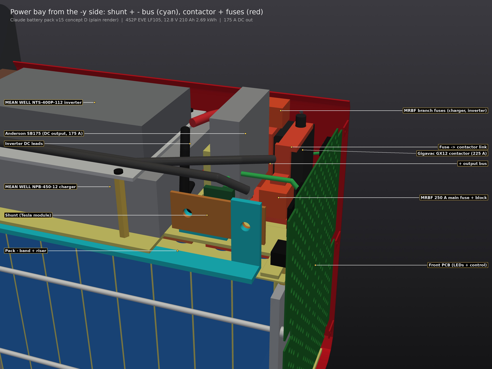

# v15: power bay rebuilt (Concept D), 175 A, control circuit on the front PCB

> First CAD of Concept D. Reasoning, candidates and traps are in [`docs/power-train.md`](../../docs/power-train.md) §1–8. ⚠️ marks an envelope modelled from an estimate.

| | v14 | **v15** |
|---|---|---|
| DC out | 500 A, 2 × M10 COP-250 risers through the lid | **175 A, Anderson SB175** on a G10 bracket; its face pokes through a lid opening. Lid carries no power copper |
| Main fuse | Class T JJN-500 (bolted blades, 2 bars) | **MRBF 250 A** (Blue Sea 5191 block) on a flange of the + tab |
| Contactor | TE EV200 (81 × 66, 1.66 W hold) | **Gigavac GX12** ⚠️ envelope (225 A continuous, M10 studs, dual-coil economizer) |
| Branch fuses | 2 MRBF on a separate load-bus bar | **Dual MRBF (Blue Sea 2151)** stacked on the contactor load stud ⚠️ stud length |
| Tray 1 | 5052 aluminium + Mylar, 7 mm above the busbars | **G10 .125**, flat. No metal plate over any pack copper |
| Pack− | 300 mm band 10 mm from busbar B, then up through a 1 mm slot in the Al tray | Band along the −y cell-top edge (13.3 mm from B), riser tab standing **outside** the tray outline; shunt bolted to it standing vertical |
| Pack+ | Z-strap up through a 1 mm slot in the Al tray (unassemblable) | Collector extension → tab → flange, standing in a notch **open to the tray's front edge**; the tray drops in after it |
| Control board | 68 × 72 mm, floating among the power parts | **On the back of the front LED PCB**, zone z 222–285 facing the bay |
| Joints after the cells | 8 | 7 |

## Checks (`cad/clearance_v15.py`, `cad/run_tower15.py`)
| Check | Result |
|---|---|
| Interference (88 parts, pairwise) | none |
| + to − copper, minimum air gap | **13.7 mm** (+ collector vs − bus flange, with the G10 tray between them). v14: 10 mm through one Al tray with 1 mm slots |
| Pack copper to a series bar | 8.5 mm (+ extension vs bar C, 3.2 V apart); 13.3 mm (− band vs bar B) |
| Pack copper to chassis | 7.4 mm (− band vs the −y body wall: one fault only, the IMD sees it). v14: 1 mm |
| Pack copper passing through chassis metal | **0** (v14: 4) |
| Envelope | 389 × 206 × 392 mm (+1.6 mm: G10 tray is thicker) |

## Assembly order
1. Module: cells, series bars, both collectors with their tabs, flex. The − tab and + tab stand straight up.
2. G10 tray 1 drops on the four standoffs. The − tab is outside its −y edge; the + tab sits in the open front notch.
3. Charger; GX12; SB175 + G10 bracket. Then shunt onto the − tab (horizontal bolts), − bus, + bus, link.
4. MRBF 250 A main fuse onto the + flange **last** (service disconnect).
5. Deck 2 + inverter; tie the converter leads through the tray slots; front PCB; lid.

## Open items found by this CAD
- ⚠️ **Charger AC inlet:** NPB-450's IEC C14 inlet is on the end facing the rear fan, with **18 mm** to the fan face. A C13 plug won't fit. v14 had it modelled at the wrong end. Options: a right-angle C13, or flipping the charger (which moves its DC terminals to the rear).
- ⚠️ GX12 outline (57 × 45 × 60 mm assumed), stud spacing and stud length (the dual MRBF block and the + bus share the load stud).
- ⚠️ SB175 contact orientation and tongue length; Anderson 924 bracket geometry.
- ⚠️ MRBF 5191/2151 block dimensions; Blue Sea says the block mounts on a 3/8″ stud: the GX12's M10 studs fit.
- ⚠️ Converter DC terminal y positions (cable routes are envelopes).
- The front PCB's air holes vs a solid control zone: re-run the cooling check.
- Converter cable ties: 6 slots in the G10 tray (model only shows the slots).
