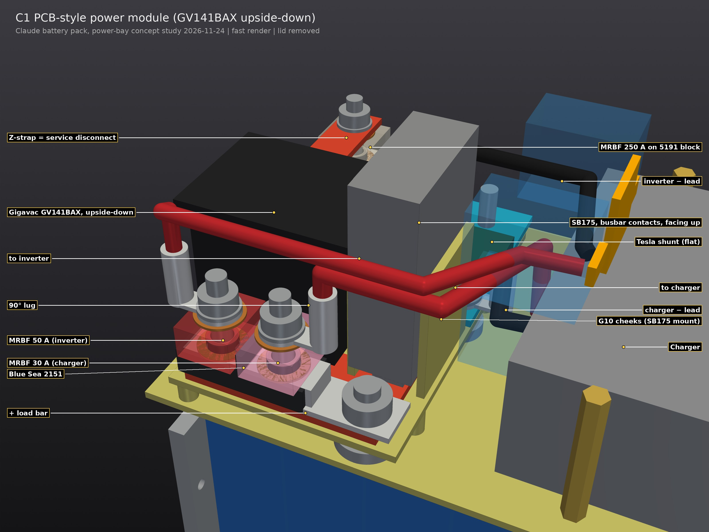
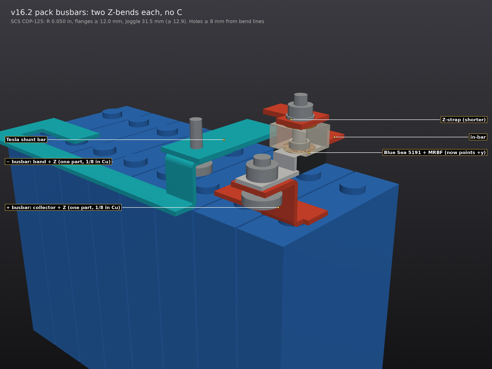
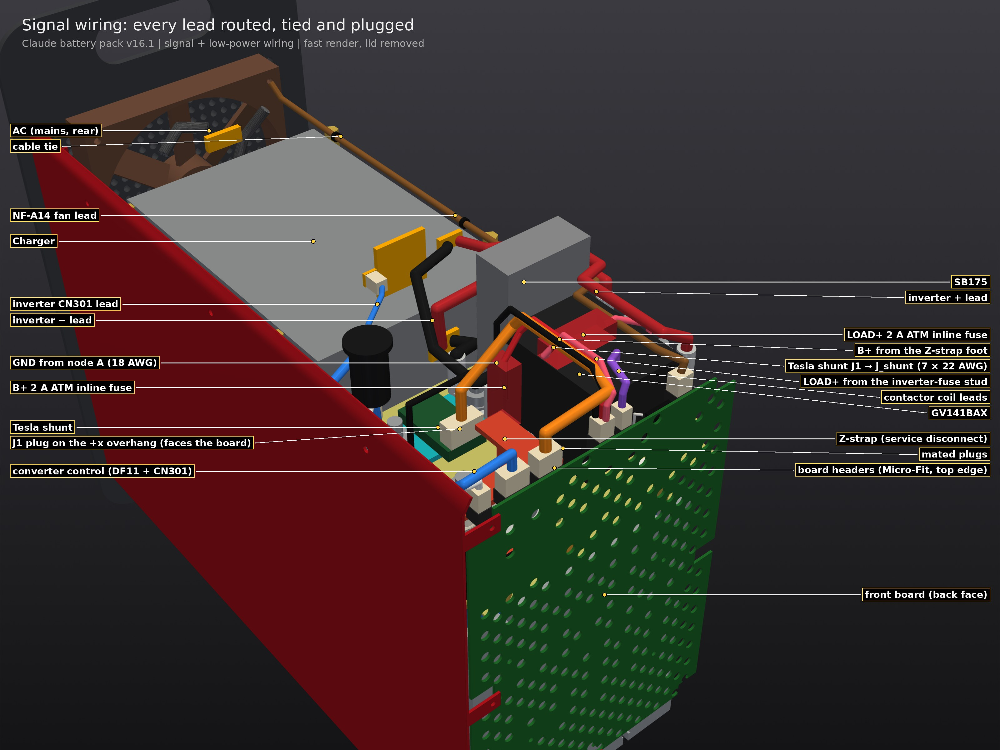

# v16: C1 power module, real fuse blocks, pack +49 mm at the rear

> Decisions, losing options and calculations: [`docs/v16-decisions.md`](../../docs/v16-decisions.md) and [`docs/v16-calcs.txt`](../../docs/v16-calcs.txt). Contactor study: [`docs/contactor-mounting.md`](../../docs/contactor-mounting.md). Converters: [`docs/power-train.md`](../../docs/power-train.md).

## v16.2 (2026-11-25): bend-legal pack busbars
Both pack busbars are now one 1/8″ copper part each: the flat collector (or band) plus a tab bent into a **Z** (R 0.050″). The proposed C-shape breaks SendCutSend's U-channel rule (base ≥ 2 × flange: 31.5 mm vs 74.6 mm). The + Z leaves the collector's −y edge; the 5191 stud moves to (135, −64.5) and the block points +y; the Z-strap gets shorter. The − Z leaves the band at y −72, so the node-A hole sits 8.8 mm from the bend line. G10 plate and tray 1 notches follow. Details and losing options: [D28](../../docs/v16-decisions.md). Checks: 0 interferences; + to − 13.7 mm; pack to chassis 7.4 mm; assembly check all clear.

## v16.1 (2026-11-25): signal wiring, assembly proof, cooling re-run
All signal and low-power wiring is now modelled ([docs/signal-wiring.md](../../docs/signal-wiring.md)); a top-down assembly check sweeps every part along its insertion path and puts a socket on every nut ([docs/v16-assembly-check.txt](../../docs/v16-assembly-check.txt)); cooling was re-run with a flow network ([docs/cooling.md](../../docs/cooling.md)). Changes it forced:

| | v16 | **v16.1** |
|---|---|---|
| Z-strap foot | M8, 1.3 mm from the strap leg (nut couldn't fit) | **M6** at y −4.3, leg 3 mm further −y (T12) |
| Blue Sea 2151 | y 76, standard M10 nut | **y 74** (fuses clear the walls' top facets), **thin M10 nut** (clears the SB175 overhang) |
| Front board + diffuser | 185.8 mm wide | **175 mm** (drops in past the top facets) |
| LED-board air holes | 287 (control parts sat on 43 of them) | **244** |
| Node-A joint | bolt, no nut | **nut + GND ring** |
| Inverter leads | + lead over the 2151 nuts; − lead over the node-B nut | re-routed; − lug barrel offset 14 mm |
| Signal wiring | envelopes dropped at the v16 merge | shunt, GND, B+, LOAD+, coil, converter control, fan, button, coax, AC: plugs, routes, rings, 2 inline fuses, ties |
| Tray 1 / tray 2 | — | 2 + 4 tie slots |
| NF-A14 | exhaust | **intake** (cooling.md, D27) |

## Changes vs v15
| | v15 | **v16** |
|---|---|---|
| Power bay | Parts placed one by one; GX12 upright; 2151 on the contactor stud | **C1 module**: G10 plate + 1/8″ copper plane. GV141BAX upside down and turned 90°; SB175; shunt crosswise |
| Main fuse | MRBF on a 5191 on the + flange | Same, pointing −y, with a **Z-strap (fuse top → in-bar) as the service disconnect** |
| Branch fuses | 2151 on the contactor load stud | **2151 on the load-bar branch along the +y wall**, 90° lugs; fuses lift out past the contactor |
| Converter leads | Envelopes | + leads from the 2151; − leads stacked on the shunt's own node-B bolt (shunt unmodified); all end at the converters' real terminals |
| Inside length | 375 mm | **424 mm**, all added at the rear. Converters −27 mm (DC plug room 30.2 / 50.8 mm); rear gap 18 → 40 mm (right-angle C13) |
| AC pass-throughs | Lid front, beside the SB175 | **Lid rear**, either side of the inverter's CN500 |
| Inverter DC | "PP75" | **PP45** (Anderson 1327/1327G6), 10 AWG |
| Joints after the cells (+) | 7 | 7: 5191 tab, fuse bottom, fuse top, strap foot, T1, T2, SB+ |

## Checks (v16.1: also `c1_power_module.py` with the harness, 0 interferences, and `assembly_v16.py`, all clear)
- **`run_tower15.py`:** 0 interferences.
- **`clearance_v15.py`:** pack copper to chassis 7.4 mm.
- **`c1_power_module.py`, all 3 contactor variants:** 0 interferences.
  - + to − 10.5 mm (rule ≥ 10).
  - Pack copper to chassis 7.3 mm (rule ≥ 7).
  - All plug keep-outs clear, including the mirrored inverter one.
  - All 3 fuses lift out.
- **Envelope:** 437.9 × 206 × 391.7 mm.

## Model
- `cad/tower15.py`: shell (L_IN 424), converters, terminals and keep-outs.
- `cad/concepts/contactor/c1_power_module.py`: the power module.
- `cad/run_v16.py`: merges the two into `claude_battery_pack_v16_assembly.step`.

## Assembly order (v16.1, checked by `cad/assembly_v16.py`)
Shell first: body halves, feet, rear plate, NF-A14 (intake). Then, top-down:
1. **Pack module** (bench-built) lowered into the body. Before the collectors go on: the M10 carriage bolt in the + flange's square hole (v16.2: at x 135, y −64.5, under the outward flange) and the M8 node-A carriage bolt in the − flange's square hole (heads under the flanges).
2. **Tray 1** with the **charger already screwed on from below** (bench), plus the 5 plate standoffs.
3. **Front board + diffuser** lowered in front of the module; M3 screws through the diffuser from the front (front plate still off). Flex tail into the FPC from above.
4. **Front plate + light pipe** (moves in along −x).
5. **Power module** (bench-built upside down, then flipped; on the bench the 2151 M10 thin nut is torqued **before** the SB175 + cheeks go on). Its shunt-bar hole drops over the node-A bolt. **MRBF fuses not yet fitted.**
6. **2151 fuses** (30 A, 50 A) onto their studs.
7. **Node-A nut** with the GND ring under it.
8. **5191** onto the + flange M10 stud, M10 nut, **MRBF 250 A**.
9. **Charger leads:** + lug on 2151 stud A, − lug on the node-B bolt (bottom ring).
10. **Tray 2 + inverter** (inverter screwed on from below on the bench) onto the posts; tray-2 screws from above.
11. **Inverter leads:** PP45 on; + lug on 2151 stud B, then the LOAD+ ring, washer, nut; − lug on node B (top ring), washer, nut.
12. **Signal harness:** plugs at the shunt J1, DF11, CN301, coil, fan, coax; ties through the tray slots; all board plugs from above.
13. **AC:** right-angle C13 onto the charger inlet, CN500 plug onto the inverter.
14. **Z-strap last** (service disconnect) with the B+ ring under its foot nut.
15. **Lid** with the rear pass-throughs; plug the button into j_btn before it closes.

Check result: every step's sweep is clear; every nut takes its socket; with the lid off, the Z-strap and all three MRBF fuses come out vertically (each fuse after its own lug, nut and leads are moved aside).

## Assembly order (v16, superseded)

1. **Bench, pack module:** cells, series bars, flex. − band + riser; + collector + riser (x 124) + flange.
   - Put the M10 carriage bolt into the + flange's square hole **now**: its head sits under the flange.
2. **G10 tray 1** drops onto the standoffs. Both risers come up through their open cuts.
3. **Bench, power module** (plate face down on the bench, so all hardware goes in from what becomes the underside):
   - All carriage bolts into the plate's square holes.
   - Copper plane parts over them: in-bar, load bar with branch, − tab, shunt bar.
   - Contactor terminals and SB175 contact studs down through copper and plate; nuts underneath.
   - Flip upright. Shunt board, G10 cheeks + SB175, Blue Sea 2151 + M10 nut.
4. **Power module drops into the bay** onto the front standoffs. Its − shunt bar seats on the − flange (node A carriage bolt).
5. **5191** onto the + flange's M10 stud, nut, MRBF 250 A.
6. Charger. Its + lead goes to 2151 stud A, its − lug onto the node-B bolt (bottom ring).
7. **Deck 2 + inverter.** PP45 plugs on; + lead to 2151 stud B, − lug onto the node-B bolt (top ring), then washer + nut.
8. **AC:** right-angle C13 onto the charger inlet; CN500 plug onto the inverter.
9. **Z-strap last** (service disconnect). Then front PCB, then lid with the rear AC pass-throughs, then wire the lid inlet/outlet before closing.
