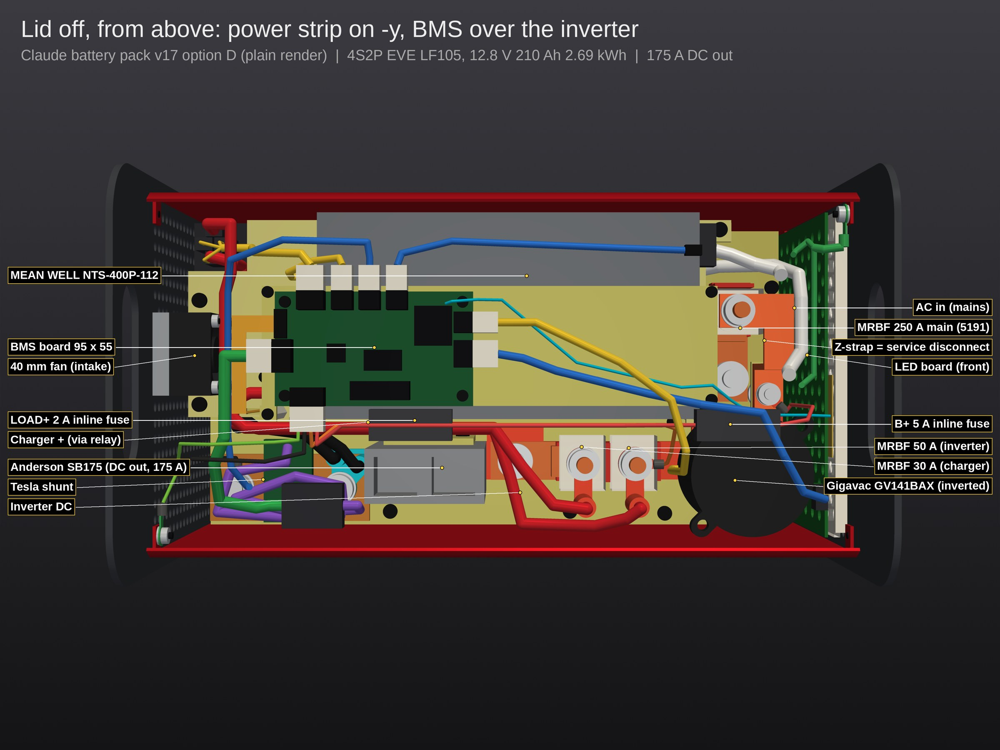
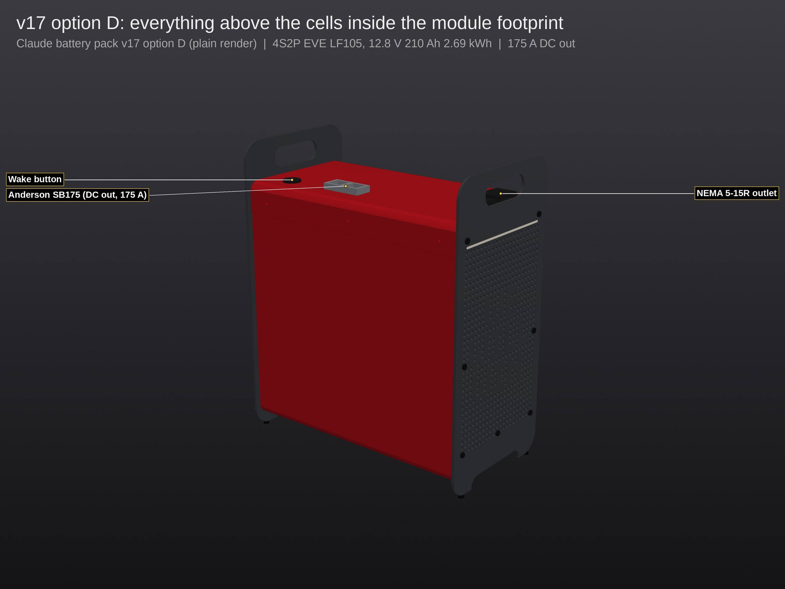
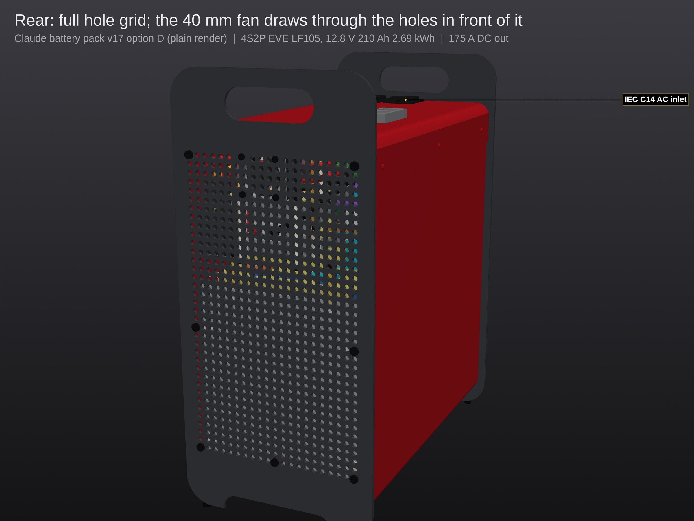
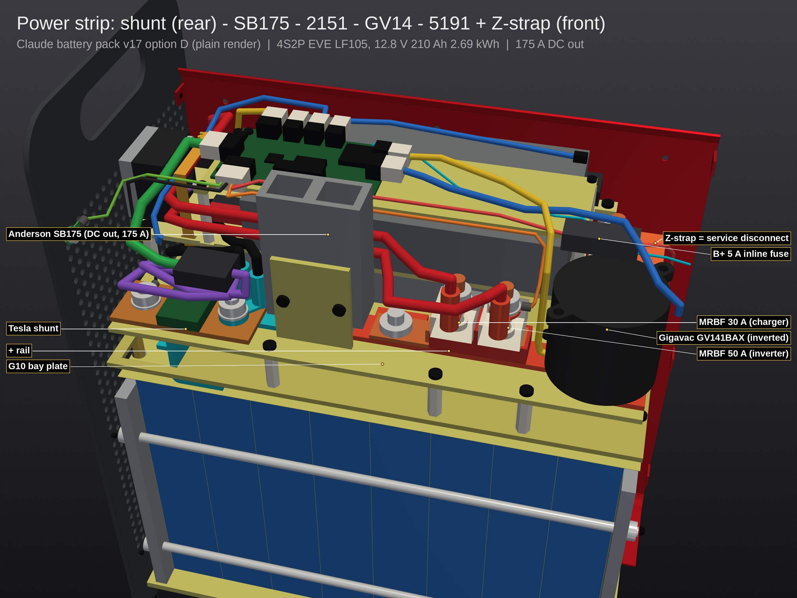
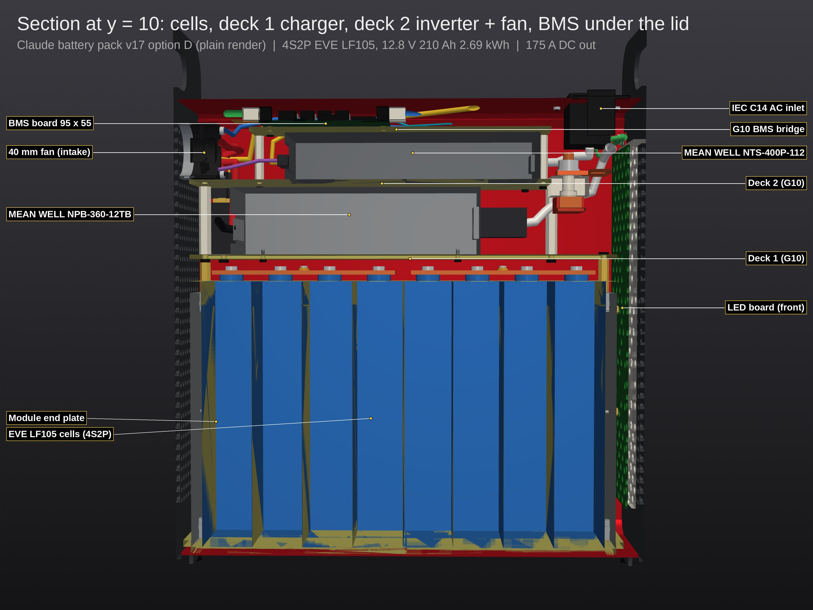
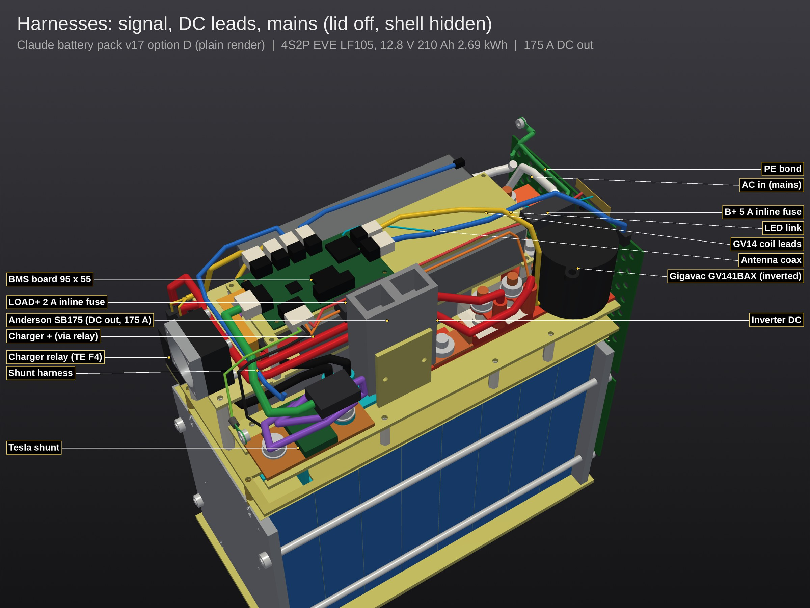
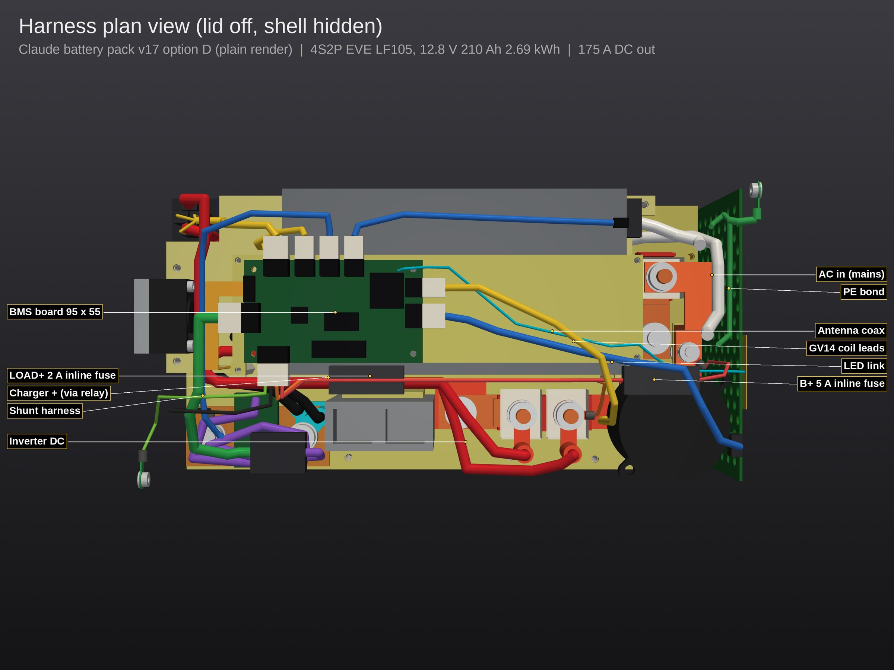

# v17: option D, everything above the cells inside the module footprint

NPB-360-12TB on deck 1, NTS-400P-112 on deck 2, 40 mm fan at the rear, power strip along −y, BMS board over the inverter (D39). New decisions: [D40–D44](../../docs/v16-decisions.md). Harness lengths: [docs/harnesses.md](../../docs/harnesses.md). BOM: [bom.md](bom.md). Cooling: [cooling.txt](cooling.txt).



## Result
| | v16.3 | **v17** |
|---|---|---|
| Inside L × W × lid [mm] | 424 × 186.8 × 318 (25.2 L) | **336.9 × 170.8 × 333 (19.2 L, −24 %)** |
| Outer L × W × H incl. feet [mm] | 437.9 × 206 × 391.7 | **348.1 × 190 × 406.6** |
| Above the cells | converters 135 wide, rear void | inside x ±156, y ±79 (exceptions below) |
| SCS parts (estimate) | $1,825 | **$1,823** ⚠️ |
| Heat, UPS case | 77 W | **100 W** (400 W inverter + 20 A charge + 5 W LEDs) |

**Past the footprint (listed by `clearance_v17.py`):** the front zone (LED board, spacers, diffuser, light pipe, antenna, their two leads and the PE lug), the rear-wall hardware (fan spacer frame, fan screws, chassis-reference lug) and the lid-mounted parts. No converter, copper, fan or board is outside.

## Checks (all PASS, 2026-11-27)
| Check | Script / output | Result |
|---|---|---|
| Interference, all pairs | `cad/run_tower17.py` | **0** unexplained; 31 ALLOW entries, all used, each justified in the script |
| + to − bare copper | `cad/clearance_v17.py` → [clearance.txt](clearance.txt) | **12.5 mm** (+ rail to − rail; rule ≥ 10) |
| Pack copper to chassis metal | same | **7.3 mm** (relay coil tab 85 to the charger case; rule ≥ 7). Collectors to end-plate standoffs 7.6; shunt to wall 8.9 |
| Pack copper to series bars | same | 12.0 mm |
| Mains to LV wiring and pack copper | same | 7.0 mm (rule used ≥ 6) |
| Under the lid | same | highest internal part z 331.5, 1.5 mm under the lid |
| Fuse lift-out prisms (wiring, structure) | same | clear |
| Top-down assembly, tool access | `cad/assembly_v17.py` → [assembly-check.txt](assembly-check.txt) | every step's sweep clear; every driver / socket path clear |
| Service, lid off | same | each MRBF lifts 150 mm after only its own nut, lug and leads; the Z-strap comes out with every other lead in place |
| SCS bend rules | `cad/flats17.py` → [scs_dxf/DFM_report.txt](scs_dxf/DFM_report.txt) | all OK; facet flats 6.67 mm vs 6.59 minimum |

The checks prove geometry only: rigid sweeps, with leads treated as flexible. ⚠️ **Wire bend radius is not checked** (routes are straight segments with sharp corners).

## What changed vs v16.3
| Item | v16.3 | v17 |
|---|---|---|
| Converters | NPB-450 + NTS-400P, 205 × 135 | NPB-360-12TB flat on deck 1; NTS-400P turned end-for-end on deck 2 (z 276.3) |
| Charger stop | CAN / remote | TE V23134-B1052-C642 relay, rear +y corner |
| Cooling | NF-A14 pack fan | Sunon 40 × 40 × 20 intake at the rear, 50 mm from the inverter DC face, on an SCS frame spacer |
| Power bay | C1 module across the front | Strip along −y on one copper plane (z 249.8–253.0) on a G10 bay plate: shunt → SB175 → 2151 → GV141BAX → 5191 + Z-strap |
| Pack straps | long − band to the front | short Zs: − riser at the rear to shunt node A; + riser at the front to the 5191 |
| BMS | front board back | 95 × 55 on a G10 bridge over the inverter, J1–J9 |
| Front board | LEDs + control | LEDs only; 3 mm gap to the diffuser; 309 lit pixels |
| Lid | AC at the rear | C14 + 5-15R over the front corner, button rear −y, SB175 face 8.2 mm above the lid |
| Shell | F 15, W 190 | F 8, W 174 (D40); rear plate 7.95 mm behind the footprint (D41) |
| Module | standoffs y ±55 | y ±48 (D42); G10 frame 1.2 mm narrower |
| Wiring | envelopes + harness.py | all of [harnesses.md](../../docs/harnesses.md) as tubes with end connectors |

## Deviations from `converter_packing.py` opt_D()
| Item | Packing | As built | Why |
|---|---|---|---|
| Box | ≈ 314 × 168 | 336.9 × 170.8 | rod ends stand 6 mm past each end plate; front LED zone 17 mm; facet and frame geometry |
| SB175 | box 55.6 × 44, "straddling" rails side by side | long axis along x, rails end to end, centre (−32, −47) | 55.6 mm across the strip hits the lid facet or the charger |
| Shunt | x −150…−66.5 | x −149…−65.5 | − riser flange geometry (hole ≥ 8 mm from the bend) |
| 2151 | y −37.75 | y −45 | top contact discs ≥ 7 mm from the inverter case |
| 5191 + in-bar | in-bar under the GV14; fuse y −19…4 | 5191 at (123, −2) along +y, fuse y 21…44; in-bar round the GV14 on +x | no live bar under the contactor; fuse clear of deck 2 and the bridge |
| Lid inlet / outlet | (138, 20) / (138, 58) | (144, 0) / (138, 44) | off the lid facet, clear of the 5191 lift-out |
| Fan | y −10…30, z 276.3 | z 277.5 (1.2 mm up) | nut driver clears deck 2 |
| Deck 2 | two rectangles, no supports | one outline; 4 nylon posts (−150, −15), (−150, 38), (104.5, −20), (115, 74) | screws reachable after the inverter is on |
| BMS bridge post | (−109, −14) | (−109, −19), bridge ear to y −22.5 | PP45 plug |
| Bay plate | — | 5 nylon 25 mm standoffs on deck 1 | — |

## Assembly order (checked by `cad/assembly_v17.py`)
Shell first: body halves, feet, rear plate. Then top-down:
1. **Pack module** (bench): carriage bolts into the two flange square holes (M8 node A on the −, M10 5191 on the +) before the straps go on. Lower into the body.
2. **Deck 1** (bench: charger, relay, bay standoffs and deck-2 posts screwed from below; charger leads P1a / P2 in the terminal block, P1a on relay pin 30, right-angle C13 plugged in). Lower, feed the flex tail through its slot, 4 screws into the end-plate standoffs.
3. **LED board, 4 spacers, diffuser** in front of the module; M3 from the front.
4. **Front plate + light pipe.**
5. **Power bay** (bench, upside down: contactor and SB175 nuts under the plate; 2151 M10 thin nut before the SB175 and cheeks). Lower onto the standoffs, shunt node-A hole over its bolt; 5 screws.
6. **2151 fuses** (30 A, 50 A).
7. **Node-A nut** with the GND ring.
8. **5191 + MRBF 250 A**, M10 nut.
9. **Deck 2** (bench: inverter and bridge posts screwed from below; PP45, CN100, CN301, CN500 plugged in). Lower; 4 nylon M4.
10. **Fan spacer + fan**; M3 from outside, nyloc nuts inside.
11. **BMS bridge** (bench: standoffs, board) onto its posts; 4 M3.
12. **Charger leads:** P1b on relay 87 and its lug on the 2151 charger stud; P2 lug on node B (bottom).
13. **Inverter leads:** P3 lug then the LOAD+ ring on the 2151 inverter stud, nut; P4 lug on node B (top), nut.
14. **Signal harness:** J2–J9, shunt pigtail pair, relay coil, taps, chassis ring on the rear −y top screw, NTC, LED link, antenna.
15. **Z-strap** (service disconnect) with the B+ ring under its foot nut.
16. **PE lug** on the front +y top screw.
17. **Lid:** wire inlet, outlet, PE and button beside the pack (150 mm loops), close.

## Copper (1/8″ C110) at 175 A continuous / 210 A
| Narrowest section | mm² | A/mm² @ 175 / 210 |
|---|---|---|
| In-bar (15.5 wide) | 49 | 3.6 / 4.3 |
| Z-strap run (15) | 48 | 3.7 / 4.4 |
| − rail (19) | 60 | 2.9 / 3.5 |
| + rail at the 2151 M10 hole (widened to 28; 18.2 net) | 58 | 3.0 / 3.6 |
| + rail elsewhere and + riser (20) | 64 | 2.8 / 3.3 |
| − riser (22.5) | 71 | 2.5 / 2.9 |

⚠️ Temperature rise not computed. v16 accepted a 4.9 A/mm² neck; nothing here is above 4.4.

## Cooling (as built)
| Rear-plate case, UPS 100 W | Fan flow [CFM] | Box rise, mixed / front-only [K] |
|---|---|---|
| **As drawn, Ø4.8** (`FAN_GRID_D`) | 4.8 | 21.5 / 47.4 |
| Ø6.5 at the same positions | 7.1 | 16.8 / 45.2 |
| Ø37 cutout + guard (+1 part) | 8.8 | 14.4 / 43.6 |
| Ø37 cutout, rear grid blanked (+1 sheet) | 8.1 | 15.4 / 15.4 |

- Worse than the pre-CAD run (15.2 K at Ø6.5): the spacer bore passes only 18 holes' worth of the 21, the LEDs add 5 W, and the 3 mm LED gap adds a second perforated layer to the front path.
- Single loads at Ø4.8: inverting 400 W 13 K, charging 11 K (mixed). Only the UPS case is marginal. ⚠️ Fan curve and orifice model unverified; bench test (owner-req §7). **Cooling fix still open** (Chris: iterate after the CAD).

## Open items and findings
**Fixed during this pass (rule: check the net section at every through-hole in a current path):** the 2151 M10 hole necked the 20 mm + rail to 10.2 mm (5.4 A/mm² at 175 A); no check script catches this.

**Modelled on assumptions; confirm on the parts before ordering:**
- ⚠️ NPB-360: terminal block and C14 positions, bottom mounting-hole pattern (modelled 15 / 8 mm inset).
- ⚠️ NTS-400P: PP45, CN100, CN301, CN500 positions on the end faces.
- ⚠️ TE relay: pin map and **bracket geometry** (modelled as a plate under the body with a screw from below deck 1). If the real bracket is different, the relay mount changes.
- ⚠️ SB175 busbar-contact depth (89.8) and cheek screw positions; GV14 flange width; shunt dims and bolt size; lid inlet, outlet and button parts.
- ⚠️ BMS connector positions along each edge (pcb owns). J3 ends 3 mm past its claimed −y plug room.

**Design:**
- ⚠️ **Wire bend radius** not checked. P4 (inverter −, 90 mm) and P1a (83 mm) turn tightly in 10 AWG: mock up or re-route with real radii.
- ⚠️ No cable ties or clips modelled. GV14 lead has ≈ 190 mm slack.
- ⚠️ SB175 plug-in and pull-out loads go into nylon standoffs (5 × M4): strength not checked.
- ⚠️ Deck 2 hangs on 4 posts with ≈ 90 mm unsupported at the rear +y corner; deflection not analysed.
- ⚠️ Tight gaps: rod end to rear wall tab 0.46 mm, rod end to LED board 1.0 mm.
- ⚠️ G10 .125 was out of stock at SCS. At .187, deck 2 clears the charger by 0.9 mm.
- ⚠️ Shunt: the pigtail's 2×5 receptacle has no catalog mate. Option "pigtail straight into J2" needs the lid at z 335 (harnesses.md).
- ⚠️ SCS total is scaled, not quoted ($1,717–1,931 across scaling methods). Re-quote from `scs_dxf/`.
- ⚠️ Structure (docs/structure.md) not re-run for the shorter shell and the new deck loads.

## Model and how to run
```
~/.venvs/cad/bin/python cad/run_tower17.py            # build, interference, STL + STEP
~/.venvs/cad/bin/python cad/clearance_v17.py
~/.venvs/cad/bin/python cad/assembly_v17.py
~/.venvs/cad/bin/python cad/flats17.py && ~/.venvs/cad/bin/python cad/bom_v17.py && ~/.venvs/cad/bin/python cad/analysis/budget_D.py
~/.venvs/cad/bin/python cad/analysis/cooling_D.py
xvfb-run -a ~/.venvs/cad/bin/python cad/render_tower17_plain.py all
```
- `cad/tower17.py` shell, module, decks, converters, relay, BMS, lid; `cad/bay17.py` power strip and copper; `cad/harness17.py` wiring and length table.
- STEP: `claude_battery_pack_v17_assembly.step`.

## Renders






